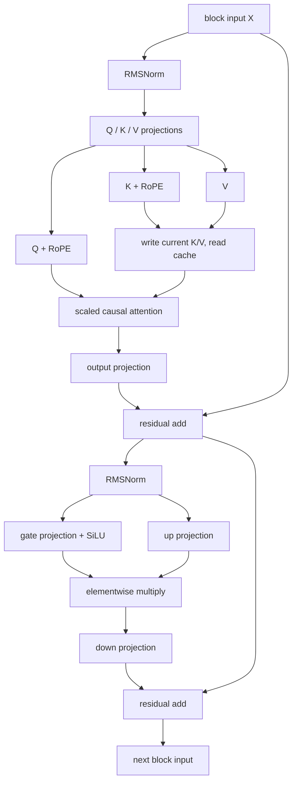

# llama.cpp 第 3 周每日学习路线: 从 Transformer 公式到 GGML 计算图

本路线根据 [llama.cpp 8 周深度学习与二次开发计划](llama-cpp-8-week-learning-plan.md) 的第 3 周安排展开, 承接 [第 1 周](001-llama-cpp-week1-daily-learning-route.md) 的 Transformer 数据流和 [第 2 周](002-llama-cpp-week2-daily-learning-route.md) 的模型加载。第 2 周回答权重从哪里来, 本周回答这些权重如何与输入组成计算图, 图中的每一步如何对应 Transformer 公式。

本周主线:

```text
Transformer 公式 + 逻辑 shape
  -> architecture / metadata key / tensor name
  -> 模型工厂 + hparams + 权重 tensor
  -> Llama graph constructor
  -> 通用 graph helper
  -> GGML tensor 的 op / src / ne / nb
  -> GDB 和 eval callback 观察
```

完成标准: 能独立解释一层 Llama 的 Attention + FFN, 将至少 10 个关键 op/tensor 对应到公式、输入输出 shape 和源码, 并指出模型适配的 metadata、factory、tensor、graph 四个落点。

## 使用约定与本周边界

- 时间预算为工作日每天 2 小时, 周末每天 4 小时, 共 18 小时。每天开头用 10 分钟闭卷回忆, 结尾至少用 15 分钟整理证据和疑问。
- 本文按当前工作区 `545ddb30a` 核对函数和命令。总计划的基准为 `3db4ff877`, 因此以当前源码中的符号为入口, 不依赖旧行号。开始实验时记录自己的 `git rev-parse --short HEAD`。
- 必做主线是普通 dense Llama: 单 sequence、单 KV stream、causal attention、无 LoRA、无 control vector。纸面例子假定 Q/K/V 的 head dimension 相同, `D = H * Dh`, 且 `H` 能被 `KvH` 整除。MoE、特殊缩放和其他模型分支先标记后跳过。
- 本周读到 `model.build_graph -> alloc_graph -> set_inputs -> graph_compute` 的边界即可。ubatch 切分和图复用留到第 4 周, KV cell 管理留到第 5 周, backend scheduler 和 kernel 留到第 7 周。
- 学习材料、日志放在仓外的 `/home/king/llama-study/`。本周产出是图、表、调试记录和设计清单, 不实现新模型。遵守 [AGENTS.md](../../AGENTS.md) 和 [CONTRIBUTING.md](../../CONTRIBUTING.md)。

### 模型选择: 分清源码主线与运行证据

第 2 周的 [模型记录](answer/week2/01.%20week2-day1/01.%20week2-day1.md) 使用 `deepseek-r1-1.5b-f16.gguf`, `general.architecture=qwen2`, 不是 `llama`。该记录的配置为 `D=1536,H=12,KvH=2,Dh=128,I=8960,V=151936,L=28`。当前工作区也未找到总计划中的 `Llama-3.2-3B-Instruct-f16.gguf`。

本周按以下方式完成, 无须先下载模型:

| 路径 | 用途 | 证据应如何标注 |
| --- | --- | --- |
| Llama 源码 + 纸面小模型 | Day 1-5 必做主线 | Llama 理论预测 / 当前源码事实 |
| `test-llama-archs --arch llama --seed 1234` | 用合成权重进入真正的 Llama graph, 完成 Day 6 GDB 观察 | synthetic Llama, 不能作为真实语言模型质量证明 |
| 本地 Qwen2 GGUF + `llama-eval-callback` | 验证真实模型的公共 helper、op 和 shape | Qwen2 实测, 与 Llama 的共有路径和差异分开记录 |
| 已有且确认架构为 Llama 的完整 GGUF | 可直接替换 callback 实验模型 | real Llama, 记录具体配置 |

Qwen2 的完整架构对比仍然选做; 使用本地 Qwen2 观察公共 helper 时, 只需确认其 Q/K/V bias、RoPE 类型和实际 shape。不要用 `models/ggml-vocab-*.gguf` 代替完整模型, 这些文件主要用于词表测试。

## 7 天安排

| 天 | 时间 | 核心问题 | 当天主要输出 |
| --- | ---: | --- | --- |
| Day 1 | 2h | 公式中的维度怎样对应 `ne[]` 和 graph helper? | 单层公式表、shape 表、两个小计算 |
| Day 2 | 2h | architecture、metadata key、tensor name 如何映射? | 三类映射表、Q weight 命名追踪 |
| Day 3 | 2h | 模型子类怎样声明构图所需的权重? | 工厂到构图调用图、权重使用表 |
| Day 4 | 2h | Llama 一层 graph 怎样连接 Attention、FFN 和 residual? | 单层图、至少 10 个节点的预测表 |
| Day 5 | 2h | helper 如何展开成实际 GGML op 和布局变换? | Attention 维度推导、helper 展开表 |
| Day 6 | 4h | 预测与运行时的 op、shape、依赖是否一致? | Llama GDB 记录、真实模型 callback 日志、差异解释 |
| Day 7 | 4h | 能否闭卷解释并指出模型扩展边界? | 公式/op 总表、适配设计清单、周复盘 |

## 统一符号与记录方法

| 符号 | 本周含义 |
| --- | --- |
| `B` | 纸面 batch size, 本周固定为 1 |
| `T` | 纸面完整序列长度 |
| `N` | 当前 ubatch 的输入 token 数; 不直接等同于 API batch 总数 |
| `S` | 单 sequence 中本次 attention 涉及的有效历史及当前 token 总数; 各 query 还受 causal mask 约束 |
| `Kcap` | 本次 graph 使用的 KV 范围长度, 对应实际 `n_kv`; 可能包含 padding/空槽, 不等于有效长度 `S`, 也不必等于 `n_ctx` |
| `D / H / KvH / Dh` | hidden size / Q head 数 / KV head 数 / head dimension |
| `I / V / L` | FFN 中间宽度 / 词表大小 / block 数 |
| `O` | 本次 ubatch 请求输出的 token 位置数; logits 通常为 `[O,V]` |

数学描述固定使用 token 在前、特征在后的逻辑 shape, 线性权重写成 `[out,in]`, 因此投影公式为 `Y = X W^T`。GGML 单独记录 `ne[0..3]`, 不把所有 tensor 都机械倒序解释。

例如普通二维投影:

```text
数学: X [N,Din], W [Dout,Din], Y = X W^T [N,Dout]
GGML: X ne=[Din,N], W ne=[Din,Dout]
      ggml_mul_mat(ctx, W, X) -> ne=[Dout,N]
```

`ne[]` 是每个轴的长度, `nb[]` 是字节 stride。连续 F32 tensor 的 `ne[0]` 通常对应连续特征轴; `permute/view` 后必须同时检查 `nb[]`。量化类型按 block 存储, 不套用 F32 的逐元素字节推导。

贯穿全周维护同一张追踪表, 先填预测, Day 6 再补观测:

| 阶段/语义 | 数学公式 | 逻辑 shape | GGML `ne[]` / `nb[]` | helper / op | 依赖 `src[]` | 证据与状态 |
| --- | --- | --- | --- | --- | --- | --- |
| 示例: K projection | `K = Xn Wk^T` | `[N,KvH*Dh]` | 预测 `[KvH*Dh,N]` | `build_qkv` / `MUL_MAT` | `wk`, `Xn` | 待实测; bias 和 reshape 另记 |

不要只记录名字: `Qcur-0` 在投影、加 bias、reshape、RoPE 阶段可能重复出现。至少结合 op、shape、来源指针或 graph node index 区分。

## Day 1: 让公式、shape 和 GGML 维度使用同一套语言

**投入: 2 小时。** 进入条件是能独立画出第 1 周的 pre-norm decoder block, 并解释第 2 周的 Q/K/V 和 FFN 权重 shape。

### 学习路线

1. **0-10 分钟, 闭卷回忆**: 画出 `embedding -> [Attention + residual -> FFN + residual] x L -> output norm -> logits`。说出哪些是固定权重, 哪些是临时激活, 哪些会写入 KV cache。
2. **10-40 分钟, 写出单层公式**: 以普通 dense Llama 为范围, 完成下表。`RMSNorm(x) = x / sqrt(mean(x^2) + eps) * gamma`, 均值只沿单个 token 的特征轴计算; `*` 在这里是逐元素乘法。

   | 阶段 | 公式或操作 | 逻辑输出 shape |
   | --- | --- | --- |
   | embedding | `X = E[token_ids]` | `[N,D]` |
   | attention norm | `Xn = RMSNorm(X)` | `[N,D]` |
   | Q/K/V 投影 | `Q = Xn Wq^T`, `K = Xn Wk^T`, `Vcur = Xn Wv^T` | Q `[N,H*Dh]`, K/V `[N,KvH*Dh]` |
   | 拆 head + RoPE | Q/K 按 position 旋转; V 不做 RoPE | Q `[N,H,Dh]`, K/V `[N,KvH,Dh]` |
   | cache 与 head 对应 | 写入当前 K/V, 读取历史和当前 K/V; Q head `h` 使用 KV head `floor(h/(H/KvH))` | K/V 有效内容 `[S,KvH,Dh]` |
   | attention score | 对每个 Q head: `A = Q K^T / sqrt(Dh) + M` | `[H,N,S]` |
   | softmax | `P = softmax(A)`, 沿 key 位置归一化 | `[H,N,S]` |
   | attention output | 每个 head 计算 `P V`, 拼接后乘 `Wo^T` | `[N,D]` |
   | 第一次 residual | `R = X + Attention(Xn)` | `[N,D]` |
   | FFN norm | `Rn = RMSNorm(R)` | `[N,D]` |
   | SwiGLU | `G = SiLU(Rn Wgate^T)`, `U = Rn Wup^T`, `F = (G .* U) Wdown^T` | G/U `[N,I]`, F `[N,D]` |
   | 第二次 residual | `Y = R + F` | `[N,D]` |
   | 最终输出 | 最后一层后 `logits = RMSNorm(Y_selected) Wout^T` | `[O,V]` |

   `SiLU(z) = z / (1 + exp(-z))`, `.*` 表示逐元素乘法。该表省略 optional bias 和特殊 attention scale; Day 4 再核对分支。最后一层可能提前选取输出位置, 因此其 FFN token 维度可由 `N` 变为 `O`。
3. **40-65 分钟, 做二维投影小计算**: 使用以下逻辑矩阵, 手算 `X W^T`, 再写出 GGML 输入输出 `ne[]`。

   ```text
   X = [[1,2,3], [4,5,6]]
   W = [[1,0,1], [0,1,-1]]
   ```

   自查结果应为 `[[4,-1],[10,-1]]`。说明 `ggml_mul_mat(W,X)` 为什么没有要求调用者显式创建一个 `W^T` tensor。
4. **65-95 分钟, 做 causal attention 小计算**: 暂时跳过 norm、投影和 RoPE, 将下面的 Q/K 视为已经完成这些步骤的单个 head。设 `Dh=2`, 手算 score、mask、softmax 和输出。

   ```text
   Q = K = [[1,0], [0,1]]
   Vcur  = [[1,2], [3,4]]
   M     = [[0,-inf], [0,0]]
   ```

   检查第 0 个 token 的概率为 `[1,0]`, 第 1 个 token 约为 `[0.3302,0.6698]`; 对应输出约为 `[[1,2],[2.3395,3.3395]]`。解释 softmax 为什么沿 key 位置做, 以及第 0 个 token 为什么不能使用第 1 个 V。
5. **95-120 分钟, 对照声明**: 在 [`src/llama-graph.h`](../../src/llama-graph.h) 定位 `llm_graph_params`、`llm_graph_context`、`build_norm()`、`build_qkv()`、`build_attn()`、`build_ffn()`。在 [`ggml/include/ggml.h`](../../ggml/include/ggml.h) 定位 `ggml_tensor` 和 `ggml_mul_mat()`。每个 helper 用一句话说明其输入和输出。

### 当天输出与验收

- 公式表、两个手算例子、逻辑 shape 与 `ne[]` 对照。
- 能解释 RMSNorm 与 softmax 分别沿哪个轴计算, Q head 与 KV head 的区别, 以及 `N/S/O` 为什么不是同一个数。
- 若不能独立完成 shape 标注, 回到 [Transformer 概念桥接](000-transformer-concept-bridge.md)。优先缩减 Day 5 的 Qwen2 选读, 不靠背函数名继续推进。

## Day 2: architecture、metadata key 和 tensor name 的三类映射

**投入: 2 小时。** 今天把第 2 周的 GGUF 字符串对应到源码枚举和名称生成规则。

### 学习路线

1. **0-10 分钟**: 闭卷写出 `Wq/Wk/Wv/Wgate/Wdown` 的逻辑 shape 和 GGML `ne[]`。
2. **10-40 分钟, architecture 映射**: 阅读 [`src/llama-arch.h`](../../src/llama-arch.h) 的 `llm_arch`, 以及 [`src/llama-arch.cpp`](../../src/llama-arch.cpp) 的 `LLM_ARCH_NAMES`、`llm_arch_from_string()`、`llm_arch_name()`。完成 `general.architecture="llama" -> LLM_ARCH_LLAMA` 的双向关系, 再对本地 `qwen2` 做一次核对。
3. **40-70 分钟, metadata key 映射**: 阅读 `llm_kv`、`LLM_KV_NAMES` 和 `LLM_KV::operator()`。任选 embedding length、head count、head count KV、FFN length、RMS epsilon 五个字段, 记录枚举、格式字符串、Llama 实际 key 和所影响的公式/shape。
4. **70-100 分钟, tensor name 映射**: 阅读 `llm_tensor`、`LLM_TENSOR_NAMES`、`LLM_TN` 和 `LLM_TN_IMPL::str()`。追踪 `tn(LLM_TENSOR_ATTN_Q,"weight",0)` 如何得到 `blk.0.attn_q.weight`, 并对 `ffn_gate`、`output_norm` 各复做一次。
5. **100-120 分钟, 整理映射边界**: 补全下表, 然后解释这些映射为什么不能互相代替。

   | 类型 | 输入 | 输出示例 | 作用 |
   | --- | --- | --- | --- |
   | architecture | `"llama"` | `LLM_ARCH_LLAMA` | 选择模型类型 |
   | metadata key | `LLM_KV_ATTENTION_HEAD_COUNT_KV` + arch | `llama.attention.head_count_kv` | 读取配置 |
   | tensor name | `LLM_TENSOR_ATTN_Q` + layer + suffix | `blk.0.attn_q.weight` | 查找权重 |
   | graph 中间节点名 | `cb(cur,"Qcur",0)` | 常见为 `Qcur-0` | 运行时观察, 不是 GGUF 权重名 |

### 当天输出与验收

- 三类映射表, 一个 Q weight 从枚举到 GGUF 名称的完整过程。
- 能说明 metadata key 常带 architecture 前缀, 而标准 block tensor 名称可跨架构复用。
- 能区分 `blk.0.attn_q.weight` 和 `Qcur-0`: 前者是权重, 后者是依赖输入生成的激活节点名。

## Day 3: 从模型工厂到构图所需的权重

**投入: 2 小时。** 今天补齐“谁提供权重、谁连接计算”的边界, 不重走第 2 周的 mmap/upload 细节。

### 学习路线

1. **0-10 分钟**: 闭卷还原 `architecture string -> enum -> model subclass`。
2. **10-35 分钟, 工厂与继承**: 阅读 [`src/llama-model.cpp`](../../src/llama-model.cpp) 的 `llama_model_create()`、`llama_model_mapping()`, [`src/llama-model.h`](../../src/llama-model.h) 的 `llama_model`、`llama_model_base`, 以及 [`src/models/models.h`](../../src/models/models.h) 的 `llama_model_llama`。画出三个架构接口: `load_arch_hparams()`、`load_arch_tensors()`、`build_arch_graph()`。
3. **35-70 分钟, 权重声明**: 阅读 [`src/models/llama.cpp`](../../src/models/llama.cpp) 的 `load_arch_hparams()` 和 `load_arch_tensors()`, 只覆盖 dense 路径。为每个权重填写下表, 将真实模型的数值放入单独一列。

   | 权重字段 | GGML `ne[]` 预测 | 使用位置 |
   | --- | --- | --- |
   | `tok_embd` | `[D,V]` | `build_inp_embd()` |
   | `attn_norm`, `ffn_norm` | `[D]` | `build_norm()` 的逐元素缩放 |
   | `wq` | `[D,H*Dh]` | `build_qkv()` |
   | `wk`, `wv` | `[D,KvH*Dh]` | `build_qkv()` |
   | `wo` | `[H*Dh,D]` | `build_attn()` 输出投影 |
   | `ffn_gate`, `ffn_up` | `[D,I]` | `build_ffn()` |
   | `ffn_down` | `[I,D]` | `build_ffn()` |
   | `output_norm`, `output` | `[D]`, `[D,V]` | 最终 norm 和 lm head |

4. **70-95 分钟, 阅读两个实际分支**: 跟到 `llama_model_base::create_tensor_qkv()`, 记录“优先尝试合并 `wqkv`, 否则使用独立 `wq/wk/wv`”的路径; 再检查 `output == NULL` 时如何复用 token embedding 权重。可选 bias 是否存在要以模型文件为准。
5. **95-120 分钟, 接到 graph**: 阅读 `llama_model::build_graph()` 和 Llama 的 `build_arch_graph()`。当前 `build_arch_graph()` 返回 `graph<false>`, 真正连接 block 的主体在 `llama_model_llama::graph<embed>::graph()`。写清通用包装层还可能添加 pooling、backend sampling 等逻辑; 本周关注普通 logits 输出路径。

### 当天输出与验收

- 工厂到 graph 的调用图、权重声明/使用表、合并 QKV 和 tied output 两个分支说明。
- 能解释为什么 `load_arch_tensors()` 中看到的是权重 shape, `build_qkv()` 中看到的是依赖 `N` 的激活 shape。
- 能从 `blk.0.ffn_down.weight` 找到模型字段、GGML shape 和 graph 使用位置。

## Day 4: 按顺序拆开 Llama 的一层 graph

**投入: 2 小时。** 今天先理解模型层的连接, Day 5 再展开公共 helper。

### 学习路线

1. **0-10 分钟**: 闭卷写出 dense Llama 的两条 residual 支路。
2. **10-30 分钟, 建图输入**: 从 Llama graph constructor 开始, 定位 `build_inp_embd()`、`build_inp_pos()`、`build_attn_inp_kv()`、`build_inp_out_ids()`。记录 token ids、position、mask/KV indices、输出位置索引分别服务于哪一步。
3. **30-65 分钟, Attention 主干**: 从 `inpSA = inpL` 读到 `ffn_inp = ggml_add(...)`, 对每个调用写“公式含义 + 输入 shape + 输出 shape”。确认 `build_qkv()` 已包括投影和 head reshape, Q/K 再进入 `ggml_rope_ext()`, V 不进入 RoPE。
4. **65-95 分钟, FFN 与输出**: 只读 `ffn_gate_inp == nullptr` 分支, 对应 `LLM_FFN_SILU + LLM_FFN_PAR`。跟踪第二次 residual、下一层输入、最终 norm、`build_lora_mm(model.output,...)` 和 `res->t_logits`。无 LoRA 时仍会使用名为 `build_lora_mm()` 的公共 helper。
5. **95-120 分钟, 画图并检查特殊位置**: 画出下图并在每条边补 shape。检查最后一层 `inp_out_ids` 引起的 `ggml_get_rows()` 为什么同时作用于 attention 输出和 residual 支路, 并把 `N -> O` 写在对应边上。



图中省略最后一层选行, 它应放在 `WO -> ADD1` 和 `X -> ADD1` 两条边上。最终 output norm 和 lm head 在所有 block 之后, 不属于每个 block。

### 当天输出与验收

- 带 shape 的单层图、至少 10 个关键节点的预测表、最后一层选行说明。
- 能解释 `inpSA` 和 `ffn_inp` 分别保留哪一次 residual 输入。
- 能指出 `ggml_build_forward_expand()` 是收集图依赖, 并未执行矩阵乘法。
- 记录 `cb()` 是构图时的命名/放置 hook; 它与执行时的 `common_debug_cb_eval()` 不是同一个 callback。

## Day 5: 将 helper 展开为 GGML op、布局和依赖

**投入: 2 小时。** 只读 [`src/llama-graph.cpp`](../../src/llama-graph.cpp) 中 Day 4 实际调用的路径。

### 学习路线

1. **0-10 分钟**: 闭卷从 Q/K/V 写到 attention output, 标出发生转置或换轴的位置。
2. **10-35 分钟, norm 与投影**: 读 `build_norm()`、`build_lora_mm()`、`build_qkv()`。确认 `RMS_NORM` 后还要用 norm weight 做 `MUL`; 独立 Q/K/V 路径通过 `ggml_reshape_3d()` 拆 head, 合并路径通过 `ggml_view_3d()` 从 `wqkv` 结果切出三部分。
3. **35-70 分钟, Attention**: 只读参数类型为 `llm_graph_input_attn_kv *` 的 `build_attn()` 重载, 然后进入 `build_attn_mha()` 的非 Flash Attention 分支。串起 `cpy_k/cpy_v -> get_k/get_v -> permute -> MUL_MAT -> SOFT_MAX -> MUL_MAT -> permute/cont -> wo`。KV 写入函数名中的 `cpy` 不保证最终 op 就叫 `CPY`, 要看实际 graph。
4. **70-90 分钟, FFN 与布局操作**: 在 `build_ffn()` 中跟踪普通 `LLM_FFN_SILU + LLM_FFN_PAR` 路径。当前使用 `ggml_swiglu_split(gate,up)`, 对应 `SiLU(gate) .* up`, 不要求日志里必须有独立 `SILU` 和 `MUL` 节点。再查看 [`ggml/src/ggml.c`](../../ggml/src/ggml.c) 的 `ggml_mul_mat()`、`ggml_reshape_3d()`、`ggml_permute()`, 找到 `op/src` 赋值和 shape/stride 处理。
5. **90-105 分钟, 选择补缺或选读**: 必做项尚未掌握时继续补表; 已掌握时才读 [`src/models/qwen2.cpp`](../../src/models/qwen2.cpp)。对照实际 bias、`llama_model_rope_type()`、RoPE factors 和 FFN 参数, 不套用“Llama 永远无 bias, Qwen2 永远有 bias”的绝对说法。
6. **105-120 分钟, 口述与记录**: 用下面的维度表解释两次 attention matmul 的收缩轴, 然后对照一个真实模型配置代入数值。

### 非 Flash Attention 的 shape 检查表

以下固定为单 stream, 且 K/V head dimension 都为 `Dh`; 所列为相应 matmul 调用点的布局。实际 `nb[]` 仍需观察, 表中保留第四维 `1`。

| 位置 | GGML `ne[]` | 要解释的含义 |
| --- | --- | --- |
| Q/K/V 刚拆 head | Q `[Dh,H,N,1]`, K/V `[Dh,KvH,N,1]` | 当前输入的投影结果 |
| attention 的 q | `[Dh,N,H,1]` | Q 换轴后, 每个 head 有 N 个 query |
| attention 的 k | `[Dh,Kcap,KvH,1]` | 读取 cache, 包括本次 K |
| `kq = ggml_mul_mat(k,q)` | `[Kcap,N,H,1]` | 沿 `Dh` 收缩, KV heads 按组共享 |
| `kq_mask` | `[Kcap,N,1,1]` | 对 head 广播, 限制未来/无效 KV 位置 |
| `ggml_soft_max_ext(kq,mask,scale,...)` | `[Kcap,N,H,1]` | 沿 `ne[0]` 归一化; 普通路径融合 scale 和 mask |
| 与概率相乘时的 v | `[Kcap,Dh,KvH,1]` | 非 FA 路径需要这种轴顺序, 可能通过转置/cont 获得 |
| `kqv = ggml_mul_mat(v,kq)` | `[Dh,N,H,1]` | 沿 `Kcap` 收缩 |
| 拼接 heads 后 | `[H*Dh,N]` | `permute + ggml_cont_2d()` |
| wo 输出 | `[D,N]` | 重新进入 residual 支路 |

`S` 是语义长度, `Kcap` 是图使用的范围。即使 prompt 很短, `kq.ne[0]` 也可能大于 prompt token 数; 先查 padding 和 mask, 不直接判断维度错误。多 stream 的情况留到后续周。

### helper 展开后至少掌握的 op

| 公式或作用 | helper / GGML API | 注意点 |
| --- | --- | --- |
| embedding lookup | `build_inp_embd` / `ggml_get_rows` | token 输入路径; 当前 helper 还支持直接 embedding 输入 |
| RMSNorm | `build_norm` / `ggml_rms_norm` + `ggml_mul` | norm weight 通过广播缩放特征 |
| 线性投影 | `build_lora_mm` / `ggml_mul_mat` | 无 LoRA、无额外 scale 时可直接对应线性层 |
| 拆 head | `ggml_reshape_3d` 或 `ggml_view_3d` | reshape 要求连续且元素总数不变; view 需正确 stride/offset |
| 换轴 | `ggml_permute` | 修改维度/stride 描述, 不等于复制数据 |
| 连续布局 | `ggml_cont`, `ggml_cont_2d` | 结果在执行阶段物化为连续数据 |
| 位置编码 | `ggml_rope_ext` | Q/K shape 不变, 数值随 position 改变 |
| 注意力分数 | `ggml_mul_mat(k,q)` | 数学中的 `QK^T`, 名字 `kq` 不代表公式反了 |
| scale + mask + softmax | `ggml_soft_max_ext` | 公式三步可对应一个图节点 |
| 加权 V | `ggml_mul_mat(v,kq)` | GQA 不必先显式复制出 H 份 KV cache |
| 门控 FFN | `ggml_swiglu_split` | 图 op 可显示为 GLU 家族, `ggml_op_desc()` 能提供具体描述 |
| residual | `ggml_add` | 两条支路 shape 必须兼容 |
| 输出选行 | `ggml_get_rows` | 最后一层从 N 个位置选 O 个输出位置 |
| 图展开 | `ggml_build_forward_expand` | 递归收集依赖, 不执行数值计算 |

### 当天输出与验收

- Attention shape 表、helper/op 对照、至少一组 `ne[]/nb[]` 预测。
- 能区分 `reshape/view/permute/cont`, 能用 shape 解释 `ggml_mul_mat(k,q)` 与 `ggml_mul_mat(v,kq)`。
- 能说明实际图为什么可能比公式步骤少: softmax、SwiGLU 和 Flash Attention 都可能将多步操作合并表达。

## Day 6: 用 GDB 和 eval callback 核对一层 graph

**投入: 4 小时。** 按“准备 30 分钟 + Llama GDB 75 分钟 + callback 60 分钟 + 对照 45 分钟 + 归档 30 分钟”执行。先保证 layer 0 和最终 logits 的记录完整。

### 1. 准备 CPU Debug 工具和结果目录

以下命令在仓库根目录执行。沿用前两周 CPU Debug 构建; 若目录尚未配置, 先使用 [构建文档](../build.md) 配置 Debug、`GGML_CUDA=OFF`、`LLAMA_BUILD_EXAMPLES=ON`、`LLAMA_BUILD_TESTS=ON`。

```bash
cd /home/king/llama.cpp
export STUDY_DIR=/home/king/llama-study
mkdir -p "$STUDY_DIR/notes" "$STUDY_DIR/results/week3/day6"
git rev-parse --short HEAD > "$STUDY_DIR/results/week3/day6/commit.txt"

cmake --build build-study-debug --target llama-eval-callback test-llama-archs -j
./build-study-debug/bin/llama-eval-callback --help \
  > "$STUDY_DIR/results/week3/day6/eval-help.txt" 2>&1
./build-study-debug/bin/test-llama-archs --arch llama --seed 1234 \
  > "$STUDY_DIR/results/week3/day6/test-llama-archs.log" 2>&1
```

`test-llama-archs` 使用合成 metadata 和初始化权重, 不需要下载 GGUF。当前测试会覆盖 Llama Dense 和 MoE 配置; 本周只跟踪首先出现的 Dense 路径。它还可能显示不同设备配置和 `SKIP`, 应记录实际结果, 不把 `SKIP` 当成通过。该测试不能替代与参考模型的逐层数值对齐。

### 2. GDB: 在 Llama 的实际 decode 路径观察

```bash
gdb --args ./build-study-debug/bin/test-llama-archs --arch llama --seed 1234
```

先只在真实 ubatch 处理入口停住:

```gdb
set pagination off
set breakpoint pending on
set logging file /home/king/llama-study/results/week3/day6/gdb-llama.txt
set logging overwrite on
set logging enabled on
break src/llama-context.cpp:llama_context::process_ubatch
run
bt 8
print ubatch.n_tokens
print ubatch.n_seqs
print this->model.arch
```

断点带源文件名, 避免停在动态库的 `@plt` 跳转入口而无法查看局部变量。运行前若提示源文件尚未加载并建立 pending breakpoint, 可继续 `run`, 待动态库加载后解析。先到 `process_ubatch()` 再加构图断点, 是为了避开 context 初始化中的图预留/探测。当前图若可复用, 后续不一定重新经过 builder, 仍可在 `graph_compute()` 观察最终图。

```gdb
break src/models/llama.cpp:llama_model_llama::build_arch_graph
break src/llama-graph.cpp:llm_graph_context::cb if il == 0
break src/llama-context.cpp:llama_context::graph_compute
continue
```

在不同停点分别执行对应命令, 不把它们一次粘贴到不匹配的栈帧:

| 停点 | 观察内容 |
| --- | --- |
| `build_arch_graph` | `bt 6`, 确认来自本次推理; 进入 graph constructor, 对照 Day 4 的顺序 |
| `llm_graph_context::cb` | `print name`, `print cur`, `print cur->op`, `print cur->ne`, `print cur->nb`, `print cur->src[0]`, `print cur->src[1]`, `print cur->view_src` |
| `llama_context::graph_compute` | `print gf->n_nodes`, `print gf->n_leafs`, `print this->cparams.flash_attn`, `print batched` |

`cb` 入口的 `name` 参数表示准备赋予的语义名, `cur->name` 此时可能尚未更新。选择 embedding、norm、Q/K/V、RoPE、attention output、FFN、residual、logits 等至少 10 个阶段记录。构图时主要检查 metadata 和依赖, 不将尚未执行的 `data` 当成有效激活值。

到 `graph_compute()` 后, 可通过以下 GDB 命令保存完整节点索引和维度:

```gdb
set $i = 0
while $i < gf->n_nodes
  set $t = gf->nodes[$i]
  printf "%d %p %s op=%d ne=[%lld,%lld,%lld,%lld]\n", $i, $t, $t->name, $t->op, $t->ne[0], $t->ne[1], $t->ne[2], $t->ne[3]
  set $i = $i + 1
end
```

`ggml_cgraph` 内部结构可见于 [`ggml/src/ggml-impl.h`](../../ggml/src/ggml-impl.h)。若 GDB 缺少该结构的调试类型, 可改用 `ggml_graph_n_nodes(gf)`、`ggml_graph_node(gf,i)` 公共函数逐项查看。

图入口记录的是执行前图结构。需要数值时使用下一节的执行 callback。Llama 合成测试的 Flash Attention 使用实际 context 设置, 不要求出现独立 `kq/softmax/kqv` 三节点; 完整的非 FA 路径在下一节固定参数观察。

### 3. eval callback: 用本地完整 GGUF 观察非 FA 路径

若已有确认架构为 Llama 的完整 GGUF, 将 `MODEL` 改成它; 否则使用第 2 周模型并标注 Qwen2。

```bash
export MODEL="$PWD/deepseek-r1-1.5b-f16.gguf"
test -f "$MODEL"

./build-study-debug/bin/llama-eval-callback \
  -m "$MODEL" -ngl 0 --device none --no-op-offload \
  -fa off -c 128 -b 32 -ub 32 -t 4 -tb 4 \
  -p "Hello llama" \
  > "$STUDY_DIR/results/week3/day6/eval.stdout.txt" \
  2> "$STUDY_DIR/results/week3/day6/eval.stderr.txt"

rg 'common_debug_cb_eval:' \
  "$STUDY_DIR/results/week3/day6/eval.stdout.txt" \
  "$STUDY_DIR/results/week3/day6/eval.stderr.txt" \
  > "$STUDY_DIR/results/week3/day6/nodes.txt"

rg 'Qcur-0|Kcur-0|Vcur-0|attn_norm-0|kq-0|kq_soft_max-0|kqv-0|ffn_.*-0|l_out-0|result_norm|result_output' \
  "$STUDY_DIR/results/week3/day6/nodes.txt" \
  > "$STUDY_DIR/results/week3/day6/layer0-and-output.txt"
```

确认日志中的实际输入 token 数小于等于 32, 让这个短 prompt 落在一个 ubatch 内。工具通过 [`examples/eval-callback/eval-callback.cpp`](../../examples/eval-callback/eval-callback.cpp) 调用一次 `llama_decode()`, 没有逐 token 生成循环; 不用 `-n` 把它解释成多步 decode 实验。

阅读 [`common/debug.cpp`](../../common/debug.cpp) 的 `common_debug_cb_eval()`:

- `ask=true` 是 scheduler 询问是否需要观察该 tensor; 返回 true 后, `ask=false` 阶段才收集执行结果。
- 日志提供 name、type、op 描述、部分源 tensor 和 `ne[]`, 数值打印还使用 `nb[]` 访问。完整依赖以 GDB 的 `src[]` 为准。
- callback 的同步、数据读取和打印会改变执行开销, 这里的耗时不作为 benchmark。
- 节点名可能重复, helper 返回值也可能被后续 `cb()` 重新命名。不要用唯一名字计数推导公式步数, 也不要把 callback 行数当成所有图节点的精确数量。

### 4. 对照预测并解释差异

至少完成以下核对, 每个结论附一条原始日志或断点证据:

| 检查项 | 应能解释的现象 |
| --- | --- |
| Q/K/V | head 数不同, projection/reshape/RoPE 阶段的 shape 不同; Qwen2 中可能出现 bias ADD |
| scale/mask/softmax | `kq_soft_max` 可由一个 `SOFT_MAX` 节点实现多条数学操作 |
| cache 范围 | `kq.ne[0]` 可能大于有效 token 数, 需要联系 `Kcap` 和 mask |
| FFN | gate/up 为 `[I,N]`, down 恢复 `[D,N]`; 最后一层可能改用 O |
| logits | `result_output` 为 `[V,O]`, O 由请求输出的位置决定 |
| 依赖与布局 | 至少一组 `src[]` 与纸面图一致, 至少一个 view/permute 的 stride 变化有记录 |

### 当天输出与验收

- 命令、模型身份、参数、预测/实测对照、至少 3 个差异及原因。
- `results/week3/day6/`: commit、架构测试结果、GDB 日志、callback 原始日志和节点摘录。
- 至少 10 个关键阶段完成“公式 + shape + op + 证据”的闭环。真实模型运行不可用时, 先保留合成 Llama GDB 证据, 将真实 GGUF callback 项标为待完成, 不伪造观测值。

## Day 7: 模型扩展设计清单与闭卷验收

**投入: 4 小时。** 今天将本周结果整理成可复用的阅读方法, 不写适配实现。

### 学习路线

1. **0-10 分钟, 闭卷回忆**: 用 5 分钟从 token id 讲到 logits, 再用 5 分钟说清数学 shape 与 `ne[]` 的对应。
2. **10-50 分钟, 阅读新增模型指南**: 阅读 [HOWTO-add-model](../development/HOWTO-add-model.md), 只整理 conversion/GGUF、架构注册、graph 和验证边界。指南中的位置描述若与当前源码组织不同, 以本周已确认的 `src/models/*.cpp`、`models.h` 和 factory 为准。
3. **50-110 分钟, 写一份假想适配清单**: 假设候选模型与 dense Llama 接近, 但 Q/K/V bias、RoPE 布局或 FFN 可能不同。先列需要从参考实现确认的事实, 再决定哪些现有路径可复用。不要默认每个差异都需要新增 arch、metadata key 或 GGML op。

   | 落点 | 必须回答的问题 | 源码/资源入口 | 计划中的验证 |
   | --- | --- | --- | --- |
   | metadata / conversion | 配置、tokenizer、RoPE 和原始权重布局如何编码? 现有 key/name 能否表达? | `conversion/`, `gguf-py/gguf/constants.py`, `tensor_mapping.py`, `LLM_KV` | 转换后 key、tensor name、shape 与参考配置一致 |
   | factory / model class | 是否确实需要新 arch? 哪个现有模型最接近? 哪些通用逻辑可复用? | `llama-arch.h/.cpp`, `llama_model_mapping()`, `models.h` | arch 字符串能选中预期子类 |
   | tensor / hparams | 哪些权重必需、可选或 tied? 合并 QKV 怎样表达? | `load_hparams()`, `load_arch_hparams()`, `load_arch_tensors()`, `create_tensor_qkv()` | 逐项核对类型、名称和 GGML `ne[]` |
   | graph | norm、RoPE、mask、FFN、residual 的顺序和公式有何差异? | `build_arch_graph()`, `llama-graph.cpp` | CPU 上逐层中间结果和 logits 对齐 |

   清单还应列出需要检查的 `llama_model_rope_type()`、model saver、架构测试等周边入口。优先采用已有 helper/op, 先形成能独立解释的设计, 不进入实现。
4. **110-150 分钟, 完成 10 个节点口试**: 从 GET_ROWS、RMS_NORM、norm weight MUL、Q projection、K projection、RoPE、score matmul、SOFT_MAX、weighted V、SwiGLU、down projection、residual ADD、lm head 中至少选 10 项。每项回答: 输入是什么、shape 是什么、公式是什么、输出给谁、是否涉及持久状态。
5. **150-210 分钟, 修正证据和完成包**: 把 Day 6 发现的差异回填 Day 1/4/5 表格; 分开标注 Llama 源码事实、synthetic Llama 观测、真实 Qwen2 观测。对尚未证实的项保留“待验证”。
6. **210-240 分钟, 周复盘与下周入口**: 写出“已确认事实、仍有疑问、关键不变量、最小扩展边界、受环境影响的观测”五项。最后只画出下面的执行边界, 作为第 4 周的起点。

```text
llama_decode
  -> llama_context::process_ubatch
  -> 构图或复用图
       -> llama_model::build_graph
       -> build_arch_graph -> 模型 graph constructor
  -> ggml_backend_sched_alloc_graph (需要分配时)
  -> set_inputs
  -> llama_context::graph_compute
  -> ggml_backend_sched_graph_compute_async
```

### 第 3 周验收清单

- [ ] 能画出一层 Llama graph, 标清两次 residual 和 norm/Attention/FFN 顺序。
- [ ] 能用 `N/S/Kcap/D/H/KvH/Dh/I/O/V` 解释主要 shape, 不混淆语义长度和物理范围。
- [ ] 能解释 `ggml_mul_mat(W,X)`、`ggml_mul_mat(k,q)`、`ggml_mul_mat(v,kq)` 的维度关系。
- [ ] 至少 10 个关键 op/tensor 有公式、shape、源码和运行证据。
- [ ] 能区分 `reshape/view/permute/cont`, 并解释一组实际 `ne[]/nb[]`。
- [ ] 能解释 RoPE 和 causal mask 解决的不同问题, GQA 如何共享 KV heads。
- [ ] 能区分构图 callback 与执行 callback, 不把建图时的 `data` 当成计算结果。
- [ ] 能解释最后一层选行和 logits 的 `[V,O]`, 不要求所有层的 token 维度都等于 N。
- [ ] 已记录 Llama 架构测试结果, 没有将 synthetic 或 Qwen2 结果冒充真实 Llama 验证。
- [ ] 已完成 metadata、factory、tensor、graph 四个落点的设计清单, 能独立说明复用理由。

## 本周完成包

```text
/home/king/llama-study/
  notes/
    week3-day1.md ... week3-day7.md
    week3-formula-op-map.md
    week3-llama-layer-graph.md
    week3-model-adaptation-checklist.md
    week3-review.md
  results/week3/day6/
    commit.txt
    eval-help.txt
    test-llama-archs.log
    gdb-llama.txt
    eval.stdout.txt
    eval.stderr.txt
    nodes.txt
    layer0-and-output.txt
```

每日笔记保留原始推理和疑问, 最后四份文档整理已确认结论。验收优先看能否用自己的话解释公式、shape 和依赖, 以及解释是否与观测相符; 不以阅读文件数量或日志长度作为完成标准。
