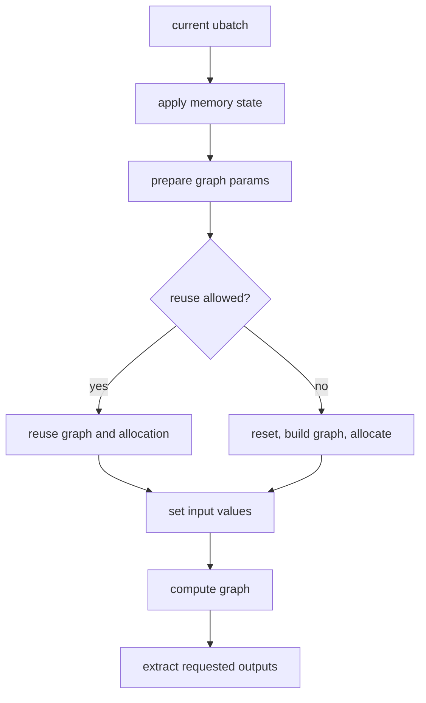
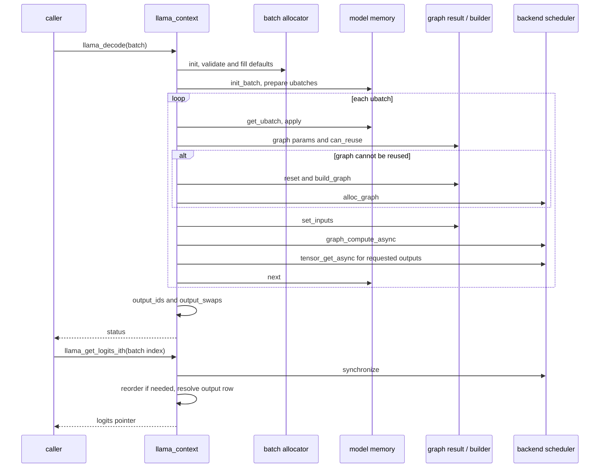

# llama.cpp 第 4 周每日学习路线: llama_context、batch、ubatch、encode/decode 主调用链

本路线根据 [llama.cpp 8 周深度学习与二次开发计划](llama-cpp-8-week-learning-plan.md) 的第 4 周安排展开, 承接 [第 3 周: 从 Transformer 公式到 GGML 计算图](003-llama-cpp-week3-daily-learning-route.md)。第 3 周回答一张图计算什么, 本周回答谁准备输入、如何切分输入、何时构图或复用、如何执行, 以及结果怎样返回给调用者。

本周主线:

```text
llama_init_from_model
  -> llama_context: backends / output buffer / memory / scheduler

llama_decode(batch)
  -> llama_batch_allocr::init
  -> memory->init_batch: 切分 ubatch 并准备 memory 状态
  -> 循环处理 ubatch
       -> process_ubatch
            -> memory context apply
            -> 复用图或重新构图、分配
            -> set_inputs
            -> graph_compute -> backend scheduler
       -> 异步提取所需 logits / embeddings
  -> 建立输出位置映射
  -> llama_get_logits_ith: 同步、必要时重排、取回结果
```

完成标准: 能沿真实源码解释一次 prompt prefill 和随后的单 token decode; 给定 batch 内容、context 参数和 memory 类型, 能预测大致 ubatch 切分; 能用断点和日志证明预测, 并区分图复用、KV 复用和结果读取。

## 使用约定与本周边界

- 工作日每天 2 小时, 周末每天 4 小时, 共 18 小时。每天开头 10 分钟闭卷回忆, 结尾至少 15 分钟整理已确认事实和待验证问题。
- 本文按工作区 `545ddb30a` 核对。函数名作为主要入口, 行号以自己 checkout 为准。总计划基准版本较早, 具体参数和分支以当前源码为准。
- 必做运行路径为 CPU、普通 decoder-only Transformer、单 sequence、短输入、无 LoRA、无 backend sampling。多 sequence 的切分先用现有 `test-batch-alloc` 验证, 不要求本周实现多会话程序。
- 沿用本地 `deepseek-r1-1.5b-f16.gguf`, 其实际架构为 Qwen2; 不把观测写成 Llama 权重实测。`llama_context`、batch 和 scheduler 的公共路径适用于本周任务。也可换成已确认架构和配置的完整 Llama GGUF。
- 本周读 memory 的 `init_batch/get_ubatch/apply/next` 协议即可, 不展开 cell 回收、sequence copy、state 保存等第 5 周内容。scheduler 只读接口和放置依据, kernel 与跨设备优化留到第 7 周。
- 学习笔记和日志放在 `/home/king/llama-study/`, 不修改 `src/` 或 `ggml/`。本周通过现有工具和测试完成, 不新增核心功能。遵守 [AGENTS.md](../../AGENTS.md) 和 [CONTRIBUTING.md](../../CONTRIBUTING.md)。

开始前闭卷回答三个问题: Q/K/V 的哪些维度随本次输入变化? `ggml_build_forward_expand()` 是否执行计算? logits 为什么可能只有一个 token 位置的输出? 若仍有疑问, 先回看第 3 周的 shape 表。

## 7 天安排

| 天 | 时间 | 核心问题 | 当天主要输出 |
| --- | ---: | --- | --- |
| Day 1 | 2h | context 拥有哪些运行时对象, 参数如何变成实际限制? | 所有权图、初始化顺序、有效参数表 |
| Day 2 | 2h | API batch 怎样补齐字段并切成 ubatch? | 字段表、三种 split 手算、测试对应表 |
| Day 3 | 2h | encode 与 decode 分别做什么, prefill 属于哪条路径? | encode/decode 对照、decode 主调用图 |
| Day 4 | 2h | 一张图何时复用, 复用后还要做什么? | reuse 决策图、三组判定推演 |
| Day 5 | 2h | graph 如何交给 scheduler, logits 如何返回? | 执行边界图、输出索引例子、同步位置 |
| Day 6 | 4h | 实际切分、图复用和输出是否符合预测? | PP/TG 断点记录、参数矩阵、原始日志 |
| Day 7 | 4h | 能否闭卷串联调用链并解释失败状态? | 时序图、返回码表、测试记录和周复盘 |

## 统一术语与记录表

本周不要用一个含糊的 batch size 同时描述所有数量。

| 名称 | 本周含义 | 常见误判 |
| --- | --- | --- |
| prompt 总长度 `P` | 应用准备处理的总 token 数 | 一定等于一次 API 调用的 token 数 |
| `batch.n_tokens` | 本次 `llama_decode()` 提交的 token 数 | 等于并发用户数 |
| `cparams.n_batch` | context 接受的逻辑 batch 上限 | core 会自动接收任意长输入并分块 |
| `cparams.n_ubatch` | 单个 ubatch 的 token 上限 | 任意模型都能按它直接切片 |
| `ubatch.n_tokens` | 当前实际计算的 token 数 | 永远等于 `n_ubatch` |
| `n_ctx / n_ctx_seq` | context 容量及单 sequence 的 context 限制 | 等于本次输入长度或 GGUF 的训练长度 |
| `n_seq_max` | context 配置的 sequence 数量限制参数 | 等于当前 ubatch 中出现的实际 sequence 数 |
| `ubatch.n_seqs` | splitter 使用的 sequence-set 布局数量 | 一定等于不同 sequence id 的数量 |
| `ubatch.n_seqs_unq` | 当前 ubatch 中不同 sequence id 的数量 | 一定等于 `n_seqs` |
| `n_outputs_all` | 整个 API batch 请求输出的位置数 | 等于其中 token 数 |
| `this->n_outputs` | decode 循环中为当前 ubatch 的输出数, 循环后为整个 batch 的输出数 | 函数中始终表示同一范围 |
| scheduler split 数 | 一张 graph 按 backend 等约束分出的执行段数 | 等于 ubatch 数 |

当前 `split_simple()` 会用 `n_seq_tokens=1, n_seqs=n_tokens` 描述非等长布局。即使全部 token 属于 sequence 0, `n_seqs` 也可能很大; 实际不同 sequence 数看 `n_seqs_unq` 和 `seq_id_unq`。

每次实验维护一张记录表:

| 运行/阶段 | API 调用序号 | batch token 数 | ubatch 序号/长度 | pos 范围、seq ids | 本 ubatch 输出数 | build/reuse | graph nodes / scheduler splits | 证据 |
| --- | --- | --- | --- | --- | --- | --- | --- | --- |
| 示例: prefill | 1 | 4 | 1 / 2 | 0..1, seq 0 | 0 | 待观测 | 待观测 | GDB/log |

## Day 1: llama_context 的对象、所有权和初始化

**投入: 2 小时。** 今天将第 2 周的模型权重与本周的运行时状态分开。

### 学习路线

1. **0-10 分钟, 闭卷回忆**: 画出 model、context、sampler 的依赖和释放顺序, 解释为什么同一个 model 可以供多个 context 使用。
2. **10-35 分钟, 阅读对象定义**: 阅读 [`src/llama-context.h`](../../src/llama-context.h) 的成员, 对照 [`src/llama-cparams.h`](../../src/llama-cparams.h) 和 [`include/llama.h`](../../include/llama.h) 中的 `llama_context_params`。将成员放入下表, 不要求逐项理解所有模式。

   | 对象/成员 | 职责 | 生命周期或边界 |
   | --- | --- | --- |
   | `const llama_model & model` | 访问 hparams、词表和权重 | context 引用 model, model 必须保持存活 |
   | `cparams` | 生效的运行参数 | 不直接等同于调用者传入的 params |
   | `backends`, `backend_cpu`, `sched` | backend 实例和图调度 | context 的运行资源 |
   | `memory` | KV 或其他持久推理状态 | 由模型类型决定实现; 某些模型可无 memory |
   | `balloc` | 校验、补齐、切分 batch | context 内复用的 batch allocator |
   | `gf_res_prev`, `gf_res_reserve` | 实际计算图和预留图的结果容器 | 图复用与内存规划使用 |
   | `buf_output`, `logits`, `embd`, `output_ids` | host 可读输出和索引映射 | 与权重 buffer、KV buffer、compute buffer 分开 |

3. **35-70 分钟, 跟构造流程**: 在 [`src/llama-context.cpp`](../../src/llama-context.cpp) 从 `llama_init_from_model()` 进入 `llama_context::llama_context()`。普通非 vocab-only 路径的主要顺序是: 规范化参数 -> 初始化模型设备/ACCEL/CPU backends -> 初始 output buffer -> `model.create_memory()` -> 收集 backend/buffer types -> `sched_reserve()`。指出 scheduler 在 `sched_reserve()` 内创建, 不能凭对象名字猜初始化顺序。
4. **70-100 分钟, 比较请求值与生效值**: 记录 causal 模式的 `n_batch` 受到请求 context 长度限制, `n_ubatch` 不超过生效 `n_batch`, `n_ubatch=0` 有默认处理; `n_ctx/n_ctx_seq` 还可能按实现要求对齐。为 `n_ctx=10,n_batch=4,n_ubatch=2,n_seq_max=1` 预测日志, Day 6 核对。
5. **100-120 分钟, 读预留入口**: 在 `sched_reserve()` 找到 `sched_need_reserve`、`memory->init_full()`、PP/TG 预留图和 `graph_reserve()`。解释为什么首次用户 decode 之前也可能看到建图日志, 以及为什么不能把所有 builder 断点命中都算作一次推理。

### 当天输出与验收

- context 所有权图、初始化顺序、请求值/有效值对照表。
- 能区分四类内存: model weights、model memory/KV、compute buffer、output buffer。
- 能解释 `sched_reserve()` 的调用不一定触发重新预留, 初始图预留也不等于真实 prompt 执行。

## Day 2: batch 字段、默认补齐和三种 ubatch 切分

**投入: 2 小时。** 今天使用纸面 token 表和已有单元测试理解切分, 无须加载模型。

### 学习路线

1. **0-10 分钟**: 闭卷区分 `n_batch`、`n_ubatch`、`n_ctx`、`n_seq_max`。
2. **10-35 分钟, 读公共输入**: 阅读 `llama_batch` 和 `llama_batch_init/free/get_one()`。普通路径选择 token ids 或 embeddings 输入; `logits` 是输出选择标记, 不是一块装有 logits 数值的数组。`llama_batch_init()` 分配容量后仍需填写有效字段, 不能认为它自动生成合法输入。

   | 字段 | 要回答的问题 |
   | --- | --- |
   | `token / embd` | id 与向量输入分别适用于什么场景? 谁拥有这些数组? |
   | `pos` | 指的是 sequence 中位置还是 batch 下标? 缺省值从哪里推导? |
   | `n_seq_id / seq_id` | 为什么一个 token 可以同时属于多个 sequence? |
   | `logits` | 哪些位置请求输出? 未输出的 token 是否仍参与 attention 和 KV 写入? |

3. **35-65 分钟, 读默认补齐**: 跟 [`src/llama-batch.cpp`](../../src/llama-batch.cpp) 的 `llama_batch_allocr::init()`。标出 token/sequence 合法性检查、默认 sequence 0、根据 memory 推导 position、输出标志和连续性校验。普通非 embeddings 模式下, `logits=nullptr` 默认只输出整个 API batch 最后一个 token, 不自动为每个 sequence 输出最后一个 token。
4. **65-100 分钟, 手算切分**: 阅读 [`src/llama-batch.h`](../../src/llama-batch.h) 和三种 split 实现, 用下面例子先预测, 再对照 [`tests/test-batch-alloc.cpp`](../../tests/test-batch-alloc.cpp)。

   | split | 纸面输入与上限 | 预期结果 | 对应测试 |
   | --- | --- | --- | --- |
   | `split_simple(2)` | seq 0 的 5 个 token, 只有最后一个输出 | 2 + 2 + 1, ubatch 输出数分别为 0、0、1 | `split_simple_chunks` |
   | `split_equal(8,false,0)` | seq 0 长 4, seq 1 长 2, 各自最后一个输出 | 先各取 2 个组成 4-token ubatch, 再取 seq 0 剩余 2 个 | `split_equal_unequal_lengths` |
   | `split_seq(8)` | 3 个独立 sequence, 每个长 2 | 每次一个 sequence set, 共 3 个 ubatch | `split_seq_per_sequence` |
   | `split_equal(4,*,0)` | 2 个 token 都属于 `{0,1}` | `sequential=true` 拒绝这种 coupled 输入; false 可形成一个 set、两个 unique ids | `split_equal_coupled` |

   对第二例额外写出原 batch 下标: 首个 ubatch 取 `[0,1,4,5]`, 第二个取 `[2,3]`。如果原输出位置是 `[3,5]`, 切分时先遇到的是 `[5,3]`, Day 5 用它解释输出重排。`split_seq()` 还允许按实现规则逐步缩小 sequence set, 不把它简化成任意情况下都只接受完全相同的 id 集合。
5. **100-120 分钟, 找实际调用者**: 读 [`src/llama-kv-cache.cpp`](../../src/llama-kv-cache.cpp) 的 `init_batch()`: 单 stream 使用 `split_simple`, 多 stream 使用 `split_equal`。再定位 [`src/llama-memory-recurrent.cpp`](../../src/llama-memory-recurrent.cpp) 的 split 调用, 只确认 memory 类型也会影响策略。`llama_ubatch::data` 可持有其数组的共享所有权, 并非所有 ubatch 都是用户数组的简单切片。

### 当天输出与验收

- 字段与默认值表、四个手算例子、原 batch 下标与 ubatch 下标的关系。
- 能解释 `n_tokens=n_seq_tokens*n_seqs` 的布局意义, 并说明 `n_seqs` 与 `n_seqs_unq` 的区别。
- 能说明 splitter 由 memory 路径选择, `ceil(N/n_ubatch)` 只适用于有明确前提的简单切分。

## Day 3: encode/decode 的共享路径与不同语义

**投入: 2 小时。** 今天先从 API 入口读到 ubatch 循环, 不展开 graph helper。

### 学习路线

1. **0-10 分钟**: 回忆第 1 周 `llama-simple` 首次输入与后续输入的差异。
2. **10-30 分钟, 公共入口**: 在 [`include/llama.h`](../../include/llama.h) 和 [`src/llama-context.cpp`](../../src/llama-context.cpp) 找到 `llama_encode()`、`llama_decode()` 包装和对应成员函数。结合 [`examples/simple/simple.cpp`](../../examples/simple/simple.cpp) 的 `llama_model_has_encoder()` 分支解释: encoder-decoder 模型才需要其 encoder 流程; decoder-only 模型的 prefill 和逐 token 处理都走 decode。
3. **30-65 分钟, decode 主干**: 只读普通有 memory、无 backend sampler 的路径, 按下面顺序画图。特别标出 `n_tokens_all`、`n_outputs_all` 和循环内 `n_outputs` 的作用域。

   ```text
   batch_inp
     -> balloc->init(... memory ...)
     -> 检查 n_tokens_all / n_batch / causal 条件
     -> sched_reserve + memory_update
     -> memory->init_batch
     -> 检查准备状态, 必要时尝试 memory 优化后重试
     -> output_reserve(n_outputs_all)
     -> do:
          get_ubatch
          统计当前 n_outputs
          process_ubatch
          提取本 ubatch 输出到累计偏移
        while mctx->next()
     -> n_outputs 恢复为总输出数
     -> output_ids / output_swaps
   ```

4. **65-95 分钟, encode 对照**: 阅读 `encode()` 的 `balloc->init(... nullptr,... true)`、`split_simple(n_tokens)`、非 causal graph、输出提取和 T5 cross-attention 数据保存分支。当前实现要求一次 encode 的 token 数不超过 `n_ubatch`, 不能像普通 causal prefill 一样任意切断完整输入。
5. **95-120 分钟, 完成对照表**: 只在支持相应模型语义时运行 encode。手头没有 encoder 模型时, 本周以源码证据完成该分支, 不把 Qwen2 强行当作 encoder 测试。

| 比较项 | 普通 decoder-only `decode()` | 常规 encoder 路径 `encode()` |
| --- | --- | --- |
| 用途 | prefill 和后续自回归 token 处理 | 编码完整输入, 供 embedding 或 encoder-decoder 使用 |
| memory | 使用模型 memory, 初始化时据此补齐 position | batch allocator 不传 memory, 缺省 position 从 0 推导 |
| 切分 | memory 创建一个或多个 ubatch | 当前一次完整输入作为一个 ubatch |
| attention | 主线为 causal | encode graph 使用 non-causal |
| 输出选择 | 普通模式尊重 batch 输出标志 | 当前实现请求所有输入位置的输出 |
| graph 类型 | 普通 context 的 default graph, 也存在其他 context 类型 | `LLM_GRAPH_TYPE_ENCODER` |
| 共同部分 | `process_ubatch`、scheduler、输出 buffer 和异步提取 | 同左 |

源码中的 `decode()` 在 `memory==nullptr` 时会转到 `encode()`; 这是具体分支, 不能据此把 prefill 与 encode 视为同义词。API 文档与特殊模型分支分开记录, MTP 等路径本周不展开。

### 当天输出与验收

- decode 调用图、encode/decode 对照表、首次 prefill 与后续单 token 输入差异。
- 能解释 causal attention 为什么允许前面的 ubatch 完成后再计算后面的 token, 而双向 attention 的完整输入依赖不满足同一条件。
- 能指出 `memory->init_batch()` 准备切分/状态, `mctx->apply()` 在实际处理当前 ubatch 前应用状态, 二者不是同一个动作。

## Day 4: process_ubatch 与图复用

**投入: 2 小时。** 今天回答“输入变了, 为什么有时不用重新建图”。

### 学习路线

1. **0-10 分钟**: 闭卷说出 graph topology、tensor 输入值、KV 内容各是什么。
2. **10-40 分钟, 逐段读 process_ubatch**: 画出 `apply -> graph_params -> can_reuse -> set_inputs -> graph_compute`。不能复用时才走 `res->reset()`、scheduler reset、`model.build_graph()` 和 `ggml_backend_sched_alloc_graph()`; 可以复用时增加 `n_reused`。pipeline parallel 分支还会在覆盖输入前同步, CPU 主线先知道其原因即可。
3. **40-75 分钟, 两层判定**: 阅读 [`src/llama-graph.h`](../../src/llama-graph.h) 的 `llm_graph_params::allow_reuse()` 和 [`src/llama-graph.cpp`](../../src/llama-graph.cpp) 的 `llm_graph_result::can_reuse()`。先比较 graph 参数, 再让每类 input 判断尺寸和使用条件; 不能只看 `n_tokens`。

   | 判定来源 | 本周重点检查 |
   | --- | --- |
   | ubatch 布局 | token 数、sequence-set 布局、unique sequence 数、token/embedding 输入模式 |
   | graph 参数 | `n_outputs`、graph type、embeddings/causal 模式及其他相关配置 |
   | KV graph input | KV index 输入长度、mask 的 `n_kv`、token 和 stream 维度 |
   | 额外机制 | sampler、adapter 等兼容性, 本周保持固定 |

4. **75-100 分钟, 三组推演**: 分别解释以下情况, 每项给出判定依据而不是只答“能/不能”。

   - 两次单 token decode, token id 和 position 不同, 其他结构条件及 `n_kv` 不变: 可能复用, 但仍需更新输入并执行完整图。
   - 两个同样长的 PP ubatch, 前者没有输出位置, 后者输出最后一个位置: `n_outputs` 不同, 可导致重新构图。
   - 单 token decode 长度不变, 但 cache 的图范围 `n_kv` 增长并改变 mask shape: 可能不能复用。当前 `get_n_kv()` 有 padding, 因此有效历史长度每次增加不意味着图 shape 每次都变。

5. **100-120 分钟, 设计观测方法**: 在 `process_ubatch()` 入口记录 `n_reused`, 在同次 `graph_compute()` 入口比较其增量, 配合 build 断点确认。也可用 `LLAMA_GRAPH_RESULT_DEBUG=2` 查看日志; 不把该函数日志的行数当成实际执行次数。



### 当天输出与验收

- reuse 决策图、判定条件表、三个推演和断点方案。
- 能解释图复用保留的是可复用的图结构/分配, KV 复用保留的是历史 K/V, 两者都不等于跳过新 token 的计算。
- 能解释即使某个 ubatch 的 `n_outputs=0`, 仍可能需要计算并更新 KV, 为后面的 token 提供历史。

## Day 5: scheduler 执行、异步输出与索引映射

**投入: 2 小时。** 今天从 `graph_compute()` 跟到调用者拿到正确的一行 logits。

### 学习路线

1. **0-10 分钟**: 闭卷写出三层切分: 应用按 API batch 上限提交、memory 拆 ubatch、scheduler 拆 graph。
2. **10-40 分钟, 计算入口**: 读 `llama_context::graph_compute()` 和 [`ggml/include/ggml-backend.h`](../../ggml/include/ggml-backend.h)。当前 `batched` 来自 `ubatch.n_tokens > 1`, 决定使用哪组线程数/threadpool; 多 sequence 的 token generation 也可能有多个 token, 不把它与用户语义的 PP/TG 完全等同。
3. **40-60 分钟, scheduler 的边界**: 对照 `reserve/reset/alloc_graph/graph_compute_async/synchronize/get_tensor_backend`。只定位 [`ggml/src/ggml-backend.cpp`](../../ggml/src/ggml-backend.cpp) 的放置和 split 入口, 说明 backend 优先级、op 支持、已有 buffer 和数据移动会影响分配。scheduler split 数不是模型层数, CPU 单 backend 路径也要以实际观测为准。
4. **60-90 分钟, 输出数据路径**: 在 decode 中找到 `n_outputs_prev*n_vocab` 和 `ggml_backend_tensor_get_async()`; 在 `llama_get_logits_ith()` 包装层找到同步, 再跟到 `output_reorder()`、`output_resolve_row()`。解释 `decode()` 返回与异步结果完成不是所有 backend 上都相同的时刻。
5. **90-120 分钟, 手算索引**: 用 Day 2 的输出顺序 `[5,3]` 说明为什么需重排。再独立完成下面的四 token 例子, 区分 API batch 下标、sequence position、输出行下标。

```text
batch token index: 0  1  2  3
sequence position: 8  9 10 11
logits flag:       0  1  0  1

最终输出行:
  row 0 对应 batch index 1
  row 1 对应 batch index 3

llama_get_logits_ith(ctx, 1)  -> row 0
llama_get_logits_ith(ctx, 3)  -> row 1
llama_get_logits_ith(ctx,-1)  -> 最后输出行, 即 row 1
```

正索引按本次 API batch 的 token 下标解析, 负索引从已输出的行末尾倒数。不要调用 index 0 来取上述第一行, 因为该 token 未请求输出; 当前 Debug 实现对这种非法访问可能直接终止, 无须通过崩溃来完成练习。输出指针由 context 管理, 后续 decode/输出重排可能改变其内容, 需要长期保存时由应用复制。

### 当天输出与验收

- graph 到 backend 的边界图、输出拷回路径和两个索引例子。
- 能解释 GPU/异步 backend 上为什么读取前需要同步, 以及公共结果访问函数如何承担这一职责。
- 能指出 `n_outputs_prev` 是本次 API 调用内的累计输出偏移, 不等于 cache 中的历史 token 数。

## Day 6: 参数矩阵与 PP/TG 断点实验

**投入: 4 小时。** 按“准备 20 分钟 + 短程观测 35 分钟 + GDB 65 分钟 + 参数矩阵 55 分钟 + 多 sequence 测试 35 分钟 + 归档 30 分钟”执行。

### 1. 准备工具与基线

沿用前几周 CPU Debug 构建。若未配置, 先参考 [构建文档](../build.md) 启用 Debug、`GGML_CUDA=OFF`、`LLAMA_BUILD_TESTS=ON`、`LLAMA_BUILD_TOOLS=ON`、`LLAMA_BUILD_EXAMPLES=ON`。

```bash
cd /home/king/llama.cpp
export MODEL="$PWD/deepseek-r1-1.5b-f16.gguf"
export STUDY_DIR=/home/king/llama-study
test -f "$MODEL"
mkdir -p "$STUDY_DIR/notes" "$STUDY_DIR/results/week4/day6"
git rev-parse --short HEAD > "$STUDY_DIR/results/week4/day6/commit.txt"

cmake --build build-study-debug --target llama-bench llama-simple test-batch-alloc -j
./build-study-debug/bin/llama-bench --help \
  > "$STUDY_DIR/results/week4/day6/bench-help.txt" 2>&1
```

将模型身份、build 类型、线程数、FA 设置、请求值与启动日志中的有效 `n_ctx/n_batch/n_ubatch` 记入笔记。以下命令使用 CPU Debug、F16 KV、FA off、4 线程、无 warmup、只运行一次, 用于观察调用链, 不作为正式性能比较。

### 2. 用 8-token prefill + 2 次单 token decode 检查预测

```bash
LLAMA_BATCH_DEBUG=2 LLAMA_GRAPH_RESULT_DEBUG=2 \
./build-study-debug/bin/llama-bench \
  -m "$MODEL" -ngl 0 -fa off -t 4 \
  -p 0 -n 0 -pg 8,2 -b 4 -ub 2 -r 1 --no-warmup -v -o json \
  > "$STUDY_DIR/results/week4/day6/pg8-2.json" \
  2> "$STUDY_DIR/results/week4/day6/pg8-2.log"
```

`-pg 8,2` 是同一轮中的 PP 后接 TG; `-p 0 -n 0` 关闭额外的独立 PP/TG 项。总计划中的 `-p 32,128 -n 8` 则会分别运行 PP32、PP128、TG8, 不能当作“处理 128-token prompt 后生成 8 个 token”。

先写下这组预测, 再看日志:

| 阶段 | API 调用 | 输入 token 数 | ubatch 切分 | sequence 0 的 position | 各 ubatch 输出数 |
| --- | ---: | ---: | --- | --- | --- |
| PP 前半段 | 1 | 4 | 2 + 2 | 0..3 | 0、1 |
| PP 后半段 | 2 | 4 | 2 + 2 | 4..7 | 0、1 |
| TG 第一步 | 3 | 1 | 1 | 8 | 1 |
| TG 第二步 | 4 | 1 | 1 | 9 | 1 |

即应用层调用 4 次 decode, core 实际处理 6 个 ubatch。前提是单 sequence、普通 KV、有效参数为 `n_batch=4,n_ubatch=2`, 且无失败重试。只统计真实处理路径, 排除初始化的 `graph_reserve` 日志。

阅读 [`tools/llama-bench/llama-bench.cpp`](../../tools/llama-bench/llama-bench.cpp) 的 `test_prompt()` 和 `test_gen()`: 前者主动将总 prompt 切成 API batch, 后者使用合成 token 做逐 token 计算, 不执行真实 logits sampling。若要联系生成流程, 另用下面短例子观察 `llama-simple` 的采样循环; 它没有 `-b/-ub` 参数。

```bash
./build-study-debug/bin/llama-simple -m "$MODEL" -ngl 0 -n 4 "Hello llama"
```

日志阅读的三个注意点:

- `LLAMA_BATCH_DEBUG=2` 配合 `-v` 才便于看到 debug 日志。日志同时打印原始 batch 和切分后的 ubatch, 不把两类记录相加。
- 当前 `ubatch_print()` 中名为 `n_outputs` 的汇总行打印 allocator 的整个 batch 输出数。当前 ubatch 输出数应数逐 token 的 `output` 标记, 或在 `process_ubatch()` 查看 `this->n_outputs`。
- `llama-bench` 的 JSON/表格耗时来自工具计时; 当前 context 默认 `no_perf=true`, 某些 `llama_perf_context_print` 耗时可能显示 0。不要据此认为没有执行, 也不要将 Debug/GDB/debug 日志耗时作为优化结论。

### 3. GDB: 观察实际处理、复用与 scheduler

```bash
gdb --args ./build-study-debug/bin/llama-bench \
  -m "$MODEL" -ngl 0 -fa off -t 4 \
  -p 0 -n 0 -pg 8,2 -b 4 -ub 2 -r 1 --no-warmup
```

先在真实 ubatch 入口停住, 避开初始化中的预留图。使用带源文件的断点避免停在动态库的 `@plt` 入口; 动态库加载前提示 pending breakpoint 可继续运行。

```gdb
set pagination off
set breakpoint pending on
set logging file /home/king/llama-study/results/week4/day6/gdb-pg8-2.txt
set logging overwrite on
set logging enabled on
break src/llama-context.cpp:llama_context::process_ubatch
run
bt 8
print ubatch.n_tokens
print ubatch.n_seqs
print ubatch.n_seqs_unq
print ubatch.n_seq_tokens
print ubatch.pos[0]
print ubatch.output[0]
print this->n_outputs
print this->cparams.n_batch
print this->cparams.n_ubatch
set $reuse_before = this->n_reused
```

此时进入上层 `decode` 栈帧, 观察 API batch 的范围, 再返回:

```gdb
up
print n_tokens_all
print n_outputs_all
print n_outputs_prev
down
break src/llama-context.cpp:llama_context::graph_compute
continue
```

到 `graph_compute()` 后查看:

```gdb
print gf->n_nodes
print gf->n_leafs
print batched
print this->n_outputs
print this->n_reused - $reuse_before
```

复用增量为 1 表示这次经过 reuse 分支; 为 0 则结合 builder 断点或 debug 日志检查重新构图。每次回到 `process_ubatch()` 都重新设置 `$reuse_before`, 按六个 ubatch 完成记录。不要在 GDB 中反复手动调用 `can_reuse()`, 其中某些 input 检查会更新内部引用。

需要观察 scheduler 时, 在已经到达真实 `graph_compute()` 后再加下面断点:

```gdb
break ggml/src/ggml-backend.cpp:ggml_backend_sched_graph_compute_async
continue
print ggml_backend_sched_get_n_splits(sched)
```

该停点的形参是 `sched` 和 `graph`, 与上一层的 `this`、`gf` 不同。观察完一次后用 `info breakpoints` 找到它并禁用, 避免每个 ubatch 都重复停在同一层。若要追踪输出拷回, 从 decode 中 `ggml_backend_tensor_get_async()` 调用点单步观察; 单独运行 `llama-simple` 时再在 `llama_get_logits_ith()` 停住观察真实取 logits 的同步路径。

### 4. 参数矩阵: 分开解释 API 调用数和 ubatch 数

先对下表做预测。这里是 PP-only, `llama-bench` 请求的 context 长度等于 prompt 长度; 当前 causal 参数规范化会影响生效 batch 上限, 所以同时列出请求值和生效值。

| P | 请求 b / ub | 预期生效 b / ub | PP 的 API decode 次数 | PP 的 ubatch 总数 |
| ---: | --- | --- | ---: | ---: |
| 32 | 64 / 16 | 32 / 16 | 1 | 2 |
| 32 | 64 / 64 | 32 / 32 | 1 | 1 |
| 128 | 64 / 16 | 64 / 16 | 2 | 8 |
| 128 | 64 / 64 | 64 / 64 | 2 | 2 |
| 128 | 32 / 16 | 32 / 16 | 4 | 8 |

通用计算方式是在应用实际提交的每个 batch 内分别计算 `ceil(batch_tokens/effective_n_ubatch)`, 然后求和; 不把 `ceil(P/n_ubatch)` 当成所有 split 模式下的规则。特别比较第三行与第五行: ubatch 总数相同, API 调用数和输出标志分布不同, 图复用表现也可能不同。

以下循环为每行保存独立结果, 便于追踪有效参数:

```bash
while read -r w4_prompt w4_batch w4_ubatch; do
  w4_case="pp${w4_prompt}-b${w4_batch}-ub${w4_ubatch}"
  LLAMA_BATCH_DEBUG=2 LLAMA_GRAPH_RESULT_DEBUG=2 \
  ./build-study-debug/bin/llama-bench \
    -m "$MODEL" -ngl 0 -fa off -t 4 \
    -p "$w4_prompt" -n 0 -b "$w4_batch" -ub "$w4_ubatch" \
    -r 1 --no-warmup -v -o json \
    > "$STUDY_DIR/results/week4/day6/$w4_case.json" \
    2> "$STUDY_DIR/results/week4/day6/$w4_case.log" || break
done <<'CASES'
32 64 16
32 64 64
128 64 16
128 64 64
128 32 16
CASES
```

遇到失败先解释失败, 不把缺失记录补成预测值。按每行补上有效参数、实际 ubatch 长度列表、`n_reused` 总量和至少一个真实 graph 的 nodes/splits。JSON 中参数可能是工具请求值, 有效限制以 context 日志/GDB 为准。

### 5. 多 sequence 切分与可选复用对照

运行现有 split 测试, 将 Day 2 的四组纸面结果与断言对照:

```bash
LLAMA_TEST_VERBOSE=1 ./build-study-debug/bin/test-batch-alloc 'split(\..*)?' \
  > "$STUDY_DIR/results/week4/day6/batch-split-tests.log" 2>&1
```

这个 regex 同时匹配父测试 `split` 和子测试。只写某个子测试名字可能导致父测试被过滤, 所以必须核对 summary 中实际运行的测试数。测试使用 embedding batch 和 mock memory, 能证明 allocator 行为, 不代表完成了真实多 sequence KV 调度。

时间允许时, 用完全相同的 `-pg 8,2` 命令加 `LLAMA_GRAPH_REUSE_DISABLE=1`, 另存日志并比较 `n_reused` 和 build 次数。这是结构对照, 不是性能结论; 不要求 graph reuse 一定发生在所有相邻的同长度输入之间。

### 当天输出与验收

- 六个 ubatch 的完整短程记录、五行参数矩阵、split 测试证据及差异解释。
- 原始日志包含命令、commit、模型和有效 context 参数。至少有一次 PP 和两次连续单 token decode 的运行证据。
- 能说明同一 API batch 内哪些 ubatch 不输出 logits, 以及为何仍需执行它们。
- 缺少模型时先完成单元测试与源码推演, 将真实推理项标为待完成; 不用词表 GGUF 代替完整权重。

## Day 7: 时序图、错误边界与第 4 周验收

**投入: 4 小时。** 今天将观察整理成能独立讲解的一条完整调用链。

### 学习路线

1. **0-10 分钟, 闭卷回忆**: 讲清 context 中的 model 引用、memory、graph、scheduler 和 output buffer。
2. **10-60 分钟, 重建两条时序**: 分别画一次多 token prefill 和一次后续单 token decode, 在图上标出 `n_tokens_all`、各 ubatch 长度、`n_outputs`、graph build/reuse、拷回偏移和同步位置。下图作为结构模板, 数值使用 Day 6 实测。
3. **60-110 分钟, 阅读失败路径**: 回到 `llama_decode()` 的 API 注释和成员实现, 完成下面返回码表。只做源码定位, 不人为制造 OOM、非法索引或断言崩溃。
4. **110-150 分钟, 运行 batch 测试并分类**: 执行完整 `test-batch-alloc`, 将 `init/split/keep_tail/mrope` 四组对应到校验、切分、尾部约束和位置布局。负向用例中的预期报错不等于测试失败, 以断言和退出状态为准。
5. **150-210 分钟, 闭卷讲解与补证据**: 用 10 分钟串联调用链, 再用 5 分钟解释“同样 N 为何重建图”和“decode 成功返回后为什么仍可能需要同步”。对解释不清的地方只补读相关函数, 不扩展到 kernel。
6. **210-240 分钟, 周复盘**: 回答已确认事实、未验证假设、关键不变量、扩展边界、环境影响五项。列出下周要接着研究的三个问题: slot 如何选择、sequence 操作如何影响 memory、state 如何保存恢复。



### decode 返回码与状态边界

| 返回值/条件 | 当前普通 decode 路径的含义 | 学习时需记录的处理原则 |
| --- | --- | --- |
| `0` | 成功提交/处理 | 根据 backend 和访问方式理解同步, 通过公共 API 读取输出 |
| `1` | 准备 memory slot 失败, 可能已尝试优化后重试 | 不是生成结束标记; 分析 batch 与 context 容量, 再决定是否调整 |
| `2` | 执行被中止 | 之前成功处理的 ubatch 可能仍保留在 memory 中 |
| `-1` | 无效 batch, 如空输入或校验失败 | 检查输入契约, 不靠盲目重试修复 |
| `-2` | 分配或准备等失败, 具体来源看日志/分支 | 不能只凭数值断言一定是模型权重 OOM |
| `-3` 等 `< -1` | fatal/compute 类错误, 具体来源看实现 | 成功完成的早期 ubatch 可能保留, 不假设整次调用自动回滚 |
| 超过 `n_batch`, 或 non-causal 输入超过 `n_ubatch` | 当前实现存在 `GGML_ASSERT` 前置条件 | 不能期待所有非法配置都优雅返回 `-1` |

`process_ubatch()` 失败后, decode 会尝试移除失败 ubatch 对应的 memory 区间; 这不等于撤销前面已经成功的 ubatch。理解 API 注释中 fatal/abort 的部分完成语义, 后续恢复应查询实际 sequence position。encode 的返回分支单独记录, 不机械套用 decode 的整张表。

```bash
./build-study-debug/bin/test-batch-alloc \
  > "$STUDY_DIR/results/week4/day6/test-batch-alloc.log" 2>&1
```

### 第 4 周验收清单

- [ ] 能解释 context 的所有权、初始化顺序和四类 buffer。
- [ ] 能区分请求参数、有效参数、实际 batch/ubatch 数量。
- [ ] 能手算 `split_simple/split_equal/split_seq` 的指定例子, 并区分 sequence set 与 unique id。
- [ ] 能解释 decoder-only prefill 也走 decode, 并说明 encode 的完整输入要求。
- [ ] 能沿 `decode -> balloc -> memory -> process_ubatch -> graph_compute -> scheduler` 找到实际代码。
- [ ] 能解释图复用的两层检查, 用一次 `n_reused` 增量或重建证据支持结论。
- [ ] 能说明图复用与 KV 复用的区别, 以及 reuse 后为何仍需 `set_inputs` 和 compute。
- [ ] 已完成 PP/TG 短程记录、参数矩阵和 batch allocator 测试。
- [ ] 能正确使用正/负 logits 索引, 并解释输出重排和同步。
- [ ] 能区分成功、slot 不足、abort、fatal error 和断言前置条件。
- [ ] 能解释 PP 的多 token 计算与 TG 的历史 KV 读取为何呈现不同计算/访存特征, 同时不把 Debug 数据当作性能证明。

## 本周完成包

```text
/home/king/llama-study/
  notes/
    week4-day1.md ... week4-day7.md
    week4-context-ownership.md
    week4-batch-ubatch-map.md
    week4-encode-decode-sequence.md
    week4-graph-reuse.md
    week4-experiment-matrix.md
    week4-review.md
  results/week4/day6/
    commit.txt
    bench-help.txt
    pg8-2.json
    pg8-2.log
    gdb-pg8-2.txt
    pp*-b*-ub*.json
    pp*-b*-ub*.log
    batch-split-tests.log
    test-batch-alloc.log
```

每天保留原始推演与疑问, 最后将有证据的结论整理到主题文档。进入第 5 周前, 应能回答: 当前输入属于哪些 sequence、准备了哪些 ubatch、实际执行了哪些图、哪些位置产生输出, 以及失败后哪些状态可能已改变。
