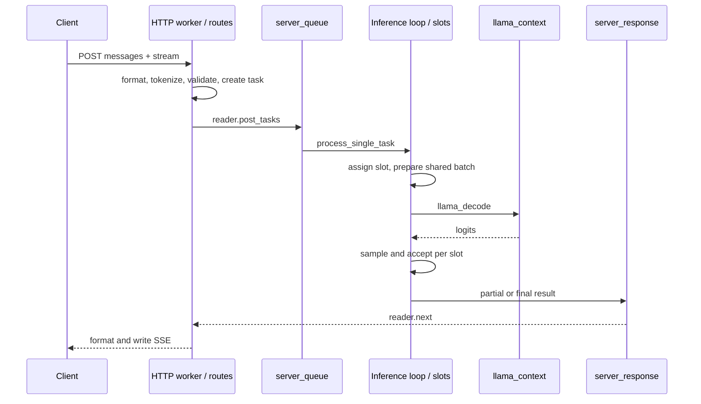
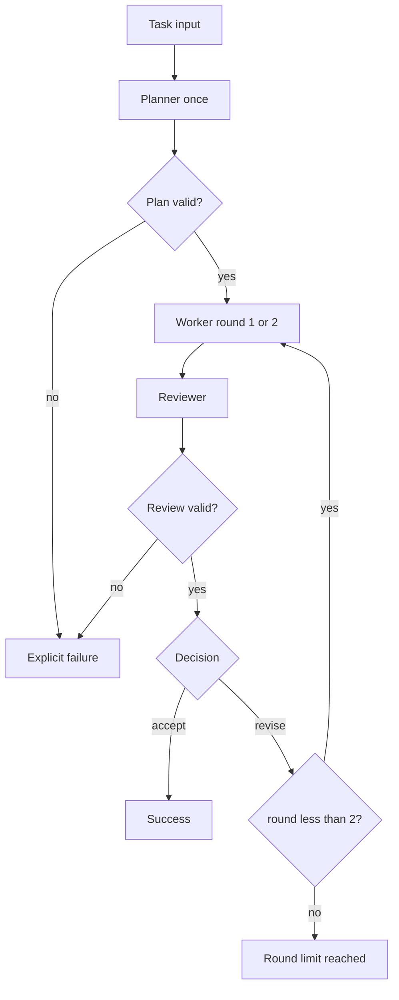

# llama.cpp 第 8 周每日学习路线: CLI、Server、并发调度和多 Agent 最终项目

本路线根据 [llama.cpp 8 周深度学习与二次开发计划](llama-cpp-8-week-learning-plan.md) 的第 8 周安排展开, 承接 [第 7 周: GGML、CPU/GPU Backend、量化、内存与性能分析](007-llama-cpp-week7-daily-learning-route.md)。本周将前七周的模型加载、生成、状态管理、结构化输出和性能分析组合成一个可以独立演示的本地项目。

本周包含两条相互衔接的主线:

```text
CLI / HTTP client
  -> chat formatting + request validation + tokenization
  -> server_task -> queue -> slot -> shared batch
  -> llama_decode -> per-slot sampling -> response queue -> SSE / JSON

local C++ application
  -> one shared model + isolated role sessions
  -> Planner JSON -> Worker candidate -> Reviewer JSON
  -> accept / revise / bounded failure
  -> trace + tests + performance report
```

完成标准: 能解释一个聊天请求从入口到流式响应的路径, 用证据说明两个请求如何进入 slot 和 batch; 完成 `llama-multi-agent-demo`, 本地运行 Planner/Worker/Reviewer 闭环, 有状态隔离、终止条件、测试、README 和性能记录。

## 使用约定与本周边界

- 工作日每天 2 小时, 周末每天 4 小时, 共 18 小时。每天开头 10 分钟闭卷回忆, 结尾至少 15 分钟整理证据。
- 本文按工作区 `545ddb30a` 核对。当前 CLI 包含 `cli-context`、`cli-client` 和 `cli-server`, Server 的调度包含 `pre_decode/decode/post_decode`; 总计划中的路径需要展开到这些实际入口。以源码与重建后的 `--help` 为准。
- CPU 为必做基线。默认使用本地 `deepseek-r1-1.5b-f16.gguf`, 实际架构为 Qwen2; 可换成第 7 周已经验证的 Q4_K_M, 但同一组实验固定模型、模板、backend、线程和采样配置。
- Server 实验使用 loopback HTTP, 最终项目直接调用本地库, 不依赖外部 API。Server 使用单模型 inference mode; router、多模态、工具调用、speculative decoding、LoRA 和 Web UI 不进入必做范围。
- 最终项目按总计划先做顺序调度, 一个 model、三个角色各自的 context/history/sampler。单 context 多 sequence 为选做, 多 Agent 的逻辑角色数量不代表同时运行的线程数量。
- 先复用第 1 周最小生成程序、第 5 周状态管理、第 6 周模板/Schema/观测 sampler、第 7 周性能配置。若前置资产未完成, 先补生成与协议验证, 删减本周优化项, 不省略状态隔离和终止条件。
- 最终项目放在 `/home/king/llama-study/multi-agent/`, 不向核心库或 Server 增加 Agent route。阅读 [Server 开发范围](../../tools/server/README-dev.md), 保持业务编排位于应用层; 遵守 [AGENTS.md](../../AGENTS.md) 与 [CONTRIBUTING.md](../../CONTRIBUTING.md)。
- 本文安排的是待完成的任务, 不代表项目已经实现或实验已经通过。先由学习者写清设计选择与不变量, 能独立解释后再实现。

开始前闭卷回答: 一个 model 能否供多个 context 使用? context state 是否包含 sampler 状态? grammar 为什么不能代替业务校验? PP/TG 为什么不等于 HTTP 端到端延迟? 不清楚的部分只回看对应周记录。

## 7 天安排

| 天 | 时间 | 核心问题 | 当天主要输出 |
| --- | ---: | --- | --- |
| Day 1 | 2h | 当前 CLI 怎样复用 common 和 Server? | CLI 调用图、依赖边界表、运行环境 |
| Day 2 | 2h | 请求怎样跨越 HTTP 与推理线程边界? | 单请求时序图、完整 SSE 记录 |
| Day 3 | 2h | 多请求怎样分配 slot、合批、等待和取消? | 两请求实验、batch/slot 对照、取消记录 |
| Day 4 | 2h | 多 Agent 的状态、协议和终止条件由谁管理? | 对象所有权图、状态机、Schema、测试契约 |
| Day 5 | 2h | 怎样共享模型并运行第一个完整顺序链? | 单次加载、三角色骨架、首个闭环记录 |
| Day 6 | 4h | 怎样处理 revise、错误、超时和 context 上限? | 完整闭环、失败路径、三个端到端任务 |
| Day 7 | 4h | 怎样证明隔离、复现、资源释放和性能结论? | 测试报告、README、演示与八周复盘 |

## 统一术语与记录表

| 名称 | 本周含义 | 必须区分 |
| --- | --- | --- |
| HTTP request | 一次传输与协议交互 | 一个请求在某些参数下可以产生多个内部 task |
| `server_task` | 进入推理队列的工作项, 包括生成、取消等 | task ID 与 HTTP completion ID 不一定相同 |
| slot | Server 用来管理一次活动生成的执行单元 | slot 可被后续请求复用, 不是永久用户会话 |
| sequence | `llama_context` 内区分 token 位置和 memory 归属的标识 | seq ID 的含义受 context 范围限制 |
| batch/ubatch | 一次 decode 输入与内部计算切分 | HTTP 请求数量不等于 `batch.n_tokens` |
| continuous batching | 在持续调度中接纳、处理、释放兼容的活动请求 | 不要求所有请求同时开始或同时结束 |
| SSE event | HTTP 流中的协议事件 | 一次网络读取、一个 event 和一个模型 token 不一一对应 |
| agent session | 应用维护的角色、history、context、sampler 和预算 | 模型权重可共享, 可变生成状态需明确隔离 |
| orchestrator | 根据经过校验的结果推进固定状态机 | 模型输出不能自行修改最大轮数或资源预算 |

Server 观察表至少记录:

```text
run_id, client_request_label, task_id, slot_id, seq_id,
phase, batch_token_count, batch_view_offset, logits_index,
prompt_tokens, generated_tokens, finish_reason, evidence
```

客户端自己的 A/B 标签不要当成服务端 task ID; 用不同输入和服务端日志关联。最终项目另用 `run_id/role/round/context_id/seq_id` 标识, 不把独立 context 中相同的 seq ID 当成状态串线。

## Day 1: CLI、common 与当前产品入口

**投入: 2 小时。** 确认实际调用链, 找到最终项目可以复用的基础设施。

### 学习路线

1. **0-10 分钟**: 口述第 1 周 `llama-simple` 的模型加载、prefill、采样和 decode 流程。
2. **10-35 分钟**: 阅读 [`tools/cli/cli.cpp`](../../tools/cli/cli.cpp)、[`cli-context.cpp`](../../tools/cli/cli-context.cpp)、[`cli-client.cpp`](../../tools/cli/cli-client.cpp) 与 [`cli-server.h`](../../tools/cli/cli-server.h)。定位 `llama_cli()`、`cli_context::init/run/generate_completion()`、`cli_client::post_sse()` 和 `cli_server::start()`。
3. **35-60 分钟**: 阅读 [`common/arg.cpp`](../../common/arg.cpp) 的参数入口, 对照 [`common/common.cpp`](../../common/common.cpp) 的 `common_init_from_params()`。再沿 [`tools/server/server-context.cpp`](../../tools/server/server-context.cpp) 的 `load_model()` 确认实际初始化位置。
4. **60-85 分钟**: 准备下方构建与记录, 重用已有构建。等待期间查看 CLI/Server CMake 依赖。
5. **85-105 分钟**: 运行一次短 CLI 请求, 记录输入模板、模型、日志与停止原因。对照 `llama-simple` 与 `llama-completion`, 说明入口差异。
6. **105-120 分钟**: 完成调用图与复用边界表。

### 当前 CLI 路径

```text
llama-cli
  -> common_init + common_params_parse
  -> cli_context::init
       -> use --server-base, or cli_server::start
       -> wait for health + fetch server properties
  -> cli_context::run / generate_completion
  -> cli_client::post_sse("/v1/chat/completions")
  -> server route -> queue -> inference
  -> parse SSE deltas -> display + append assistant message
```

当前 `cli_server::start()` 在同一进程的新线程中调用 `llama_server()` 并选择可用端口, 然后通过 loopback HTTP 交互。不要仅依据某处注释中的 child/spawn 字样判断它创建了独立子进程; 检查实际调用。连接外部 `--server-base` 则不会由 CLI 再次加载本地模型。

| 层 | 本周复用内容 | 最终项目中的职责 |
| --- | --- | --- |
| `libllama` | model/context/batch/memory/sampler 公共 API | 加载一次模型, 执行生成和资源释放 |
| `llama-common` | 参数映射、chat templates、token 辅助、sampling、Schema 转 grammar、日志 | 减少重复的模型格式与生成配置逻辑 |
| CLI/Server 产品层 | 消息交互、HTTP、slot 调度、响应格式 | 阅读其设计与实验方法, 最终项目不需要复制其全部实现 |
| 项目应用层 | 角色、协议、轮次、业务验证、错误传播、trace | 用少量对象完成固定 Planner/Worker/Reviewer 流程 |

### 环境与构建

```bash
cd /home/king/llama.cpp
export MODEL="$PWD/deepseek-r1-1.5b-f16.gguf"
export STUDY_DIR=/home/king/llama-study
export WEEK8_RESULTS="$STUDY_DIR/results/week8"
export WEEK8_THREADS=4
export WEEK8_PORT=18080
export WEEK8_BASE="http://127.0.0.1:$WEEK8_PORT"
mkdir -p "$STUDY_DIR/notes" "$STUDY_DIR/multi-agent" "$WEEK8_RESULTS"
git rev-parse HEAD > "$WEEK8_RESULTS/commit.txt"

cmake -S . -B build-study-debug \
  -DCMAKE_BUILD_TYPE=Debug -DGGML_CUDA=OFF -DGGML_BLAS=OFF \
  -DLLAMA_BUILD_COMMON=ON -DLLAMA_BUILD_TESTS=ON \
  -DLLAMA_BUILD_EXAMPLES=ON -DLLAMA_BUILD_TOOLS=ON \
  -DLLAMA_BUILD_SERVER=ON -DLLAMA_BUILD_UI=OFF
cmake --build build-study-debug --target \
  llama-cli llama-server llama-parallel \
  test-sampling test-chat-template test-json-schema-to-grammar -j 4

cmake -S . -B build-study-release \
  -DCMAKE_BUILD_TYPE=Release -DGGML_CUDA=OFF -DGGML_BLAS=OFF \
  -DLLAMA_BUILD_COMMON=ON -DLLAMA_BUILD_TESTS=ON \
  -DLLAMA_BUILD_EXAMPLES=ON -DLLAMA_BUILD_TOOLS=ON \
  -DLLAMA_BUILD_SERVER=ON -DLLAMA_BUILD_UI=OFF
cmake --build build-study-release --target llama-cli llama-server llama-parallel -j 4

./build-study-release/bin/llama-cli --help > "$WEEK8_RESULTS/cli-help.txt" 2>&1
./build-study-release/bin/llama-server --help > "$WEEK8_RESULTS/server-help.txt" 2>&1
./build-study-release/bin/llama-parallel --help > "$WEEK8_RESULTS/parallel-help.txt" 2>&1
cp build-study-release/CMakeCache.txt "$WEEK8_RESULTS/cmake-release.txt"
```

第 7 周可能关闭了 `LLAMA_BUILD_SERVER`, 本周需要重新打开; 当前 CLI 的构建也依赖它。保持第 7 周核对过的 CPU backend 配置, Debug 用于断点, Release 用于计时。新终端要重新设置以上环境变量; 端口已被占用时选择另一个空闲端口并更新记录。

短 CLI 观察:

```bash
./build-study-release/bin/llama-cli \
  -m "$MODEL" -ngl 0 --offline --fit off -c 2048 -np 1 \
  -t "$WEEK8_THREADS" -tb "$WEEK8_THREADS" \
  --single-turn --simple-io --temp 0 --seed 42 -n 64 \
  -p 'Explain continuous batching in two short sentences.' \
  > "$WEEK8_RESULTS/cli.stdout.txt" 2> "$WEEK8_RESULTS/cli.stderr.txt"
```

本地 reasoning 模型可能在 token 上限前尚未输出最终答案, 这不是 CLI 调用链失败。记录 reasoning/content 边界与实际停止原因; 结构化输出沿用第 6 周已验证的模板与约束方式。

### 当天输出与验收

- 当前 CLI 调用图、common/libllama/产品层边界表。
- `results/week8/` 中有版本、构建、帮助和一次 CLI 记录。
- 能解释为什么最终项目不能为每个 Agent 调一次会重新加载模型的完整初始化流程。

## Day 2: HTTP 请求、task、response reader 与 SSE

**投入: 2 小时。** 跟踪一条请求, 画清线程和所有权边界。

### 学习路线

1. **0-10 分钟**: 回忆 CLI 如何到达聊天 route。
2. **10-35 分钟**: 阅读 [`tools/server/server.cpp`](../../tools/server/server.cpp)、[`server-http.cpp`](../../tools/server/server-http.cpp) 的启动、路由与响应写出路径, 区分 HTTP worker 与推理循环。
3. **35-60 分钟**: 阅读 [`server-context.h`](../../tools/server/server-context.h) 和 `server_routes::init_routes()/handle_completions_impl()`; 对照 [`server-chat.cpp`](../../tools/server/server-chat.cpp)、[`server-schema.cpp`](../../tools/server/server-schema.cpp), 定位消息模板、tokenization、参数校验和 task 创建。
4. **60-80 分钟**: 阅读 [`server-task.h`](../../tools/server/server-task.h)、[`server-queue.h`](../../tools/server/server-queue.h) 中 task/result/reader 的关系, 找到 `post_tasks()`、`next()`、`wait_for_all()` 与 `stop()`。
5. **80-105 分钟**: 启动本地 Server, 完成一次流式请求, 保存 headers、SSE 与客户端时间。
6. **105-120 分钟**: 画出下面的时序图, 将至少三个箭头与真实函数对应。

### 本地 Server 基线

终端 A 前台启动, 完成实验后用该终端的 Ctrl+C 正常退出:

```bash
./build-study-release/bin/llama-server \
  -m "$MODEL" --alias week8-local --offline --fit off \
  --host 127.0.0.1 --port "$WEEK8_PORT" \
  -ngl 0 -c 4096 -np 2 --no-kv-unified \
  -b 512 -ub 128 -t "$WEEK8_THREADS" -tb "$WEEK8_THREADS" \
  -ctk f16 -ctv f16 -fa off --cont-batching --no-context-shift \
  --jinja --metrics --slots --temp 0 --seed 42 \
  > "$WEEK8_RESULTS/server.stdout.txt" 2> "$WEEK8_RESULTS/server.stderr.txt"
```

终端 B 检查状态, 以 `/health` 返回 200 且 body 为 `{"status":"ok"}` 为准备完成的证据, 不用固定 sleep 猜测模型何时加载完:

```bash
curl --silent --show-error -i "$WEEK8_BASE/health"
curl --silent --show-error "$WEEK8_BASE/props" > "$WEEK8_RESULTS/props.json"
curl --silent --show-error "$WEEK8_BASE/slots" > "$WEEK8_RESULTS/slots-idle.json"
```

此配置显式选择两个 slot 和非 unified KV, 预期每 slot 约 2048 context, 仍需核对实际 `n_ctx/n_ctx_seq/n_ctx_slot` 和 `/props`。不要将 `-c 4096` 理解为两个 slot 各自都有 4096。更改 slot 数做性能比较时同时检查每 slot 容量是否改变。

### 一条可重复的流式请求

```bash
cat > "$WEEK8_RESULTS/request-a.json" <<'JSON'
{
  "model": "week8-local",
  "messages": [{"role": "user", "content": "Request A: Explain why KV cache helps decoding. Keep it short."}],
  "stream": true,
  "stream_options": {"include_usage": true},
  "temperature": 0,
  "seed": 42,
  "max_tokens": 64,
  "cache_prompt": false
}
JSON

curl --silent --show-error --no-buffer --max-time 180 \
  --trace-time --trace-ascii "$WEEK8_RESULTS/single-a.trace.txt" \
  -D "$WEEK8_RESULTS/single-a.headers.txt" \
  -H 'Content-Type: application/json' \
  --data-binary "@$WEEK8_RESULTS/request-a.json" \
  -o "$WEEK8_RESULTS/single-a.sse" \
  -w '{"http_code":%{http_code},"ttfb_s":%{time_starttransfer},"total_s":%{time_total}}\n' \
  "$WEEK8_BASE/v1/chat/completions" > "$WEEK8_RESULTS/single-a.http-time.json"
```

检查 HTTP 状态、`text/event-stream`、相同 completion ID 的事件、最终 `finish_reason`、usage 与 `[DONE]`。若流中包含 error, 不能只因 HTTP 200 就认定生成成功。`max_tokens` 截断是明确的结果, 不能算作完整语义回答。

`curl --no-buffer` 只关闭 curl 输出缓冲; `time_starttransfer` 是首字节相关时间, 不能直接当作首个模型 token 的时间。用 trace 观察首个非空生成 delta, reasoning 模型分别记录首个 reasoning 与首个 content 的时点。参数含义见 [curl 手册](https://curl.se/docs/manpage.html)。

SSE 按事件边界解析, 不能假定一次网络读取包含一个完整 JSON 或一个 token。事件用空行分隔, 具体规则见 [SSE 标准](https://html.spec.whatwg.org/dev/server-sent-events.html)。无需在本周实现通用 SSE 库, 可对照 `cli_client::post_sse()` 学习本项目路径。

### 必须画出的时序图



Server 独立运行时, 推理循环由调用 `start_loop()` 的线程执行; HTTP workers 通过队列提交 task。backend 内部仍可使用 CPU 线程池或 GPU, 不要把单个推理控制循环误解为只能使用一个 CPU 核。

### 当天输出与验收

- 单请求时序图与线程边界。
- `single-a.*`: 原始请求、响应、headers 与客户端时间。
- 能指出消息/history 由谁提交、task 由谁持有、部分结果在哪里格式化, 并解释服务端 KV 复用不等于持久保存应用聊天历史。

## Day 3: Slot 状态、continuous batching、排队与取消

**投入: 2 小时。** 先证明并发发生在哪里, 再讨论吞吐和延迟。

### 学习路线

1. **0-10 分钟**: 回忆 task ID、slot ID、sequence ID 和 logits index 的区别。
2. **10-35 分钟**: 阅读 [`server-queue.cpp`](../../tools/server/server-queue.cpp) 的 `start_loop()/defer()/pop_deferred_task()`; 对照 `process_single_task()`、`launch_slot_with_task()` 和 `server_slot::release()`。
3. **35-60 分钟**: 阅读 `update_slots()`、`pre_decode()`、`decode()`、`post_decode()` 和 `server_slot::can_batch_with()`。标出 token 入 batch、batch view、decode、采样与状态转换。
4. **60-90 分钟**: 运行两个请求, 观察 slot 占用和一次包含多个 sequence 的 batch; 再制造一个等待或取消情形。
5. **90-105 分钟**: 对照 `llama-parallel` 的简化调度, 核对 sequence 与 logits 映射。
6. **105-120 分钟**: 整理并发证据与一个待验证的性能判断, 计时补测放到 Day 7。

### 核心状态与合批条件

基础生成路径先读:

```text
IDLE -> STARTED -> PROCESSING_PROMPT -> DONE_PROMPT -> GENERATING -> IDLE
```

`WAIT_OTHER` 等分支留到需要处理 parent/child task 时再读。slot 的释放可能保留可复用的 prompt/cache 信息, 不能仅凭 IDLE 就判断所有 KV 已清空。

当前 `update_slots()` 调用 `pre_decode()` 准备输入, 经 `batch.render()` 形成 batch, 再按 view 调用 `decode()` 和 `post_decode()`。`can_batch_with()` 检查 task 类型、输入形态和 LoRA 兼容性; batch/ubatch 容量、context 资源与其他配置也限制实际调度。

每个 slot 保存自己的 `i_batch`; `post_decode()` 用 `slot.i_batch - off` 找到当前 batch view 中的输出。不要给所有 slot 统一读取 `llama_get_logits_ith(ctx, -1)`。采样后分别更新各自 sampler、token 和停止状态。

### 两个 HTTP 请求实验

创建第二个请求, 与 A 使用不同内容但相同生成参数:

```bash
cat > "$WEEK8_RESULTS/request-b.json" <<'JSON'
{
  "model": "week8-local",
  "messages": [{"role": "user", "content": "Request B: Explain the difference between prefill and decode. Keep it short."}],
  "stream": true,
  "stream_options": {"include_usage": true},
  "temperature": 0,
  "seed": 42,
  "max_tokens": 64,
  "cache_prompt": false
}
JSON

curl --silent --show-error --no-buffer --max-time 180 \
  -H 'Content-Type: application/json' --data-binary "@$WEEK8_RESULTS/request-a.json" \
  -o "$WEEK8_RESULTS/concurrent-a.sse" \
  -w '{"http_code":%{http_code},"total_s":%{time_total}}\n' \
  "$WEEK8_BASE/v1/chat/completions" > "$WEEK8_RESULTS/concurrent-a.http-time.json" \
  2> "$WEEK8_RESULTS/concurrent-a.stderr.txt" &
WEEK8_PID_A=$!

curl --silent --show-error --no-buffer --max-time 180 \
  -H 'Content-Type: application/json' --data-binary "@$WEEK8_RESULTS/request-b.json" \
  -o "$WEEK8_RESULTS/concurrent-b.sse" \
  -w '{"http_code":%{http_code},"total_s":%{time_total}}\n' \
  "$WEEK8_BASE/v1/chat/completions" > "$WEEK8_RESULTS/concurrent-b.http-time.json" \
  2> "$WEEK8_RESULTS/concurrent-b.stderr.txt" &
WEEK8_PID_B=$!

wait "$WEEK8_PID_A"
WEEK8_EXIT_A=$?
wait "$WEEK8_PID_B"
WEEK8_EXIT_B=$?
printf 'A=%s B=%s\n' "$WEEK8_EXIT_A" "$WEEK8_EXIT_B" > "$WEEK8_RESULTS/concurrent-exit.txt"
```

请求运行期间在另一个终端查询 `/slots` 和 `/metrics`, 保存活动快照; 事后只看到两个成功响应, 不能证明它们曾同时占用 slot 或合入同一个 batch。必要时增大两个请求的 token 上限来扩大观察窗口, 两边一致修改并记录。

先保存现有结果, 再将 A、B 按顺序发送, 输出改名为 `sequential-a.*`、`sequential-b.*`, 构成同一个 `-np 2` Server 下的顺序/并发对照。这样不会同时改变每 slot context 容量。两种顺序各预热一次, 正式数据在 Day 7 至少重复 3 组。

### 断点只观察, 不用于计时

先停止 Release Server, 用相同参数启动 Debug Server 并进入 GDB。每次只启用一组断点, 然后从另一终端发请求:

```gdb
set breakpoint pending on
break server_context_impl::process_single_task
break server_context_impl::pre_decode
break server_context_impl::post_decode
run
info threads
bt
```

在 `process_single_task()` 查看 `task.id/type` 与分配到的 slot; 在 `post_decode()` 查看 `off`、`n_batch_tokens`、`batch_view.n_tokens`、`batch_view.seq_id` 和 slot 的 `i_batch`。GDB 停住所有线程会影响 HTTP 超时, 只保存调用证据, 不将这些时间用于性能结论。

### 排队、取消和慢客户端

| 场景 | 操作 | 验证证据 |
| --- | --- | --- |
| 两个活动 slot | 并发发送 A/B | 两个活动 slot, 与相应 task/seq 的关联 |
| 无空闲 slot | 两个较长请求占用时再发 C | `defer` 或 deferred metric, 释放后 C 被接纳; 没观察到就注明窗口不足 |
| 普通 SSE 断连 | 请求运行中中断 curl, 或为专用请求设置较短 `--max-time` | reader stop/cancel task、目标 slot 最终释放, 随后短请求正常完成 |
| 慢消费者, 选做 | 独立运行慢读客户端 | 观察响应队列、内存与生成进度, 不预设已有完整的有界背压策略 |

本周断连实验不发送 `X-Conversation-Id`。当前版本的可恢复流会改变断连语义, 可选读 [`server-stream.cpp`](../../tools/server/server-stream.cpp) 与开发文档, 但不要用它替代普通 SSE 取消测试。取消通过队列和轮询处理, 不承诺能立即抢占正在运行的 kernel。

取消记录必须证明请求曾被接纳; 如果 curl 在连接前或模型加载前超时, 不能算活动生成取消成功。慢客户端实验也要区分网络缓冲、HTTP 写出、结果队列和 slot 生成进度, 只记录真实观察。

### 对照 parallel 示例

```bash
./build-study-release/bin/llama-parallel \
  -m "$MODEL" -ngl 0 --offline --fit off \
  -np 3 -ns 6 -n 32 -c 4096 -b 512 -ub 128 \
  -t "$WEEK8_THREADS" -tb "$WEEK8_THREADS" --temp 0 --seed 42 -pps \
  > "$WEEK8_RESULTS/parallel.stdout.txt" 2> "$WEEK8_RESULTS/parallel.stderr.txt"
```

阅读 [`examples/parallel/parallel.cpp`](../../examples/parallel/parallel.cpp): `-np 3` 是模拟三个并发 client, `-ns 6` 是总请求数; 实现额外保留 sequence 0 给共享 system prompt, client 使用 `id+1`。对照 `common_batch_add()`、`llama_memory_seq_cp/rm()`、`client.i_batch` 和 `common_sampler_sample/accept()`。

该示例使用自定义 prompt 格式, [README](../../examples/parallel/README.md) 提醒 instruction 模型可能不适配。用它验证调度与 sequence 管理, 最终项目继续使用模型自身的 chat template。

### 当天输出与验收

- slot 状态图、一次真实 batch 的 request/slot/seq/logits 对照。
- `results/week8/server-concurrency.csv`: 顺序/并发请求、排队与取消记录, 包含未观察到或失败的场景。
- 能解释为什么合批可能提高总体吞吐, 但不保证每个请求延迟都降低。

## Day 4: 最终项目的对象、协议和状态机

**投入: 2 小时。** 今天先把设计和测试契约写清楚, 不开始扩展调度框架。

### 学习路线

1. **0-10 分钟**: 回忆第 5 周的 context/memory/sampler 边界。
2. **10-35 分钟**: 写下方对象所有权图与销毁顺序, 用第 7 周数据估算三个 context 的资源。
3. **35-60 分钟**: 确定固定状态机、最大轮数、每角色 token 预算和结果状态。
4. **60-85 分钟**: 复用第 6 周 Planner Schema, 制定 Reviewer Schema 与应用验证规则。
5. **85-105 分钟**: 定义 generation 接口、mock 输入输出和失败测试; 不需要引入通用 Agent 框架。
6. **105-120 分钟**: 闭卷解释设计, 将仍未决定的选择写入 `design.md`, 决定后再实现。

### 默认对象与所有权

| 模块 | 拥有什么 | 关键约束 |
| --- | --- | --- |
| `model_runtime` | backend 生命周期、唯一 model、共享只读模板资源 | 只加载一次 model, 最后释放 |
| `agent_session` | role、system prompt、history、独立 context、该次调用的 sampler | Planner/Worker/Reviewer 各自隔离, 默认每 context 只有 seq 0 |
| `generation_engine` | 一次生成的 batch、输出、计时和预算检查 | 借用 model/session, 返回结构化结果, 不决定是否进入下一角色 |
| `orchestrator` | plan、candidate、review、round 和总预算 | 只按经校验的结果推进固定状态机 |
| `protocol` | Planner/Reviewer Schema、grammar、解析与业务验证 | 原始输出、解析失败与业务拒绝分别保留 |
| `trace_sink` | 每次角色调用与状态变化记录 | trace 不修改 sampler 候选或推理状态 |

这些是职责划分, 可以先放在少量 `.h/.cpp` 中, 不要求每行变成一个类或子系统。复用现有 RAII 类型或前几周的小型封装。销毁时先释放各角色的 sampler/context/batch 等资源, 再释放共享 model, 最后结束 backend 生命周期。

第 1 版每次角色调用从完整 role history 重新格式化 prompt, 清理该角色的 context memory, 重建或 reset 该次 sampler, 再完整 prefill。这样先验证协议与隔离; 增量 prompt cache 和共享前缀优化放到选做。history 存文本消息, 不把 KV Cache 当作唯一历史来源。

三个 context 内都使用 seq 0 是合法的, 日志必须同时记录 context/role。若第 7 周预算不足以同时保留三个 context, 可以按角色调用创建/销毁 context 并重新 prefill, model 仍只加载一次; 将额外初始化成本计入性能报告。

### 固定状态机与“两轮”的含义



一次 round 定义为一次 Worker + 一次 Reviewer。最多两轮, 即 Planner 1 次、Worker 最多 2 次、Reviewer 最多 2 次, 总生成调用最多 5 次。Reviewer 第二次仍要求 revise 时返回 `round_limit`, 不把最后一个候选伪装成已通过审查。

示例起点: 每 context 2048 tokens, Planner 128、Worker 192、Reviewer 96 的生成上限, 实际依据第 6、7 周记录调整。限制总 token、每次调用的单调时钟 deadline 和总任务 deadline。预算由程序决定, 模型输出无权增加。

### Planner 与 Reviewer 协议

复用 `results/week6/planner.schema.json`: `goal` 与最多三个含 `role/task` 的步骤。固定调度器不直接执行模型给出的任意流程; 将 worker 步骤整理为一次 Worker 输入, reviewer 步骤作为审查要求, 仍按上面的状态机调用 Reviewer。应用要求至少有一个非空 worker 任务, 计划与用户需求相关。

Reviewer 使用一个受限协议, 保存为 `multi-agent/schemas/reviewer.schema.json`:

```json
{
  "type": "object",
  "properties": {
    "decision": {"type": "string", "enum": ["accept", "revise"]},
    "feedback": {"type": "string", "maxLength": 128}
  },
  "required": ["decision", "feedback"],
  "additionalProperties": false
}
```

应用额外要求 `revise` 时 feedback 非空, `accept` 时已覆盖预先定义的检查项。`accept` 是模型给出的判断, 仍需人工按任务标准验收, 不能把 JSON 合法当作内容正确。

对 Planner/Reviewer 都执行三步: 完整 JSON parse、已支持 Schema 约束验证、应用语义验证。`nlohmann::json` 解析不自动完成 Schema 验证; 对这两个固定小 Schema 可以显式检查字段、类型、枚举、边界和多余属性, 无需新建通用验证框架。

用 [`common/json-schema-to-grammar.h`](../../common/json-schema-to-grammar.h) 的 `json_schema_to_grammar()` 或第 6 周转换路径生成 grammar。模型带 reasoning 时继续使用第 6 周已经验证的纯 JSON 输出协议和模板处理, 不能假设截取第一对花括号就能得到合法结果。

### 设计自检与接口契约

先用语言写出 `generate(session, messages, output_constraint, budget)` 的契约: 返回原始文本、token 计数、停止原因、timing 和错误信息; 只有完成输出并通过相应验证后, 才提交本轮业务结果。

进入 Day 5 前必须能回答:

- model 的唯一 owner 是谁? 为什么不会因三个 session 加载三次权重?
- 哪些消息进入 Worker, 哪些进入 Reviewer? Worker 第二轮如何收到旧候选与 feedback?
- 新任务如何清理三角色的 history、sampler 与 KV, 失败调用留下的部分结果怎么办?
- EOG、token 上限、context 上限、timeout、decode error 和无效 JSON 分别返回什么?
- Reviewer 拒绝两次后为什么一定终止? 测试怎样在没有模型时强制走到该分支?

### 当天输出与验收

- `multi-agent/design.md`: 所有权图、状态机、预算和设计取舍。
- `schemas/`: Planner/Reviewer Schema 与正反例。
- `tests/cases/`: 首轮 accept、revise 后 accept、两轮 revise、非法协议等 fixture 设计。
- 能不看助手解释上述设计, 再开始编写实现。

## Day 5: 共享模型、角色 prompt 与首个顺序闭环

**投入: 2 小时。** 复用前几周的代码, 完成一次可以观察的 Planner -> Worker -> Reviewer 调用。

### 学习路线

1. **0-10 分钟**: 回顾 Day 4 契约, 检查角色与预算配置。
2. **10-35 分钟**: 建立仓外小项目, 复用 CMake target `llama` 与 `llama-common`, 完成唯一 model 的 RAII 加载。先用一个角色完成短生成。
3. **35-65 分钟**: 接入三个角色的独立 history/context/sampler, 每个角色通过 [`common/chat.h`](../../common/chat.h) 的模板接口格式化消息。
4. **65-90 分钟**: 为 Planner/Reviewer 接入各自 grammar 和完整输出验证, 串起一轮 Worker/Reviewer。
5. **90-105 分钟**: 保存首轮 trace, 检查模型加载次数、上下文归属、停止原因。
6. **105-120 分钟**: 整理问题, 将 revise 与失败路径留到 Day 6 完成。

### 实现边界

- `common_init_from_params()` 返回的对象有其 model/context 所有权。若采用它, 将初始化 owner 保留在 runtime 中; 可查看 `model_only` 路径或复用前几周的公共 API 加载方式。不要为三个角色各调用一次完整模型初始化。
- `common_chat_templates_init/apply()` 处理实际模型模板; system/user/assistant 消息与角色间传递文本由应用管理, 不手写一个声称适用于所有模型的拼接模板。
- Planner 只看到用户任务与规划要求; Worker 看到任务、已校验计划与必要反馈; Reviewer 看到原任务、计划与当前候选。共享候选文本是显式数据传递, 不共享可变 sampler 或 KV。
- 一轮生成可重用前几周的 tokenize -> prefill -> sample -> decode 循环, 同时保留正确的 `position/logits` 选择与返回值检查。
- 采样接口统一选择一种: 核心 `llama_sampler_sample()` 会接受所选 token, `common_sampler_sample()` 需要配套 `common_sampler_accept()`。不要混用导致重复 accept。
- 在 Day 4 的完整 history 重算方案下, 重新处理模板后的全部 prompt; 不假设追加一段消息就一定对应旧 token 序列的严格后缀。
- 每次生成开始前清理上一调用的部分状态, 非法结构化输出进入显式错误路径, 不写入“已成功完成”的业务状态。

建议项目第一版只提供本地 `--model`、`--task` 或 `--task-file`、`--output-dir` 和有限预算参数, 不实现聊天 UI、网络服务或工具执行。项目自己的命令行是待实现接口, 与仓库已有工具参数分开记录。

### 第一个 smoke case

输入一个短任务, 如“为理解 KV Cache 制定三项练习”。要求完成:

1. 唯一 model 成功加载, 三个角色使用同一 model 指针。
2. Planner 输出完整 JSON, 类型与应用规则校验通过。
3. Worker 根据计划输出候选文本。
4. Reviewer 输出可解析的 `accept/revise`。
5. 保存三次生成的输入、输出、停止原因、context/seq 与计时; 不要求模型必然首轮 accept。

若生成上限导致 JSON 截断, 先缩短协议内容或在预算内调整上限, 不通过补括号把截断输出伪装为完整结果。用确定性的 mock 返回先验证编排, 再调模型 prompt, 避免二者混在一起调试。

### 当天输出与验收

- `multi-agent/` 可构建并运行一个短任务, 记录唯一 model 的加载次数。
- `results/week8/demo-smoke/`: 三角色输入、原始输出、验证结果与 trace。
- 能指出每个角色的 history/context/sampler owner, 以及发生错误时谁负责停止后续调用。

## Day 6: Revise 闭环、终止条件与三个端到端任务

**投入: 4 小时。** 将成功路径与失败路径都做成有限、可检查的执行过程。

### 时间安排

| 时间 | 任务 |
| --- | --- |
| 0-20 分钟 | 检查 smoke case, 固定协议和任务验收标准 |
| 20-75 分钟 | 完成 revise -> Worker -> Reviewer, 验证最多两轮 |
| 75-120 分钟 | 完成 token/context/deadline/error 处理与资源清理 |
| 120-190 分钟 | 运行三个真实端到端任务, 保留所有角色记录 |
| 190-220 分钟 | 补关键失败 fixture 和隔离检查 |
| 220-240 分钟 | 整理结果表与待修问题 |

### 每个停止原因都要有定义

| 条件 | 预期行为 | 必须保留的证据 |
| --- | --- | --- |
| 正常 EOG | 完成本轮文本, 再运行协议/业务校验 | generated token 数、完整输出、校验状态 |
| 生成 token 达到上限 | 标记 `token_limit`, 结构化结果未完整时不进入下一阶段 | 上限、实际计数、部分输出 |
| prompt 超过 context 预算 | 在 prefill 前返回 `context_limit` | 模板后实际 token 数、生成预留和容量 |
| 单轮/总 deadline 到期 | 停止继续提交 decode, 返回 `timeout` | elapsed、deadline、最后完成位置 |
| decode 或分配失败 | 返回具体错误, 停止编排, 清理部分状态 | 返回值、role、context、phase |
| JSON/Schema/业务校验失败 | 返回 `invalid_protocol` 或对应明确错误 | 原文、解析/验证原因 |
| 第二轮仍 revise | 返回 `round_limit`, 可附最后候选供查看 | 两轮反馈、候选与调用次数 |
| 用户取消 | 停止后续角色与 token 调用, 释放或重置资源 | 取消点、已执行调用数、最终状态 |

context 预算按格式化后的实际 tokens 计算, 包括 system prompt、模板特殊 token、原任务、计划、候选和反馈。第一版不做自动 context shift, 超限显式失败, 避免截掉关键约束后仍声称任务完整执行。

deadline 使用单调时钟。只在 token/batch 边界检查意味着协作式停止, 不能保证恰好在 deadline 时刻中断当前 kernel; 需要时研究 `llama_set_abort_callback()` 的 backend 适用范围, 但不把硬实时取消作为本周必做项。失败后不得继续使用部分 decode 结果作为有效 history。

### 三个端到端任务

| 任务 | 固定输入示例 | 人工验收标准 |
| --- | --- | --- |
| 制定学习任务 | 给熟悉 C++ 的工程师设计三项 KV Cache 练习 | 每项有明确动作与可检查产出, 无明显概念错误 |
| 分析 C++ 代码 | 提供一段短代码, 其中返回指向局部数组的指针 | 指出生命周期/悬空指针问题, 修正思路合理 |
| 生成并审查短设计 | 设计共享一个模型、隔离三个会话的本地程序 | 明确 model/context/sampler 所有权, 有预算和失败退出 |

代码分析任务由学习者准备固定片段和预期错误点, 不让模型临时生成被测输入。每个任务保存原始输入、Planner JSON、每轮 Worker 候选、Reviewer JSON、验证结果和最终状态, 人工验收不能由 Reviewer 自己代替。

三个真实任务都应完成合法协议和可接受结果。若小模型能力不足, 保存失败事实, 缩短任务或在资源预算内换已准备的模型重新验证; 未通过前将项目标为未验收, 不以 mock 成功替代真实推理成功。

真实模型未必自然走到 revise 分支, 用 mock fixture 强制验证 `revise -> accept` 与 `revise -> revise -> round_limit`。真实任务和模拟测试在报告中分开列出。

### Trace 最小字段

```text
run_id, role, round, model_id, context_id, seq_id,
input_tokens, generated_tokens, seed, sampler_config, grammar_id,
format_ms, tokenize_ms, prefill_ms, decode_ms, sample_ms,
total_ms, stop_reason, protocol_valid, task_status
```

区分已采样 token 数与实际送入后续 decode 的 token 数: 最后一个 EOG 或终止 token 可能不再执行下一步 decode。记录自己的 PP/TG 计数口径, 不简单用生成 token 总数除以不匹配的 decode 时间。

独立计时时在需要的边界同步, 或复用已确认有同步语义的 API; 只测异步提交耗时不能代表执行时间。使用 `llama_perf_context()` 时确认启用了性能计数, 并按调用 reset 或取差值; 多轮累计值不能冒充单个角色本次耗时。

### 当天输出与验收

- 三个真实任务的完整运行目录, 能追溯每个结果来自哪个角色和轮次。
- 至少覆盖一次 mock revise 后成功与一次轮数耗尽, 总调用数不超过 5。
- 所有资源与失败路径有明确 owner, 无无限循环或无界重试。

## Day 7: 测试、性能、README 与八周总验收

**投入: 4 小时。** 完成独立复现所需的证据, 有余力再做单 context 多 sequence。

### 时间安排

| 时间 | 任务 |
| --- | --- |
| 0-20 分钟 | 冷启动重跑 smoke case, 检查运行说明 |
| 20-80 分钟 | 执行协议、状态机、隔离与失败测试 |
| 80-140 分钟 | 完成 Server 顺序/并发重复实验和项目计时 |
| 140-175 分钟 | 整理性能与资源结论; 全部必做通过后才选做优化 |
| 175-215 分钟 | 补 README、构建/运行命令、结果与限制 |
| 215-240 分钟 | 录制演示, 完成八周闭卷口述与后续路线选择 |

### 1. 项目自己的必要测试

| 层次 | 输入/操作 | 断言 |
| --- | --- | --- |
| 协议 | 合法 Planner/Reviewer JSON | 完整解析, 所有字段、边界与业务规则满足 |
| 协议失败 | 截断、额外文字、缺字段、未知 decision、超长字段、空 revise feedback | 明确拒绝, 不进入下一角色 |
| 状态机 | mock 首轮 accept | 调用顺序为 P/W/R, 总数 3 |
| 状态机 | mock revise 后 accept | 调用顺序为 P/W/R/W/R, 第二轮包含正确 feedback |
| 轮数上限 | mock 连续 revise | 第二轮结束返回 `round_limit`, 总数 5 |
| 错误传播 | 任一角色报错或 deadline 到期 | 后续角色不再调用, 状态与日志一致 |
| 角色隔离 | 在一个角色加入独有标记 | 另一个角色的实际 messages/token 输入只含设计允许的数据; 不用模型是否复述标记代替隔离检查 |
| 请求隔离 | 同进程依次跑任务 A、B、A | 每个新任务重置 history/sampler/KV, B 的私有数据不进入第二次 A |
| 复现 | 相同任务/config 的独立重置运行 | 固定版本、backend、batch、模板和采样下比较 token 轨迹; 差异逐项定位 |
| 边界与生命周期 | EOG、短预算、超长 prompt、失败后再运行 | 不越界、不挂起、不使用失效对象, 失败后可开始新任务 |

greedy 与固定 seed 是受控复现的条件之一, 不保证跨 backend、不同 batch 或不同量化版本逐 token 一致。`A/B/A` 只有在配置和运行状态一致时才适合比较输出; 先查实际输入与状态, 再查数值路径。

### 2. 复用仓库测试, 说明覆盖边界

```bash
ctest --test-dir build-study-debug -N \
  -R '^(test-sampling|test-chat-template|test-json-schema-to-grammar)$' \
  > "$WEEK8_RESULTS/ctest-list.txt"

ctest --test-dir build-study-debug --output-on-failure \
  -R '^(test-sampling|test-chat-template|test-json-schema-to-grammar)$' \
  > "$WEEK8_RESULTS/ctest.txt" 2>&1
```

这些测试验证采样、模板和转换等基础设施, 不验证你的 orchestrator。项目测试在自己的 CMake/测试入口执行, 必须包含上一表中与实际实现对应的断言。

阅读 [`tools/server/tests/README.md`](../../tools/server/tests/README.md)、[`unit/test_basic.py`](../../tools/server/tests/unit/test_basic.py)、[`unit/test_chat_completion.py`](../../tools/server/tests/unit/test_chat_completion.py) 的结构。其预设可能依赖特定模型、token 数、下载缓存和 Python 依赖, 不能只替换为任意本地模型就要求全部原断言成立。本周离线基线优先使用上述本地 HTTP 实验; 运行上游集成测试时先核对 fixture, 单独记录环境与跳过项。

[`tests/test-thread-safety.cpp`](../../tests/test-thread-safety.cpp) 用于阅读多 context 并发的边界, 会建立多个模型/context, 不是最终项目“模型只加载一次”的证明, 也不能证明任意共享对象都线程安全。本周顺序版不必为此运行额外大规模测试。

### 3. 性能记录口径

沿用第 7 周的 Release/hardware/model/config 记录, 增加以下指标:

| 指标 | 测量边界 | 不能替代什么 |
| --- | --- | --- |
| HTTP TTFB | 客户端发送到首字节相关时点 | 不能代替首次生成文本到达时间 |
| 首个生成 delta 延迟 | 发送到首个非空 reasoning/content, 分别标注 | 不一定等于首次最终答案内容 |
| 请求总延迟 | 发送到流完成, 包含等待与传输 | 不等于内核 TG 时间 |
| 排队时间 | 服务端接纳 task 到分配 slot | 没有对应时间戳时标为未测, 不靠两个不同口径耗时相减猜测 |
| 总体生成吞吐 | 本组完成的生成 token 总数 / 从首请求发出到末请求完成的墙钟时间 | 不是各请求 tokens/s 的简单相加 |
| 项目端到端时间 | 用户任务开始到最终状态, 包括所有角色与校验 | 不等于某个 Worker 的生成时间 |
| 内存 | 一份权重 + 各 context 的 KV/compute/output + 应用状态 | 不把每 context RSS 简单相加, 共享映射需区分 |

Server 的顺序/并发各预热一次, 每种至少重复 3 组, 保存每组原始数据、均值和波动。不要只把各请求 `time_total` 相加作为并发总墙钟时间。小样本不报告有代表性的 p99; `[DONE]`、SSE chunk 数和字符数也不能充当生成 token 数。

项目对同一短任务重复 3 次, 区分“整个进程冷启动包含加载”和“同一进程已有 model 的运行”。第二种每次重置任务状态, 才能同时证明权重共享与任务隔离。记录不同 Reviewer 决策造成的实际调用数, 不将三次和五次模型调用的总时间直接解释成推理速度变化。

对照 Server 的 `timings`、`/metrics` 与自己的测量时, 阅读 `server_slot::get_timings()` 和采样计时位置, 说明它们在并发下的口径, 不拿它们直接替代第 7 周 `llama-bench` 的内核基线。

### 4. 单 context 多 sequence, 选做

只在默认版全部验收且有剩余时间时进行, 可以只完成设计对照, 无需当周实现:

- 共享一个 context, 为角色或请求分配明确的 sequence; 设置足够的 `n_seq_max` 与 cache 容量。
- 每个 sequence 保留独立 position、history、sampler 和输出下标, 一次 batch 中的 logits 必须映射回正确角色。
- 只有 token 前缀完全一致时才考虑 `seq_cp`; 不同 system prompt 的角色通常不能直接共享整段前缀。
- 同一任务的 Planner -> Worker -> Reviewer 存在数据依赖, 不能仅因有三个角色就并行计算; 要利用 batching, 通常需要多个独立任务的就绪阶段。
- 共享 context 不代表可从多个线程无保护地调用 decode; 先由一个执行循环合批, 再研究更复杂并发。
- 使用第 5 周 sequence 测试与默认独立 context 版本作对照。优化没有通过隔离和数值检查前, 保留默认版作为验收版本。

### 5. README 与演示必须让别人能复现

README 至少包含: 项目解决的问题、适用模型与模板、源码版本、构建依赖、完整构建命令、三个示例任务的运行命令、协议、状态机、所有权、预算与错误语义、测试入口、性能表和已知限制。

建议目录如下, 具体文件数量以最小实现为准:

```text
/home/king/llama-study/multi-agent/
  CMakeLists.txt
  README.md
  design.md
  src/
    main.cpp
    runtime.h / runtime.cpp
    orchestrator.h / orchestrator.cpp
    protocol.h / protocol.cpp
  schemas/
    planner.schema.json
    reviewer.schema.json
  tests/
    cases/
    test-protocol.cpp
    test-orchestrator.cpp
  tasks/
    learning.txt
    code-review.txt
    design.txt
```

文件树是交付结构示例, 不是已经生成的工程。自己的构建说明要明确使用当前 checkout 的头文件和库, 避免链接到系统中另一个版本。演示中展示一次真实任务、一次强制 revise 的 mock 测试、一次明确失败, 并说明三者证据不同。

### 第 8 周验收清单

- [ ] 能解释当前 CLI 的本地 Server/HTTP 路径与 common/libllama 边界。
- [ ] 能从 `/v1/chat/completions` 跟到 task、queue、slot、batch、decode、采样和 SSE。
- [ ] 有真实的两个请求并发证据, 能区分 slot 并行、batch 合并和 backend 并行。
- [ ] 能说明无空闲 slot、取消、慢客户端的处理位置, 区分普通 SSE 与可恢复流。
- [ ] 最终项目只加载一次 model, 角色 context/history/sampler 独立, 释放顺序正确。
- [ ] Planner/Reviewer 输出经过完整解析、约束和应用校验, Worker 得到正确的计划与反馈。
- [ ] 最大两轮、最大 token、context、deadline、EOG、取消和错误都有有限退出路径。
- [ ] 三个真实端到端任务通过人工验收, 另有 mock 覆盖 revise 与轮数耗尽。
- [ ] 角色与任务隔离、受控复现、失败后恢复有独立证据。
- [ ] 有重复的 Release 性能数据, 区分加载、各角色推理、HTTP 等待与总延迟。
- [ ] README 中的构建、测试和演示命令可以在记录的环境复现。

## 八周总验收与完成包

用一个固定任务做 15 分钟闭卷讲解, 每个结论指向前八周的实际产物:

| 时间 | 讲解主题 | 对应证据 |
| --- | --- | --- |
| 0-3 分钟 | token -> embedding -> Attention/FFN -> logits -> token | 第 1、3 周 shape 图 |
| 3-6 分钟 | GGUF 加载、model/context、memory 与 sampler 生命周期 | 第 2、4、5、6 周调用图与状态实验 |
| 6-9 分钟 | backend placement、量化、PP/TG 与内存 | 第 7 周数据和有条件的瓶颈结论 |
| 9-12 分钟 | HTTP 请求、slot、batch、流式响应与取消 | 本周 Server 时序图和并发记录 |
| 12-15 分钟 | 多 Agent 协议、隔离、两轮状态机与失败路径 | 项目设计、测试和演示 |

```text
/home/king/llama-study/
  notes/
    week8-day1.md ... week8-day7.md
    week8-review.md
    eight-week-review.md
  multi-agent/
    source + schemas + tests + tasks + README
  results/week8/
    commit.txt / cmake-release.txt
    cli-help.txt / server-help.txt / parallel-help.txt
    cli.stdout.txt / cli.stderr.txt
    props.json / slots-idle.json / active-slot-snapshots/
    request-a.json / request-b.json
    single-a.* / sequential-a.* / sequential-b.*
    concurrent-a.* / concurrent-b.* / concurrent-exit.txt
    scheduler-trace.txt / cancel-trace.txt
    parallel.stdout.txt / parallel.stderr.txt
    server-concurrency.csv / server-performance.csv
    demo-smoke/ / demo-runs/ / failures/
    project-tests.txt / ctest.txt
    agent-performance.csv / memory-budget.md
```

最终复盘分别列出“已独立解释并验证”“仍依赖参考资料”“尚未完成”三类能力, 不以读完文件数量替代掌握程度。之后只选择一个方向继续 4 至 6 周: 优先沿总计划的 runtime/scheduler 与 AI 编译器 backend 主线, 用本周项目定位一个有基线、有假设、可复现的优化问题。
