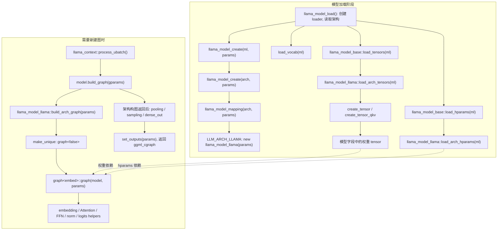

# week3 day3

本文回答 [第 3 周学习路线 Day3](../../003-llama-cpp-week3-daily-learning-route.md) 的当天输出与验收: 工厂到 graph 的调用图、权重声明/使用表、合并 QKV 和 tied output 分支, 以及从权重名称追到 shape 和计算位置的方法。

源码基准为当前工作区 `dd545f7e7`。本文采用普通 dense Llama、单 sequence、单 KV stream、无 LoRA 的主线, 假定 `D=H*Dh`, Q/K/V 的 head dimension 相同。涉及重新读取 GGUF、运行模型、GDB 或 eval callback 的手动实验暂时跳过; 所有运行结果均不作新增实测声明。

符号沿用 Day1: `D/H/KvH/Dh/I/V` 分别为 hidden size、Q head 数、KV head 数、head dimension、FFN 中间宽度、词表大小; `N` 是当前 ubatch 的输入 token 数, `O` 是请求输出的位置数。逻辑权重使用 `[out,in]`, GGML 二维权重用 `ne=[in,out]`, 表中省略尾部的 1。

## 习题1: 从模型工厂到 graph 的调用图

### 1. 三层继承与三个架构接口

```text
llama_model
  -> llama_model_base
       -> llama_model_llama
```

这里的箭头表示从父类到子类, 各层职责如下。

| 类型 | 职责 |
| --- | --- |
| `llama_model` | 保存 `hparams`、`vocab`、`tok_embd`、`output`、`layers` 等模型状态, 声明加载和架构接口, 提供通用 `build_graph()` 包装层 |
| `llama_model_base` | 实现公共的 `load_hparams()`、`load_vocab()`、`load_tensors()` 等流程, 提供 `create_tensor()`、`create_tensor_qkv()` 和名称 helper `tn` |
| `llama_model_llama` | 实现 Llama 的三个架构接口, 声明嵌套的 `graph<embed>` 构图类型 |

注意公共加载实现的准确类名是 `llama_model_base::load_hparams()` 和 `llama_model_base::load_tensors()`; 模型对象上的 `load_*` 调用会使用相应的虚函数实现。

| 架构接口 | 谁调用它 | Llama 中做什么 | 得到什么 |
| --- | --- | --- | --- |
| `load_arch_hparams(ml)` | 公共 `load_hparams()` | 读取 RMS epsilon; 利用层数、词表大小、head 配置等判断模型规格 `type` | 补全架构相关配置, 不计算激活 |
| `load_arch_tensors(ml)` | 公共 `load_tensors()` | 按名称及预期 shape 创建/取得 embedding、norm、QKV、attention output、FFN、lm head 等权重 tensor | 将权重 tensor 指针保存到模型字段 |
| `build_arch_graph(params)` | 通用 `llama_model::build_graph()` | 创建 `graph<false>` 对象, 其构造函数用模型权重和本次输入描述连接计算节点 | 返回 `unique_ptr<llm_graph_context>`, 其中关联了构图结果 |

D、H、KvH、I 等公共配置先由 `llama_model_base::load_hparams()` 读取, 不能以为所有超参数都只在 `load_arch_hparams()` 中读取。`load_arch_tensors()` 开头的 `LLAMA_LOAD_LOCALS` 则将已有配置取为局部变量, 如 `n_embd=D`、`n_head=H`、`n_ff=I`、`n_vocab=V`。

### 2. 调用关系图



图中加载阶段的多个分支由外层 `llama_model_load()` 按顺序调用: 先创建模型对象, 再加载超参数、词表和权重, 省略了设备准备、统计等步骤。不是 `llama_model_mapping()` 自己加载权重或构建计算图。

工厂的架构选择沿用 Day2 的链条:

```text
general.architecture 的 value "llama"
  -> llm_arch_from_string("llama")
  -> LLM_ARCH_LLAMA
  -> llama_model_mapping() 中对应分支
  -> llama_model_llama 对象
```

这里有两次用途不同的对象构造: `new llama_model_llama(params)` 创建保存配置和权重的模型对象; 后续 `make_unique<graph<false>>(*this,params)` 才进入真正连接计算节点的 graph 构造函数。

`process_ubatch()` 在不能复用已有图时调用 `model.build_graph(gparams)`。模型初始化时也可能为图预留等目的调用构图入口, 因此不能仅凭进入 builder 就断言发生了一次实际推理。Day3 只需掌握入口, 图复用细节留到后续。

### 3. build_arch_graph 与 build_graph 各自负责什么

当前 Llama 实现是:

```cpp
std::unique_ptr<llm_graph_context> llama_model_llama::build_arch_graph(const llm_graph_params & params) const {
    return std::make_unique<graph<false>>(*this, params);
}
```

`graph<false>` 走带 KV cache 的 attention 路径, 并在 `if constexpr (!embed)` 分支中构建 lm head 和 `res->t_logits`。其构造函数的普通 dense 主线为:

```text
build_inp_embd(model.tok_embd)
  -> 每层 attention norm
  -> build_qkv() + Q/K RoPE
  -> build_attn(..., wo, ...)
  -> 第一次 residual
  -> FFN norm + build_ffn(..., LLM_FFN_SILU, LLM_FFN_PAR, ...)
  -> 第二次 residual
  -> 下一层
  -> 最终 output norm
  -> build_lora_mm(model.output, ...)
  -> res->t_logits
  -> ggml_build_forward_expand(gf, cur)
```

最后一层会按需要提前选出 O 个输出位置, 所以其后半段和最终 logits 的 token 维度可能由 N 变为 O。此处省略选行和可选分支的展开, 但不能把最终 logits 一律写成 `[V,N]`。

通用 `llama_model::build_graph()` 在架构构图后还依次调用:

| 包装层步骤 | 是否一定添加节点 |
| --- | --- |
| `build_pooling(...)` | 否; 未请求 embeddings 时直接返回, 具体处理还取决于 pooling 类型 |
| `build_sampling()` | 否; `samplers` 为空或没有 logits 时直接返回, 否则可添加 backend sampling 节点 |
| `build_dense_out(...)` | 否; 需要 embeddings 模式和相应的附加 dense 权重 |
| `res->set_outputs(params)` | 标记需要的图输出, 如 logits、embedding 等 |
| `res->get_gf()` | 返回最终 `ggml_cgraph *` |

因此“模型架构图构建完毕”和“通用包装层返回最终图”是两个位置。本周重点仍是普通 logits 路径。`build_*` 和 `ggml_build_forward_expand()` 描述或收集依赖, 不执行数值运算; 实际处理 ubatch 时, 新建图之后还要分配图内存、`set_inputs()` 和 `graph_compute()`。

## 习题2: 权重声明与 graph 使用表

### 1. 符号 shape 与已有模型数值

下表的声明和使用位置以 Llama 源码为主线。数值列单独引用 [第 2 周 Day1 模型记录](../week2/01.%20week2-day1/01.%20week2-day1.md) 的 Qwen2 配置:

```text
文件记录: deepseek-r1-1.5b-f16.gguf
配置记录: D=1536, H=12, KvH=2, Dh=128, I=8960, V=151936
推导:     H*Dh=1536, KvH*Dh=256
```

**数值列是依据已有 Qwen2 记录代入, 本次未复测, 不作为真实 Llama 的观测。** 既有文档已经注明原始日志只输出了 metadata key, 未直接显示所有 value; 特别是 H、KvH、Dh 的解释需要结合配置, 不能只凭投影矩阵宽度唯一确定 head 数。norm 的数值 shape 在这里按 D 推导。

以下层内字段均指 `model.layers[il]` 的成员, 名称中的 `<il>` 是 block 索引; 独立 Q/K/V 权重表适用于未采用合并权重的分支。

| 模型权重字段 | 常见 GGUF 名称 | 逻辑 shape | GGML `ne[]` 预测 | 已有 Qwen2 配置代入的 `ne[]` | graph 使用位置 |
| --- | --- | --- | --- | --- | --- |
| `tok_embd` | `token_embd.weight` | `[V,D]` | `[D,V]` | `[1536,151936]` | `build_inp_embd()`; token 输入路径用 `ggml_get_rows()` 查表 |
| `attn_norm` | `blk.<il>.attn_norm.weight` | `[D]` | `[D]` | `[1536]` | attention 前的 `build_norm()`; RMSNorm 后乘 gamma |
| `ffn_norm` | `blk.<il>.ffn_norm.weight` | `[D]` | `[D]` | `[1536]` | FFN 前的 `build_norm()`; RMSNorm 后乘 gamma |
| `wq` | `blk.<il>.attn_q.weight` | `[H*Dh,D]` | `[D,H*Dh]` | `[1536,1536]` | `build_qkv()` 中 Q 投影 |
| `wk` | `blk.<il>.attn_k.weight` | `[KvH*Dh,D]` | `[D,KvH*Dh]` | `[1536,256]` | `build_qkv()` 中 K 投影 |
| `wv` | `blk.<il>.attn_v.weight` | `[KvH*Dh,D]` | `[D,KvH*Dh]` | `[1536,256]` | `build_qkv()` 中 V 投影 |
| `wo` | `blk.<il>.attn_output.weight` | `[D,H*Dh]` | `[H*Dh,D]` | `[1536,1536]` | `build_attn()` 内对拼接后的 heads 做输出投影 |
| `ffn_gate` | `blk.<il>.ffn_gate.weight` | `[I,D]` | `[D,I]` | `[1536,8960]` | `build_ffn()` 中 gate 投影, 随后做 SiLU 门控 |
| `ffn_up` | `blk.<il>.ffn_up.weight` | `[I,D]` | `[D,I]` | `[1536,8960]` | `build_ffn()` 中 up 投影, 与激活后的 gate 逐元素相乘 |
| `ffn_down` | `blk.<il>.ffn_down.weight` | `[D,I]` | `[I,D]` | `[8960,1536]` | `build_ffn()` 的 down 投影, 将中间宽度 I 恢复到 D |
| `output_norm` | `output_norm.weight` | `[D]` | `[D]` | `[1536]` | 所有 block 之后的 `build_norm()` |
| `output` | `output.weight`, 缺失时使用 `token_embd.weight` | `[V,D]` | `[D,V]` | `[1536,151936]` | 最后的 `build_lora_mm(model.output,...)`, 输出 `ne=[V,O]` |

`load_arch_tensors()` 中的 `{n_embd,n_ff}` 等参数就是 GGML 顺序的 shape, 不要再把它当成数学 `[out,in]`。例如 gate 的 `{n_embd,n_ff}` 是 `[D,I]`, down 的 `{n_ff,n_embd}` 是 `[I,D]`。

每个权重的 `create_tensor(...)` 会经过 loader 的名称查找和 shape 检查, 将 tensor 指针保存到相应字段; 文件数据的映射、上传等由公共加载流程处理。该函数并未计算 `Q=Xn Wq^T` 或 FFN 激活。

### 2. dense 路径和可选参数的边界

加载时, Llama 用 `n_expert == 0` 选择 dense FFN 权重声明; 构图时, 用 `model.layers[il].ffn_gate_inp == nullptr` 选择普通 `build_ffn()` 分支。正常的 dense 模型在这两处对应一致, 不能因为看到 `ffn_gate` 中的 gate 就把它当成 MoE router。

当前源码支持以下可选 bias, 是否存在取决于模型文件:

| 参数 | GGML `ne[]` |
| --- | --- |
| 独立 `wq_b` | `[H*Dh]` |
| 独立 `wk_b`、`wv_b` | `[KvH*Dh]` |
| 合并 `wqkv_b` | `[H*Dh+2*KvH*Dh]` |
| `wo_b` | `[D]` |
| `ffn_gate_b`、`ffn_up_b` | `[I]` |
| `ffn_down_b` | `[D]` |

这些参数以 `TENSOR_NOT_REQUIRED` 尝试加载, 缺失不要求报错; graph helper 在指针存在时才添加相应 bias。不能将“本周纸面公式省略 bias”理解为“当前 Llama 实现永远不支持 bias”。另外还存在可选的 RoPE factors 和 scale 参数, 本题不展开其特殊分支。

## 习题3: 合并 QKV 与 tied output 两个分支

### 1. 优先尝试合并 wqkv, 否则使用独立 wq/wk/wv

Llama 的 `load_arch_tensors()` 调用:

```cpp
create_tensor_qkv(layer, i, n_embd,
    n_embd_head_k * n_head, n_embd_k_gqa, n_embd_v_gqa, 0);
```

在本周假设下, 参数对应输入宽度 D、Q 输出宽度 `H*Dh`、K/V 输出宽度 `KvH*Dh`。普通文件加载路径如下:

```text
n_embd_qkv = H*Dh + KvH*Dh + KvH*Dh

尝试 blk.<il>.attn_qkv.weight
  预期 ne = [D,n_embd_qkv]
  标志为 TENSOR_NOT_REQUIRED | TENSOR_SKIP_IF_VIRTUAL
  |
  +-- layer.wqkv 非空:
  |     使用合并权重
  |     再尝试可选的 attn_qkv.bias
  |
  +-- layer.wqkv 为空:
        加载独立 attn_q.weight / attn_k.weight / attn_v.weight
        ne 分别为 [D,H*Dh] / [D,KvH*Dh] / [D,KvH*Dh]
        再尝试对应的三个可选 bias
```

这里的分支条件是 `layer.wqkv` 是否非空, 不是单看架构名。普通独立分支的三个 weight 使用调用方传入的 `flags=0`, 是必需权重; 缺失会在 loader 的检查阶段报错。`TENSOR_SKIP_IF_VIRTUAL` 用于无实际文件的虚拟加载路径, 避免自动选择合并权重; 该路径不作为本文的文件实测。

构图中的 `build_qkv()` 与加载结果相对应:

| 权重分支 | 投影操作 | 投影结果 `ne[]` | 拆 head 的方式 |
| --- | --- | --- | --- |
| `layer.wqkv` 非空 | 一次合并线性投影, 特征顺序为 Q、K、V | `[(H+2*KvH)*Dh,N]` | 三次 `ggml_view_3d()` 按 offset 和 stride 取出 Q/K/V |
| 独立 `wq/wk/wv` | 三次线性投影 | Q `[H*Dh,N]`, K/V `[KvH*Dh,N]` | 各自 `ggml_reshape_3d()` 拆 head |

两种路径最终都给出 Q `ne=[Dh,H,N,1]`、K/V `ne=[Dh,KvH,N,1]`。合并路径每个 token 的完整投影行含 Q、K、V 三段, 所以切出单段时要保留完整行的 stride, 不能随意用连续 reshape 代替 view。Q/K 随后在 Llama graph 中做 RoPE, V 不做。

这个分支说明的是权重表示方式和构图路径, 不表示本次已经观察到本地模型选择了其中哪一条。

### 2. output 缺失时复用 token embedding 权重

当前 Llama 权重声明中的关键代码是:

```cpp
output = create_tensor(tn(LLM_TENSOR_OUTPUT, "weight"),
                       {n_embd, n_vocab}, TENSOR_NOT_REQUIRED);

if (output == NULL) {
    output = create_tensor(tn(LLM_TENSOR_TOKEN_EMBD, "weight"),
                           {n_embd, n_vocab}, TENSOR_DUPLICATED);
}
```

| 条件 | `model.output` 的权重来源 | 计算含义 |
| --- | --- | --- |
| 成功加载 `output.weight` | 独立的 output 权重 | `logits = Ynorm Wout^T` |
| `output == NULL` | 按 `token_embd.weight` 的名称再次取得权重 | `Wout=E`, 即 `logits = Ynorm E^T` |

embedding 表 E 的逻辑 shape 是 `[V,D]`, GGML `ne=[D,V]`。输入端按 token id 从 E 查行, 得到 `[N,D]` 激活; 输出端把同一套权重当作词表投影矩阵, 将 `[O,D]` 的 `Ynorm` 变成 `[O,V]` 的 logits。共享的是权重数值, 两端的计算角色不同。

**`TENSOR_DUPLICATED` 不等于保证 `output == tok_embd`。** 当前 loader 会将带该标志的 token embedding 按 output 角色考虑放置; 若目标 buffer type 对应的 context 已有同名 tensor, 就返回现有对象, 否则创建另一份 tensor 描述并安排相同来源的权重。因而可能复用同一 tensor, 也可能因放置需要使用另一份实例。判断 tied output 应看权重来源, 不应只看指针相等或物理内存是否共享。

本次未检查本地 GGUF 的实际 output 分支, 也未测量内存复用情况; 上述结论来自源码。

## 习题4: 为什么 load_arch_tensors 中是权重 shape, build_qkv 中是依赖 N 的激活 shape?

`load_arch_tensors()` 描述模型参数: 一个线性层需要多少输入特征、多少输出特征, 由模型配置决定。`build_qkv()` 则描述本次输入经过这些权重后生成的结果, 它还必须知道当前有多少个 token。`llm_graph_context` 的 `n_tokens` 来自 `ubatch.n_tokens`, 所以是本次构图参数。

以独立 Q 投影为例:

```text
权重 Wq:
  逻辑 shape = [H*Dh,D]
  GGML ne    = [D,H*Dh]
  来源        = layers[il].wq, 不包含 token 数 N

输入 Xn:
  逻辑 shape = [N,D]
  GGML ne    = [D,N]

Qflat = Xn Wq^T:
  GGML 调用  = ggml_mul_mat(ctx0,Wq,Xn)
  逻辑 shape = [N,H*Dh]
  GGML ne    = [H*Dh,N]

拆 head 后:
  逻辑 shape = [N,H,Dh]
  GGML ne    = [Dh,H,N,1]
```

在上述 Qwen2 记录的配置下, Wq 始终为 `ne=[1536,1536]`; 若纸面取 `N=3`, 投影结果是 `[1536,3]`, 拆 head 后是 `[128,12,3,1]`; 若 `N=1`, 激活变为 `[1536,1]` 和 `[128,12,1,1]`, Wq 不变。这是维度代入, 没有运行模型实验。

因此 `wq` 是固定参数, `Qcur` 是依赖输入的激活。`build_qkv()` 调用 `build_lora_mm()` 的名称不代表一定启用了 LoRA; 在无 LoRA、无额外 scale 的主线中, 它以 `ggml_mul_mat()` 表达普通线性投影。bias 若存在会改变结果数值, 不改变这里的 shape。

## 习题5: 从 blk.0.ffn_down.weight 追到字段、shape 和 graph 使用位置

### 1. 名称与模型字段

```text
LLM_TENSOR_FFN_DOWN
  -> LLM_TENSOR_NAMES 中的 "blk.%d.ffn_down"
  -> tn(LLM_TENSOR_FFN_DOWN,"weight",0)
  -> "blk.0.ffn_down.weight"
```

在 `llama_model_llama::load_arch_tensors()` 的 dense 分支中:

```cpp
auto & layer = layers[i];
layer.ffn_down = create_tensor(
    tn(LLM_TENSOR_FFN_DOWN, "weight", i), {n_ff, n_embd}, 0);
```

令 `i=0`, 可得到:

| 项目 | 答案 |
| --- | --- |
| GGUF 名称 | `blk.0.ffn_down.weight` |
| 模型字段 | `model.layers[0].ffn_down` |
| 逻辑权重 shape | `[D,I]` |
| GGML `ne[0..3]` | `[I,D,1,1]` |
| 已有 Qwen2 配置代入 | `[8960,1536,1,1]`, 本次未复测 |
| 作用 | 将 FFN 中间宽度 I 投影回 residual 使用的 hidden size D |

### 2. graph 中的调用链和公式

Llama graph 的 dense 分支将 `model.layers[il].ffn_down` 作为 `down` 参数传给 `build_ffn()`。调用链为:

```text
llama_model_llama::graph<embed>::graph()
  -> build_norm(..., model.layers[il].ffn_norm, ...)
  -> build_ffn(..., model.layers[il].ffn_down, ...,
               LLM_FFN_SILU, LLM_FFN_PAR, il)
       -> gate/up 投影
       -> ggml_swiglu_split(gate,up)
       -> cur = build_lora_mm(down,cur)
            -> ggml_mul_mat(ctx0,down,cur)
  -> 与 ffn_inp 相加, 完成第二次 residual
```

令 `Rn` 为 FFN norm 后的激活, `T` 为 SwiGLU 的中间结果, 省略 bias 和额外 scale:

```text
T = SiLU(Rn Wgate^T) .* (Rn Wup^T)       逻辑 shape [N,I]
F = T Wdown^T                           逻辑 shape [N,D]

GGML:
  Wdown.ne = [I,D]
  T.ne     = [I,N]
  ggml_mul_mat(Wdown,T).ne = [D,N]
```

down 投影沿 I 收缩, 把特征维度从 I 恢复为 D, 才能与 `ffn_inp` 做 residual 相加。若这是提前选行后的最后一层, 将这里激活 shape 中的 N 换成 O, 权重 `[I,D]` 不变。

后续运行时追踪不必要求日志一定出现独立的 `ffn_down-0` 名称: 当前 helper 对该名称的 callback 有条件判断, 返回值还会被调用方命名为 `ffn_out`。可靠的定位依据是模型字段、`MUL_MAT` 的输入依赖与 shape, 而不只是节点名。

## 手动实验与验收状态

| 验收项 | 本次状态 | 说明 |
| --- | --- | --- |
| 工厂、继承和三个架构接口 | 已完成源码核对 | 已区分模型对象创建、公共加载流程、Llama 架构接口和 graph 构造 |
| 工厂到 graph 的调用图 | 已完成 | 已标明加载阶段、需要新建图时的入口及权重依赖 |
| 权重声明/使用表 | 已完成源码推导 | 已列出核心权重字段、名称、shape、使用位置, Qwen2 历史数值单列 |
| 合并 QKV 分支 | 已完成源码核对 | 已说明加载优先级及 graph 中 view / reshape 的对应 |
| tied output 分支 | 已完成源码核对 | 已说明 fallback、权重角色与指针/物理存储的区别 |
| 权重 shape 与激活 shape | 已完成解释 | 权重由模型配置决定, 激活还依赖当前 N; 最后一层可使用 O |
| `blk.0.ffn_down.weight` 全链追踪 | 已完成 | 已追到 `layers[0].ffn_down`、`ne=[I,D]`、`build_ffn()` 和 down matmul |
| 重新读取真实 GGUF 的配置、bias 和分支 | 暂时跳过手动实验 | 未重新检查模型文件, 不宣称本地模型实际采用了合并 QKV 或 tied output |
| 运行 synthetic Llama / 真实模型, 用 GDB 或 callback 核对 | 暂时跳过手动实验 | 未运行构图或推理测试, 文中没有新增运行时 shape、指针或数值观测 |

## 源码核对入口

| 文件 | 定位内容 |
| --- | --- |
| [llama.cpp](../../../../src/llama.cpp) | `llama_model_load()` 如何串联工厂、hparams、词表和权重加载 |
| [llama-model.h](../../../../src/llama-model.h) | `llama_model`、`llama_model_base`、三个架构接口、`LLAMA_LOAD_LOCALS` |
| [models/models.h](../../../../src/models/models.h) | `llama_model_llama` 继承关系和 `graph<embed>` 声明 |
| [llama-model.cpp](../../../../src/llama-model.cpp) | 工厂、公共加载、`create_tensor_qkv()`、`llama_model::build_graph()` 包装层 |
| [models/llama.cpp](../../../../src/models/llama.cpp) | Llama 的 hparams、权重声明、tied output 和完整 graph 构造主线 |
| [llama-model-loader.cpp](../../../../src/llama-model-loader.cpp) | 名称/shape 检查、`TENSOR_SKIP_IF_VIRTUAL` 和 `TENSOR_DUPLICATED` 的处理 |
| [llama-graph.cpp](../../../../src/llama-graph.cpp) | `build_qkv()`、`build_ffn()`、`build_lora_mm()` 及 pooling/sampling/dense_out |
| [llama-context.cpp](../../../../src/llama-context.cpp) | `process_ubatch()` 中的新建图、分配、设输入和执行边界 |
| [llama-arch.cpp](../../../../src/llama-arch.cpp) | `LLM_TENSOR_FFN_DOWN` 到 `blk.%d.ffn_down` 的名称模板 |
