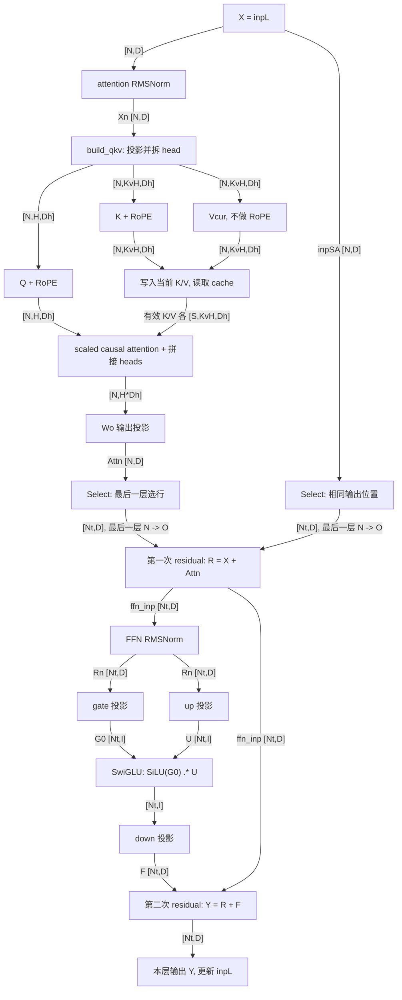

# week3 day4

本文回答 [第 3 周学习路线 Day4](../../003-llama-cpp-week3-daily-learning-route.md) 的当天输出与验收: 带 shape 的单层图、至少 10 个关键节点的预测表、最后一层选行, 以及 residual、图展开和两种 callback 的区别。

源码核对基准为当前工作区 `dd545f7e7`。以下采用普通 dense Llama、单 sequence、单 KV stream、causal attention、无 LoRA、无 control vector 的主线。为使 op 预测明确, 表格按独立 Q/K/V、非 Flash Attention、无 bias/额外 scale/clamp 的路径展开; 这些是纸面推导条件, 不是本次模型运行参数。手动实验暂时跳过, 文末单独记录状态。

## 习题1: 建图输入与带 shape 的单层图

### 1. 本文使用的维度

| 符号 | 含义 |
| --- | --- |
| `N` | 当前 ubatch 的输入 token 数, 也是本层 attention 的 query 数 |
| `S` | 本次 attention 涉及的有效历史及当前 token 总数, 每个 query 仍受 causal mask 限制 |
| `Kcap` | graph 使用的 KV 范围长度, 对应 `n_kv`, 可能包含 padding 或空槽 |
| `O` | 当前 ubatch 请求输出的 token 位置数 |
| `D/H/KvH/Dh` | hidden size / Q head 数 / KV head 数 / head dimension; 本周假定 `D=H*Dh`, Q/K/V 的 Dh 相同 |
| `I/V/L` | FFN 中间宽度 / 词表大小 / block 数 |
| `Nt` | 本文为简化图表引入的记号: 普通层为 N, 最后一层选行后为 O; 不是源码字段 |

逻辑激活按 `[token,feature]` 表示, 线性权重按 `[out,in]` 表示。注意力分数按 head 汇总为 `[H,N,S]`。GGML 的 `ne=[D,N]` 是 `[D,N,1,1]` 的简写, 不应把所有多维张量都机械倒序解释。

### 2. 四类输入分别服务于哪一步

普通 Llama 的 `build_arch_graph()` 创建 `graph<false>`, 构造函数首先调用以下入口。

| 构图入口 | 输入/描述及 shape | 服务的计算 |
| --- | --- | --- |
| `build_inp_embd(model.tok_embd)` | token ids 为 I32、`ne=[N]`; embedding 权重 `ne=[D,V]` | token 输入路径用 `ggml_get_rows()` 查词表, 得到逻辑 `[N,D]`、`ne=[D,N]` 的 `inpL` |
| `build_inp_pos()` | 普通 Llama 每个 token 一个 position, I32、`ne=[N]` | 传给 Q/K 的 `ggml_rope_ext()`, 让注意力携带位置信息 |
| `build_attn_inp_kv()` | 返回包含 KV context、写入索引及 mask 的输入对象; 单 stream 的 mask 为 `ne=[Kcap,N,1,1]` | 指定当前 K/V 写入的位置, 读取历史和当前 cache, 排除未来或无效 KV 位置 |
| `build_inp_out_ids()` | 输出位置索引为 I32、`ne=[O]` | 最后一层的两次 `ggml_get_rows()`, 将 attention 输出和 residual 支路同时从 N 行选为 O 行 |

这几种整数的含义不同: token id 是词表索引, position 是 RoPE 使用的位置, KV index 是 cache 写入地址的索引, out id 是当前 ubatch 内需要输出的行号。它们不能互相代替。

KV indices 的长度也不能统一猜成 N: 当前 K 写入索引为 I64、`ne=[N]`; V 的索引长度取决于 cache 布局, 转置 V 的路径会展开到 `N * n_embd_v_gqa_max()`。Day4 只需明确它们用于写 cache, 具体 cell 管理留到后续。

这些 helper 先建立输入 tensor 和输入对象, 实际 token、position、mask、out ids 等内容随后由 `set_inputs()` 填入。`build_inp_embd()` 还支持直接 embedding 输入, 本文只沿 token ids 路径说明。

### 3. 单层主干图

下图边上的 shape 是逻辑 shape。图中将 KV 写入/读取及 attention 内部运算合并表示, 权重、position、mask 和 out ids 的旁路输入见上表。两个 Select 框只在最后一层执行, 其他层按直通理解; `Nt=N` 或 `Nt=O` 与此对应。



普通层将 Y 送入下一层, 所以 `Nt=N`。最后一层后才执行下面的尾部, 它不属于每个 block:

```text
最后一层输出 Y_selected: 逻辑 [O,D], ne=[D,O]
  -> build_norm(..., model.output_norm, LLM_NORM_RMS, ...)
       逻辑 [O,D], ne=[D,O]; 保存为 res->t_embd
  -> build_lora_mm(model.output, ...)
       逻辑 [O,V], ne=[V,O]; 保存为 res->t_logits
```

### 4. 用公式核对主干顺序

先忽略最后一层选行, 对普通层写为:

```text
Xn = RMSNorm_attn(X)
Qflat = Xn Wq^T, Kflat = Xn Wk^T, Vflat = Xn Wv^T
Qcur = RoPE(reshape(Qflat),pos)
Kcur = RoPE(reshape(Kflat),pos)
Vcur = reshape(Vflat)

对每个 Q head h, 使用 KV head j(h)=floor(h/(H/KvH)):
P_h = softmax(Qcur_h Kcache_j(h)^T / sqrt(Dh) + mask)
Z_h = P_h Vcache_j(h)
Attn = concat_heads(Z_h) Wo^T

R = X + Attn
Rn = RMSNorm_ffn(R)
G0 = Rn Wgate^T
U  = Rn Wup^T
F  = (SiLU(G0) .* U) Wdown^T
Y  = R + F
```

`build_qkv()` 已同时完成投影和拆 head, 调用方拿到的 Q/K/V 已是三维语义; RoPE 在该 helper 外只作用于 Q/K。V 不经过 RoPE。

`LLM_FFN_PAR` 表示 gate 和 up 都以同一份 Rn 为输入, 不是先做 up 再把 up 的结果送给 gate。普通 `LLM_FFN_SILU + LLM_FFN_PAR` 路径用 `ggml_swiglu_split(G0,U)` 表达 `SiLU(G0) .* U`, 所以实际图不要求分别出现独立的 SiLU 和逐元素乘法节点。

## 习题2: 关键节点预测表

以下是源码推导的阶段表, 编号用于阅读, 不是实际 graph node index。全部条目状态均为“预测, 未运行观察”。层号记为 `il`, 例如 `Qcur-il` 在第 0 层通常显示为 `Qcur-0`。

二维张量省略尾部的 1。attention 中逻辑 shape 的 S 只数有效 KV 位置, `ne[]` 的 Kcap 是实际参与 graph 的范围; 多出的无效位置由 mask 排除。Wq/Wk/Wv/Wo 和 FFN 权重的完整 shape 可对照 [Day3 权重表](week3-day3.md)。

### 1. embedding 与 Attention

| 编号 / 阶段 | 公式及主要输入 | 逻辑输出 shape | GGML 输出 `ne[]` | helper / 预期 op / 常见观察名 |
| --- | --- | --- | --- | --- |
| 1. embedding | ids `[N]`, E `[V,D]`; `X=E[ids]` | `[N,D]` | `[D,N]` | `build_inp_embd()` / `GET_ROWS` / `embd` |
| 2. attention RMS | X `[N,D]`; `X / sqrt(mean_D(X^2)+eps)` | `[N,D]` | `[D,N]` | `build_norm()` 内的 `RMS_NORM` / `norm-il` |
| 3. attention norm weight | 第 2 行结果与 gamma_attn `[D]` 逐元素相乘 | `[N,D]` | `[D,N]` | `MUL` / `attn_norm-il` |
| 4. Q projection | Xn `[N,D]`, Wq `[H*Dh,D]`; `Xn Wq^T` | `[N,H*Dh]` | `[H*Dh,N]` | `build_qkv()` / `MUL_MAT` / `Qcur-il` |
| 5. K projection | Xn `[N,D]`, Wk `[KvH*Dh,D]`; `Xn Wk^T` | `[N,KvH*Dh]` | `[KvH*Dh,N]` | `build_qkv()` / `MUL_MAT` / `Kcur-il` |
| 6. V projection | Xn `[N,D]`, Wv `[KvH*Dh,D]`; `Xn Wv^T` | `[N,KvH*Dh]` | `[KvH*Dh,N]` | `build_qkv()` / `MUL_MAT` / `Vcur-il` |
| 7. 拆 head | 对第 4-6 行结果拆出 head 轴 | Q `[N,H,Dh]`, K/V `[N,KvH,Dh]` | Q `[Dh,H,N,1]`, K/V `[Dh,KvH,N,1]` | 三次 `RESHAPE`; 仍可能命名为 `Qcur/Kcur/Vcur-il` |
| 8. Q RoPE | 已拆 head 的 Q 与 pos `[N]` | `[N,H,Dh]` | `[Dh,H,N,1]` | `ggml_rope_ext()` / `ROPE` / `Qcur-il` |
| 9. K RoPE | 已拆 head 的 K 与 pos `[N]` | `[N,KvH,Dh]` | `[Dh,KvH,N,1]` | `ggml_rope_ext()` / `ROPE` / `Kcur-il` |
| 10. QK score | 每个 head 的 Q `[N,Dh]` 与所用 K `[S,Dh]`; `Q K^T` | `[H,N,S]` | `[Kcap,N,H,1]` | `build_attn_mha()` / `MUL_MAT` / `kq-il` |
| 11. 概率 P | score、mask 和 `1/sqrt(Dh)`; `softmax(score/sqrt(Dh)+mask)` | `[H,N,S]` | `[Kcap,N,H,1]` | `ggml_soft_max_ext()` / `SOFT_MAX` / `kq_soft_max-il` |
| 12. 加权 V | 每个 head 的 P `[N,S]` 与 V `[S,Dh]`; `P V` | 每个 head `[N,Dh]`, 合记 `[H,N,Dh]` | `[Dh,N,H,1]` | `MUL_MAT` / `kqv-il` |
| 13. 拼接 heads | 将 head 输出换轴并连续化 | `[N,H*Dh]` | `[H*Dh,N]` | `PERMUTE + CONT`, 使用 `ggml_cont_2d()` / `kqv_out-il` |
| 14. Wo 投影 | Z `[N,H*Dh]`, Wo `[D,H*Dh]`; `Attn=Z Wo^T` | `[N,D]` | `[D,N]` | `build_attn()` 内 `build_lora_mm()` / `MUL_MAT` / `attn_out-il` |

第 10 行之前, `build_attn()` 构建当前 K/V 的 cache 写入, 再通过 `get_k()/get_v()` 取得含历史的 K/V。当前 K 已经过 RoPE, V 未经过 RoPE。写入 helper 名为 `cpy_k/cpy_v`, 不能据此断言图中 op 一定叫 `CPY`; 本文不把未核对的 cache 写入 op 当成观测结果。

两次 attention matmul 调用点的输入布局为:

```text
ggml_mul_mat(k,q):
  k.ne = [Dh,Kcap,KvH,1]
  q.ne = [Dh,N,H,1]
  沿 Dh 收缩, 输出 [Kcap,N,H,1]

ggml_mul_mat(v,P):
  v.ne = [Kcap,Dh,KvH,1]
  P.ne = [Kcap,N,H,1]
  沿 Kcap 收缩, 输出 [Dh,N,H,1]
```

P 沿 key 位置归一化, 即该布局的 `ne[0]`。这些形状需要换轴和正确的 stride 才能得到, 仅有 `ne[]` 还不足以证明连续布局; `nb[]` 的详细验证留给后续。

### 2. 选行、FFN、residual 与最终输出

| 编号 / 阶段 | 公式及主要输入 | 逻辑输出 shape | GGML 输出 `ne[]` | helper / 预期 op / 常见观察名 |
| --- | --- | --- | --- | --- |
| 15. 最后一层选 Attn | Attn `[N,D]`, out_ids `[O]`; `A_sel=Select(Attn)` | `[O,D]` | `[D,O]` | `GET_ROWS`; 不要求存在固定的单独 callback 名 |
| 16. 最后一层选 residual | X `[N,D]`, 同一 out_ids `[O]`; `X_sel=Select(X)` | `[O,D]` | `[D,O]` | `GET_ROWS`; 结果重新赋给 `inpSA` |
| 17. 第一次 residual | 普通层 `R=X+Attn`; 最后一层 `R=X_sel+A_sel` | `[Nt,D]` | `[D,Nt]` | `ADD` / `ffn_inp-il` |
| 18. FFN RMS | R `[Nt,D]`; `R/sqrt(mean_D(R^2)+eps)` | `[Nt,D]` | `[D,Nt]` | `RMS_NORM` / `norm-il` |
| 19. FFN norm weight | 第 18 行结果与 gamma_ffn `[D]` 相乘 | `[Nt,D]` | `[D,Nt]` | `MUL` / `ffn_norm-il` |
| 20. gate projection | Rn `[Nt,D]`, Wgate `[I,D]`; `G0=Rn Wgate^T` | `[Nt,I]` | `[I,Nt]` | `build_ffn()` / `MUL_MAT` / `ffn_gate-il` |
| 21. up projection | 同一 Rn `[Nt,D]`, Wup `[I,D]`; `U=Rn Wup^T` | `[Nt,I]` | `[I,Nt]` | `build_ffn()` / `MUL_MAT` / `ffn_up-il` |
| 22. SwiGLU | G0、U 均为 `[Nt,I]`; `T=SiLU(G0).*U` | `[Nt,I]` | `[I,Nt]` | `ggml_swiglu_split()` / `GLU` 的 `SWIGLU` 子类型 / `ffn_swiglu-il` |
| 23. down projection | T `[Nt,I]`, Wdown `[D,I]`; `F=T Wdown^T` | `[Nt,D]` | `[D,Nt]` | `build_lora_mm()` / `MUL_MAT`; helper 返回值会被命名为 `ffn_out-il` |
| 24. 第二次 residual | F 与保留的 R, 都为 `[Nt,D]`; `Y=R+F` | `[Nt,D]` | `[D,Nt]` | `ADD`; 先可命名为 `ffn_out-il`, 后为 `l_out-il` |
| 25. 最终 output RMS | 最后一层 Y `[O,D]`; 沿 D 做 RMSNorm 的归一化部分 | `[O,D]` | `[D,O]` | `RMS_NORM` / `norm` |
| 26. 最终 norm weight | 第 25 行结果与 `model.output_norm` `[D]` 相乘 | `[O,D]` | `[D,O]` | `MUL` / `result_norm`; `res->t_embd` 指向该结果 |
| 27. lm head | Ynorm `[O,D]`, Wout `[V,D]`; `logits=Ynorm Wout^T` | `[O,V]` | `[V,O]` | `MUL_MAT` / `result_output`; `res->t_logits` 指向该结果 |

第 15、16 行只属于最后一层, 第 25-27 行只在所有 block 之后执行。gate/up 在数学上并行, 实际 helper 先构建 up 再构建 gate; 表格编号不代表严格构图顺序或 kernel 执行顺序。

预测表中的名字也不是节点的唯一标识: 投影、reshape、RoPE 可能复用 `Qcur-il`; 两次 norm 的中间结果可能同名; FFN 输出与 residual 后结果也可能先后使用 `ffn_out-il`。核对时应同时看 `op`、`ne[]`、`src[]` 和 tensor 指针/图节点索引。

如果实际使用合并 QKV, 投影和拆 head 的节点会改为合并 matmul 加 view; 使用 Flash Attention 时, 不应要求独立出现 score、softmax、加权 V 三个节点。`ggml_op_desc()` 对 `GLU` 会给出具体子类型, 所以 callback 日志可能显示 `SWIGLU`, 而不是原始枚举名 `GLU`。

## 习题3: 最后一层为什么同时对两条支路选行?

### 1. 源码位置与 shape 变化

关键代码位于 attention 输出投影之后、第一次 residual 之前:

```cpp
if (il == n_layer - 1 && inp_out_ids) {
    cur   = ggml_get_rows(ctx0,   cur, inp_out_ids);
    inpSA = ggml_get_rows(ctx0, inpSA, inp_out_ids);
}
ggml_tensor * ffn_inp = ggml_add(ctx0, cur, inpSA);
```

此时 `cur` 是 attention 输出投影结果 Attn, `inpSA` 是本层原始输入 X。

```text
cur:   [N,D] -> Select -> [O,D]
inpSA: [N,D] -> Select -> [O,D]
                         |
                         +-> ffn_inp = cur + inpSA: [O,D]
                               -> FFN norm / FFN / 第二次 residual
                               -> 最终 norm: [O,D]
                               -> logits: [O,V]
```

两条支路必须选择同一批 token, 才能逐行相加。只选 attention 输出而保留全部 residual 输入, 会造成 token 维度或位置对应关系错误。

### 2. 纸面例子与提前选行的依据

设 `N=4`, `O=2`, `inp_out_ids=[1,3]`, 则第一次 residual 应为:

```text
R[0] = X[1] + Attn[1]
R[1] = X[3] + Attn[3]
```

不能把 `Attn[1]` 加到 `X[0]` 上。out ids 是 ubatch 内的行号, 不是词表中的 token id, 也不一定等于序列的绝对 position。

同一组索引下有:

```text
Select(X + Attn) = Select(X) + Select(Attn)
```

后面的 RMSNorm、dense FFN、residual 和 lm head 都逐 token 独立, 因此对所选位置来说, 先选行再执行这些操作与先计算全部 token 再选出对应结果等价。这能减少最后一层后半段和输出投影的计算。

但不能直接把整个层输入裁成 O 个 token 再照常执行 attention: 未请求输出的 token 仍可能提供所需的 K/V, 且当前 token 的 K/V 还需要进入 cache。当前实现保留 N 个 token 的 Q/K/V 与 attention, 在 Wo 之后才选行; 前面各层也保留 N 个 token, 供后续层继续使用。

### 3. O=N 时也可能保留选行节点

更准确地说, 当前 `build_inp_out_ids()` 实现会创建长度为 `n_outputs` 的索引 tensor, 没有启用“O=N 就省略选行”的优化。`llm_graph_input_out_ids::set_input()` 在 `n_outputs==n_tokens` 时填入 `[0,1,...,N-1]`。

所以当前普通 Llama 路径最后一层即使 O=N, 也会经过这两次 `GET_ROWS`, 只是内容相当于按原顺序取全体行。源码注释说明保留这些节点有助于维持图拓扑稳定, 例如服务于 pipeline parallelism。不能仅凭 `N==O` 就预测图里一定没有选行节点。

## 习题4: inpSA 与 ffn_inp 分别保存哪一次 residual 输入?

| 变量 | 赋值时机 | 保存的语义 | 在哪里使用 |
| --- | --- | --- | --- |
| `inpSA` | 每层开头 `inpSA=inpL` | attention norm 之前的本层输入 X; 最后一层选行后改为所选 X | 第一次 residual: `ffn_inp = cur + inpSA` |
| `ffn_inp` | attention 输出投影并按需选行之后 | 第一次 residual 的结果 R | 既送入 FFN norm, 又保留到第二次 residual: `cur = cur + ffn_inp` |
| `cur` | 构图中反复赋值 | 当前阶段的 tensor 指针, 可依次代表 norm、投影、FFN 输出等不同结果 | 不能把它始终解释为同一块激活 |
| `inpL` | 每层结束 `inpL=cur` | 该层最终输出 Y | 下一层输入, 或最后一层后的 output norm 输入 |

两条 residual 的完整公式为:

```text
R = X + Attention(RMSNorm_attn(X))
Y = R + FFN(RMSNorm_ffn(R))
```

因此第一条跳连加回原始 X, 第二条跳连加回 R, 都不是加回 norm 后的结果。`inpSA=inpL` 只是保存 tensor 指针, 不会复制数据或新增计算节点; `cur=...` 的赋值也不表示覆盖已有 tensor 的数值。

源码在第二次 residual 后仍调用 `build_cvec()`。本题未启用 control vector 时, `apply_to()` 返回原 tensor, 不新增数值变换, 随后的 `cb(cur,"l_out",il)` 只是给该结果设置观察名称。

## 习题5: ggml_build_forward_expand 为什么不是执行矩阵乘法?

需要区分“创建运算描述”“收集图依赖”“执行图”三个阶段。

| 阶段 | 源码入口 | 实际动作 |
| --- | --- | --- |
| 创建运算描述 | 例如 `ggml_mul_mat(ctx,W,X)` | 检查维度, 创建结果 tensor, 设置 `op=MUL_MAT`, `src[0]=W`, `src[1]=X` |
| 收集图依赖 | `ggml_build_forward_expand(gf,cur)` | 从 cur 沿 `src[]` 递归访问依赖, 去重, 更新使用计数和标记, 将叶子/运算节点登记到 graph |
| 执行图 | `llama_context::graph_compute()` 进入 backend scheduler | 在图内存准备和输入填充后, 由 backend 执行实际运算 |

当前 `ggml_build_forward_expand()` 的实现是调用 `ggml_build_forward_impl(cgraph,tensor,true,true)`, 后者进入 `ggml_visit_parents_graph()`。这里的 `compute=true` 会设置待计算标记, 不表示当场运行 kernel。代码在这条路径里处理的是节点、依赖、计数和标志。

Llama graph 构造函数末尾对最终 `cur` 调用 `ggml_build_forward_expand()`; attention helper 也会显式展开 Q/K/V 和 cache 写入等依赖。多次 expand 是把需要的节点纳入图, 不是重复执行多次矩阵乘法。

实际 ubatch 的新建图路径可概括为:

```text
model.build_graph(gparams)
  -> ggml_backend_sched_alloc_graph(...)
  -> res->set_inputs(&ubatch)
  -> llama_context::graph_compute(...)
  -> ggml_backend_sched_graph_compute_async(...)
```

因此构图时可以核对 `op/src/ne/nb` 等信息, 不能把尚未执行的中间 tensor 的 `data` 当成已经算好的激活结果。

## 习题6: cb() 与 common_debug_cb_eval() 不是同一个 callback

| 比较项 | 构图 `llm_graph_context::cb()` | 执行调试 `common_debug_cb_eval()` |
| --- | --- | --- |
| 谁触发 | graph constructor 和 `build_*` helper 主动调用 | backend scheduler 在图求值流程中调用 |
| 接入位置 | `llm_graph_params.cb`, 普通 context 由 `graph_get_cb()` 提供 | `cparams.cb_eval` / `cb_eval_user_data`, 注册到 scheduler |
| 参数关注点 | 当前 tensor、语义名 name、层号 il; 转发时还传入 ubatch | tensor、`ask`、用户数据 |
| 主要用途 | 设置名称, 并在特定条件下给 scheduler 提供 backend 放置指定 | 选择要观察的 tensor, 读取并打印执行结果 |
| 能否据此读取有效激活 | 调用时可能尚未分配或执行, 不能据此认定 data 有效 | `ask=false` 的数据收集阶段才用于读取所观察的计算结果 |
| 是否可能不触发 | 图复用时不必重新经过构图 callback | 未注册 eval callback 时不会通过该函数收集结果 |

构图 callback 的具体链条是:

```text
cb(cur,"Qcur",0)
  -> llm_graph_context::cb() 调用 cb_func
  -> llama_context::graph_get_cb() 提供的函数
  -> ggml_format_name(cur,"%s-%d","Qcur",0)
  -> 名称为 Qcur-0
```

`il<0` 时直接使用传入名称, 所以全局输出可以叫 `result_norm` 或 `result_output`。同一个构图 hook 还会在特定条件下对 `norm`、`l_last` 等节点调用 `ggml_backend_sched_set_tensor_backend()`; 这不表示它亲自执行节点。

执行 callback 的 `ask` 分两阶段:

1. `ask=true`: scheduler 询问是否希望观察该 tensor; 当前 `common_debug_cb_eval()` 返回 true。
2. `ask=false`: 进入实际收集, 根据过滤规则打印名称、op、shape 等; 对非 host buffer 先取回数据, 对符合条件的非量化 tensor 打印数值。

因此看到 `cb(Qcur,"Qcur",il)` 只能说明构图中正在给一个阶段命名/安排放置, 不能当成已经取得该阶段运行结果的证据。

## 手动实验与验收状态

| 验收项 | 本次状态 | 说明 |
| --- | --- | --- |
| 带 shape 的单层图 | 已完成源码推导 | 已标明 Attention、FFN、两条 residual, 两处最后一层 `N -> O` |
| 至少 10 个关键节点的预测表 | 已完成 | 共列出 27 个关键阶段, 包含公式、输入、逻辑 shape、`ne[]`、helper/op 和常见名称; 不是实际图节点计数 |
| 最后一层选行说明 | 已完成源码核对 | 已解释双支路同步选行、提前选行等价性和 O=N 时的当前行为 |
| `inpSA` / `ffn_inp` | 已完成解释 | 分别保留 X 与第一次 residual 结果 R |
| `ggml_build_forward_expand()` | 已完成源码核对 | 收集图依赖并设置标记, 不执行 matmul |
| 构图与执行 callback | 已完成解释 | 已区分命名/放置 hook 和 `ask` 两阶段的数据观察 |
| 启动模型、GDB 或 eval callback 实测 | 暂时跳过手动实验 | 未运行 synthetic Llama 或真实 GGUF; 未取得实际 node index、`nb[]`、指针或激活数值 |

本次的完成项是 Day4 所需的图、预测和源码解释。运行时核对保留到后续实验, 不将表格中的预测值当作观测记录。

## 源码核对入口

| 文件 | 定位内容 |
| --- | --- |
| [models/llama.cpp](../../../../src/models/llama.cpp) | `graph<embed>::graph()` 的两次 residual、RoPE、dense FFN、最后一层选行和 logits |
| [llama-graph.cpp](../../../../src/llama-graph.cpp) | 四类输入 helper、out ids 的填充、`build_norm()`、`build_qkv()`、`build_attn()`、`build_ffn()`、构图 `cb()` |
| [llama-context.cpp](../../../../src/llama-context.cpp) | `graph_get_cb()`、eval callback 注册、`process_ubatch()` 和 `graph_compute()` |
| [ggml.c](../../../../ggml/src/ggml.c) | `ggml_mul_mat()`、`ggml_glu_impl()`、`ggml_op_desc()`、`ggml_build_forward_expand()` 和依赖遍历 |
| [common/debug.cpp](../../../../common/debug.cpp) | `common_debug_cb_eval()` 的 `ask` 分支与数据读取/打印 |
| [llama-kv-cache.cpp](../../../../src/llama-kv-cache.cpp) | `build_input_k_idxs()`、`build_input_v_idxs()` 的索引布局 |
| [llama-adapter.cpp](../../../../src/llama-adapter.cpp) | 未启用 control vector 时 `llama_adapter_cvec::apply_to()` 的直通行为 |
