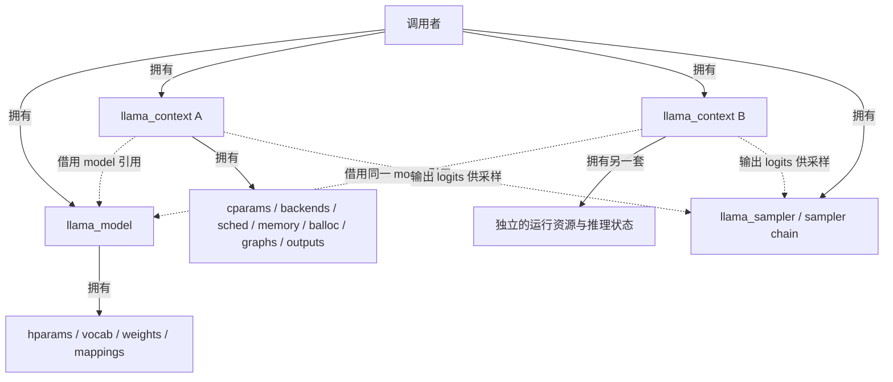

# week4 day1

本文解答[第 4 周学习路线](../../004-llama-cpp-week4-daily-learning-route.md)中 Day 1 的“当天输出与验收”, 包括 context 所有权、初始化顺序、请求参数与有效参数、四类内存以及图预留的含义。

源码核对基准为当前工作区 `dd545f7e7`, 与路线标注的 `545ddb30a` 不同。以下以 CPU、普通 decoder-only Transformer、causal attention、非 vocab-only、正常分配内存、无 LoRA、无 backend sampling 为主要范围。所有数值和日志片段都是源码推导, 未运行模型、GDB 或性能实验; 需要手动实验的项目在文末说明。

## 1. context 所有权图

### 1.1 model、context 与 sampler 的关系

`llama_model` 保存模型超参数、词表、权重 tensor 及权重存储。`llama_context` 通过 `const llama_model & model` 引用它, 同时管理本次推理所需的运行资源和持久状态。普通 CPU sampler 由调用者单独管理, 从 context 的输出中选择下一个 token。



图中的输出连线表示数据使用关系, 不表示 sampler 拥有 context。实际多会话程序通常为各自的随机数状态和采样历史配置独立 sampler。

**为什么一个 model 可以供多个 context 使用?** 普通推理读取相同权重, 而每个 context 分别维护自己的 KV、有效参数、图调度和输出。因此不需要为了另一段独立会话重复加载一份权重。共享 model 不意味着两个 context 自动共享 KV 或生成历史。

**释放顺序:** 在本题无 backend sampling 的范围内, 停止使用相关对象后, 可以按示例程序的 `llama_sampler_free(smpl)`、`llama_free(ctx)`、`llama_model_free(model)` 释放。存在多个 context 时, 必须先释放所有引用该 model 的 context, 最后释放 model。普通 sampler 与 context 之间没有强制的相互析构顺序, 硬性依赖是 model 必须活得比引用它的 context 更久。

`llama_free()` 只 `delete ctx`, 不释放其引用的 model。context 析构会先 `synchronize()`, 等待未完成的异步操作, 包括写入输出 buffer 的复制, 随后成员通过 RAII 释放。若以后启用 backend sampling, context 保存的是调用者提供的 sampler 指针, 调用者还必须保证这些 sampler 在 context 使用期间存活。

### 1.2 成员职责与生命周期

| 对象 / 成员 | 职责 | 所有权、生命周期或边界 |
| --- | --- | --- |
| `const llama_model & model` | 访问架构、hparams、词表和权重 | 借用引用, 不复制或接管 model |
| `llama_cparams cparams` | 保存规范化后的运行参数 | context 内的值对象; 不等于原始 `llama_context_params` 的直接副本 |
| `backends` | 保存实际执行算子的 backend 实例 | `vector<ggml_backend_ptr>`, context 拥有这些实例 |
| `backend_cpu` | 快速访问 CPU backend, 设置线程池等 | 指向 `backends` 内 CPU 实例的非拥有别名, 不需要再独立释放 |
| `backend_ptrs` / `backend_buft` | 向 scheduler 提供 backend 指针及对应 buffer type | 指针和类型描述列表, 不代表额外复制一套 backend 或 compute buffer |
| `sched` | 图的 backend 放置、切分、compute buffer 规划和执行调度 | `ggml_backend_sched_ptr`; 在 `sched_reserve()` 内创建, 需要重新预留时可重建 |
| `memory` | 保存跨调用的推理状态 | `llama_memory_ptr`, 由 `model.create_memory()` 创建后交给 context 持有; 普通 Transformer 使用 KV cache, recurrent/hybrid 模型可使用其他实现, 某些模型返回空指针 |
| `balloc` | 校验 batch、补齐缺省字段、提供 ubatch 切分能力 | `unique_ptr<llama_batch_allocr>`, 在 context 内复用; 具体切分还由 memory 的 `init_batch()` 协调 |
| `gf_res_prev` | 保存实际计算使用的图、输入对象、输出 tensor 指针和复用判据 | context 拥有的 `llm_graph_result`; 可跨 ubatch 复用, 不是模型权重或 KV 的所有者 |
| `gf_res_reserve` | 保存预留或探测图的结果容器 | 同样由 context 拥有; 与实际计算图容器分开 |
| `buf_output` | 提供 host 可读的 logits / embeddings 等输出存储 | context 拥有的 backend buffer, 容量不足时可重新分配 |
| `logits` / `embd` | 描述输出数据的地址和长度 | `buffer_view<float>`, 是 `buf_output` 内的视图, 不是各自独立拥有的 buffer |
| `output_ids` / `output_swaps` | 保存 batch 位置到输出行的映射及重排信息 | context 内的 vector; `output_ids` 独立于 `buf_output`, 初始化长度为生效 `n_batch` |

这里的“graph result”不等于一份永久保存的数值结果。它主要管理图及 tensor 元数据、输入设置对象和输出 tensor 引用; tensor 的计算数据空间由 scheduler 等资源提供。

## 2. 初始化顺序

入口为 `llama_init_from_model(model, params)`, 普通路径如下:

```text
llama_init_from_model(model, params)
  -> 校验 model 与参数, 处理部分架构 / 类型约束
  -> new llama_context(*model, params)
       -> 绑定 model 引用, 初始化 cvec / loras / balloc
       -> 规范化 cparams, 确定 batch 上限并对齐 context 容量
       -> 初始化模型设备 backends
       -> 添加 ACCEL backends, 再添加 CPU backend
       -> 收集线程设置函数, 设置 abort callback
       -> output_reserve(params.n_seq_max)
       -> memory.reset(model.create_memory(params_mem, cparams))
       -> 收集 backend_ptrs / backend_buft / 预期 buffer 大小
       -> 确定 pipeline_parallel
       -> sched_reserve()
            -> 建立 gf_res_prev / gf_res_reserve
            -> ggml_backend_sched_new(...)
            -> memory->init_full(), 若 memory 存在
            -> resolve_fused_ops(...)
            -> PP 预留 -> TG 预留 -> 再次 PP 预留
       -> 完成后续兼容性检查和词表 token id 辅助数组初始化
  -> 返回 context
```

入口会拒绝空 model、`n_batch` 和 `n_ubatch` 同时为 0、请求 `n_ctx=0` 且模型训练 context 长度也为 0 等配置。构造函数抛出的标准异常由入口捕获, 记录错误后返回空指针。

需要注意的顺序有三点:

1. **先初始化 backend, 再分配初始输出 buffer。** 此时尚未创建 scheduler。`output_reserve()` 按至少 `n_seq_max` 个输出位置准备空间, 不代表已经生成了这些位置的 logits。
2. **先创建 memory, 再进行 scheduler 预留。** 预留图要根据 memory 提供的 KV 形状等信息估算计算空间。函数名 `model.create_memory()` 表示由 model 选择实现, 返回对象的所有权在 context。
3. **scheduler 在 `sched_reserve()` 内创建。** `sched` 成员的声明位置、`init backends` 注释都不能代替真实调用顺序。后者主要是在整理 backend / buffer type 列表和判断流水并行条件。

CPU 路径仍会创建 CPU backend; 如果存在 ACCEL backend, 也可能加入它们。`vocab_only` 会跳过上述主要运行资源初始化, 不应拿它与本题的完整推理 context 混为一谈。

## 3. 请求参数与有效参数

### 3.1 参数怎样变成实际限制

令 `p` 为传入构造函数的参数, `C0` 为选择模型默认值后、尚未对齐的 context 长度。当前实现按以下先后顺序计算:

```text
S  = max(1, p.n_seq_max), 且 S <= LLAMA_MAX_SEQ = 256
C0 = (p.n_ctx == 0) ? model.hparams.n_ctx_train : p.n_ctx

B  = causal_attn ? min(C0, p.n_batch) : p.n_batch
U  = min(B, (p.n_ubatch == 0) ? p.n_batch : p.n_ubatch)

C1 = PAD(C0, 256)

若 kv_unified == true:
    Cseq = C1
    C    = C1
否则:
    Cseq = PAD(floor(C1 / S), 256)
    要求 Cseq != 0
    C    = Cseq * S

最终:
    cparams.n_seq_max = S
    cparams.n_ctx     = C
    cparams.n_ctx_seq = Cseq
    cparams.n_batch   = B
    cparams.n_ubatch  = U
```

`PAD(x,256)` 表示向上对齐到 256 的整数倍。这是当前 checkout 的实现规则, 不能推广为所有版本都使用的固定 API 约定。

**顺序决定结果:** causal 模式计算 `B` 时使用的是 `C0`, 此时尚未执行 `n_ctx` 对齐。后面即使 context 容量变大, 也不会重新放大 `n_batch`。`n_ubatch=0` 使用请求 `n_batch` 作为候选值, 再受有效 `B` 限制, 因而在正常正数配置下最终为 `U=B`。不要将这一规则外推为 `n_batch=0` 也会自动补成正数。

| 参数 / 配置 | 请求值的含义 | 有效值的来源与限制 |
| --- | --- | --- |
| `n_ctx` | 请求的 context 容量; 0 表示取模型值 | 先取请求值或 `hparams.n_ctx_train`, 再对齐; 非 unified 模式还受 sequence 布局调整 |
| `n_ctx_seq` | 公共 params 中没有独立同名请求字段 | 根据 `n_ctx`、`n_seq_max` 和 `kv_unified` 派生 |
| `n_batch` | 单次提交的逻辑 token 数上限 | causal 模式为 `min(C0, p.n_batch)`; 非 causal 模式保留请求值 |
| `n_ubatch` | 单个物理计算批次的 token 数上限 | 不超过有效 `n_batch`; 0 按上述规则处理 |
| `n_seq_max` | context 的 sequence 数量限制参数 | 至少为 1, 超过 `LLAMA_MAX_SEQ` 时初始化失败; 不代表当前已经有这么多活跃 sequence |
| `attention_type` | 显式 attention 模式或 unspecified | unspecified 使用模型 `hparams.causal_attn`, 否则根据是否为 causal 设置 `cparams.causal_attn` |
| `kv_unified` | 是否使用统一的 KV 布局 | 影响 `n_ctx_seq` 和 memory 布局; 当前公共默认值为 false |
| `n_outputs_max` | 输出数量上限配置, 0 为默认处理 | 当前普通 decoder 路径中, 0 会得到有效 `n_batch`; 带 encoder 的模型还会强制采用有效 `n_batch` |
| `type_k` / `type_v` | KV 数据类型 | 经 `llama_memory_params` 传给 `create_memory()`, 不是简单复制到 `llama_cparams` |

`kv_unified=true` 时 `n_ctx_seq=n_ctx` 表示单条 sequence 可使用的 context 范围; 多条 sequence 仍共享这份容量, 不意味着每条都额外获得独立的 `n_ctx` 个槽位。非 unified 模式下则按每条 sequence 的对齐容量组织总容量。

`llama_context_default_params()` 在当前源码中的默认请求值包括 `n_ctx=512,n_batch=2048,n_ubatch=512,n_seq_max=1,kv_unified=false`。所以“`n_ctx=0` 会取模型值”不等于“默认函数返回 `n_ctx=0`”。公共 API 默认值也不能直接当作各个命令行工具的默认值。

### 3.2 题目给定参数的逐步推导

假设从公共默认参数开始, 设置 `n_ctx=10,n_batch=4,n_ubatch=2,n_seq_max=1`, 模型使用 causal attention, 其余相关配置保持 `kv_unified=false,n_outputs_max=0`。

```text
S    = max(1, 1)       = 1
C0   = 10
B    = min(10, 4)     = 4
U    = min(4, 2)      = 2
C1   = PAD(10, 256)   = 256
Cseq = PAD(256/1,256) = 256
C    = 256 * 1       = 256
n_outputs_max        = B = 4
```

| 项目 | 请求值 | 有效值 | 解释 |
| --- | ---: | ---: | --- |
| `n_ctx` | 10 | 256 | context 长度向上对齐 |
| `n_ctx_seq` | 无独立请求字段 | 256 | 单 sequence 的有效 context 长度 |
| `n_batch` | 4 | 4 | 在对齐前计算 `min(10,4)` |
| `n_ubatch` | 2 | 2 | `min(4,2)` |
| `n_seq_max` | 1 | 1 | 已满足有效范围 |
| `n_outputs_max` | 0 | 4 | 采用有效 `n_batch` 作为上限, 不是当前已有 4 个输出 |

以下只是**预测的初始化日志节选, 未执行验证**:

```text
llama_context: n_seq_max     = 1
llama_context: n_ctx         = 256
llama_context: n_ctx_seq     = 256
llama_context: n_batch       = 4
llama_context: n_ubatch      = 2
llama_context: causal_attn   = 1
llama_context: kv_unified    = false
llama_context: n_outputs_max = 4
```

如果模型 `n_ctx_train > 256`, 还会输出 `n_ctx_seq` 小于训练 context 长度的提示。具体训练长度、buffer 字节数、图节点数、scheduler split 数和耗时没有在本次任务中实测, 不填入猜测值。

这些限制也不等于实际工作量: `n_ctx=256` 不代表已经输入 256 个 token; `n_batch=4` 不代表每次必须提交 4 个 token; `n_ubatch=2` 不代表每张图一定处理 2 个 token。即使 context 已对齐到 256, 也不能一次向这个 context 提交 10 个 token, 因为 `decode()` 仍要求本次 token 数不超过有效 `n_batch=4`。

### 3.3 用对照例子检查规则

下表均为 causal attention 下的纸面推导, 其余参数满足初始化前置条件。

| 请求 `(n_ctx,n_batch,n_ubatch,n_seq_max)` | `kv_unified` | 有效 `(n_ctx,n_ctx_seq,n_batch,n_ubatch,n_seq_max)` | 说明 |
| --- | --- | --- | --- |
| `(10,4,2,1)` | false | `(256,256,4,2,1)` | 题目原例 |
| `(10,64,32,1)` | false | `(256,256,10,10,1)` | batch 先受未对齐的 10 限制, 不会随 context 放大到 64 |
| `(10,4,0,1)` | false | `(256,256,4,4,1)` | `n_ubatch=0` 的默认处理 |
| `(10,4,8,1)` | false | `(256,256,4,4,1)` | `n_ubatch` 被有效 `n_batch` 限制 |
| `(512,64,32,2)` | false | `(512,256,64,32,2)` | 两条 sequence 各有 256 的容量 |
| `(512,64,32,2)` | true | `(512,512,64,32,2)` | 共享 512 的总容量 |
| `(513,64,32,2)` | false | `(1024,512,64,32,2)` | 先得到 768, 每条的 384 再对齐到 512, 总容量调整为 1024 |

最后一例说明: 不要只根据日志中的 `rounding down` 字样判断调整方向, 应按实际赋值公式计算。

初始化后应通过 `llama_n_ctx()`、`llama_n_ctx_seq()`、`llama_n_batch()`、`llama_n_ubatch()`、`llama_n_seq_max()` 查询实际生效值; `include/llama.h` 也明确建议这样做。本次没有运行这些查询。

## 4. 四类内存的区别

| 类别 | 保存什么 | 谁管理 / 何时准备 | 生命周期与边界 |
| --- | --- | --- | --- |
| model weights | embedding、各层 attention / FFN 矩阵、norm 权重等 | model 加载阶段准备; `llama_model::impl` 管理权重 buffer、tensor 元数据和 mmap 映射等 | 跟随 model, 普通推理中主要被读取; 多个 context 可以引用同一份权重 |
| model memory / KV | 普通 Transformer 各层历史 K/V 及位置、sequence 等元数据; 其他模型可保存 recurrent state | context 的 `memory` 管理, 通过 `model.create_memory()` 选择实现并初始化 | 跨 decode 调用保留和更新, 服务于历史状态; 名称中的 model memory 不表示由 model 对象拥有 |
| compute buffer | 图输入、激活、中间结果及调度所需的计算空间 | context 的 scheduler 及其 graph allocator 管理, `sched_reserve()` 预留, 具体图执行前分配使用 | 可跨图复用分配容量, 但其中中间数值不是长期会话历史; 不负责保存模型参数 |
| output buffer | 给调用者读取的 logits、按配置提取的 embeddings 等 | context 的 `buf_output` 管理, `output_reserve()` 分配或扩容 | 随后输出可能覆盖内容或触发重新分配; `logits/embd` 只是其中的视图, 不应当作永久保存的结果 |

在纯 CPU 路径下, 这些存储可以都位于系统内存, 仍然属于不同的用途和所有权。不能用“在 CPU 还是 GPU”区分四类内存。

还有两个容易混淆的细节:

- `gf_res_prev` / `gf_res_reserve` 内的 `ctx_compute` 和 `buf_compute_meta` 保存图及 tensor 元数据。该 GGML context 使用 `no_alloc=true`, 实际计算数据空间另由 scheduler 分配, 不能把带有 `compute` 字样的成员全部看成同一块数据 buffer。
- 图内的 logits tensor 与 host 侧 `logits` 视图处于不同阶段。前者是计算图输出, 后者指向提取结果的 output buffer。output buffer 默认使用 CPU buffer type, 若输出设备提供适合传输的 host buffer type 则优先采用它。

对于题目参数, 初始 `output_reserve(1)` 按一个输出位置准备 logits 空间; 默认不提取 embeddings。此时 `output_ids` 已有 4 个位置且初始化为无效映射, `n_outputs=0`。这再次说明“分配输出容量”和“已有有效输出”是两回事。

## 5. `sched_reserve()` 的含义与验收解答

### 5.1 为什么调用它不一定重新预留?

`sched_need_reserve` 初始为 true。函数开头先检查它: 若为 false, 立即返回; 若为 true, 则先将它设为 false, 同步此前工作, 再创建图容器和 scheduler、完成预留。

正常初始化成功后, 后续 `encode()` / `decode()` 虽然仍会调用 `sched_reserve()`, 但如果没有新的预留需求, 就不会再次执行这套流程。改变 causal attention、更新 LoRA 配置或 backend sampler 等操作, 可将标志重新设为 true, 让下一次调用重新预留。这里应以实际 setter 的赋值为准, 不能假定任何参数改变都会触发它。

这与 `process_ubatch()` 判断实际图能否复用是两个层次。`sched_reserve()` 提前返回, 只说明本次无需整体重新预留; 当前 ubatch 仍可能因为形状等条件变化而重新构图。

### 5.2 `memory->init_full()` 做了什么?

它为预留生成“按完整 memory 容量考虑”的临时 memory context, 用于构造计算空间需求较大的图。

普通 KV 实现中, `llama_kv_cache::init_full()` 创建 `llama_kv_cache_context(this)`, 将 `n_kv` 设为 cache 大小, 并准备虚拟 slot 信息供构图使用。它没有提交用户 token, 也没有把虚构的 token 历史写入 KV。这里的 full 指预留时采用的形状范围, 不是 cache 已装满真实 prompt。

### 5.3 为什么会预留 PP、TG, 然后再次 PP?

`sched_reserve()` 使用如下尺寸准备图:

```text
n_seqs      = cparams.n_seq_max
n_tokens    = min(cparams.n_ctx, cparams.n_ubatch)
n_outputs_pp = min(n_tokens, cparams.n_outputs_max)

PP: graph_reserve(n_tokens, n_seqs, n_outputs_pp, mctx)
TG: graph_reserve(n_seqs,   n_seqs, n_seqs,       mctx)
PP: graph_reserve(n_tokens, n_seqs, n_outputs_pp, mctx)
```

第一次 PP 按 prompt processing 的多 token 形状准备计算空间; TG 按每条 sequence 一个 token 的生成形状预留并获取节点数、split 数; 最后再次 PP, 让 allocator 保持适合较大 PP 图的预留状态, 减少推理时重新分配。

题目中 `n_seqs=1,n_tokens=2,n_outputs_pp=2`, 所以三次调用参数依次为 `(2,1,2)`、`(1,1,1)`、`(2,1,2)`。这里 PP 使用的输出数是预留尺寸, 不代表真实 prompt 一定请求两个位置的 logits。

在这三次主要预留之前, `resolve_fused_ops()` 还可能通过 `graph_reserve(..., split_only=true)` 构图并检查算子的 backend 放置。因此不能将初始化 builder 命中次数硬编码为 3。多 sequence 时, `graph_reserve()` 还会将虚拟 token 数补到 sequence 数的整数倍; 这也不是对真实输入 token 数的观测。

### 5.4 初始图预留为什么不等于真实 prompt 执行?

`graph_reserve()` 内部的主要流程是:

```text
reset scheduler 与旧的实际图复用状态
  -> 用局部 llama_batch_allocr::ubatch_reserve() 准备虚拟 ubatch
  -> 使用 gf_res_reserve 构造 graph 参数
  -> model.build_graph(...)
  -> 普通路径: ggml_backend_sched_reserve(...)
       -> split graph
       -> graph allocator 预留计算 buffer
     或 split_only 路径: 只切图 / 估算大小
  -> 返回 graph
```

其中没有真实输入的 `set_inputs()` 和 `graph_compute()`。预留图中即使包含 KV 写入等算子节点, 也不代表已经执行这些节点。

真实 decode 的 ubatch 计算则在 `process_ubatch()` 中进行 memory context 的 `apply()`, 构建或复用图、必要时分配计算空间, 然后执行 `res->set_inputs(&ubatch)` 和 `graph_compute()`。后者调用 `ggml_backend_sched_graph_compute_async()` 才进入 scheduler 的实际计算路径。

因此, 在首次用户 decode 之前看到 builder 日志或断点命中, 可能只是初始化的尺寸预留或算子支持探测。判断是不是用户 prompt 推理, 要结合调用栈、输入来源和是否进入实际 compute。工具自己的 warmup 也可能执行真实计算, 但仍不能自动记为用户 prompt 的一次执行。

## 6. Day 1 验收与手动实验状态

| 验收项 | 答案 / 状态 |
| --- | --- |
| context 所有权图 | 已完成源码分析: model 被引用, context 持有运行资源; 多 context 可共享权重, 各自维护状态 |
| 初始化顺序 | 已完成源码分析: 参数规范化、backends、output、memory、backend 类型列表、scheduler 预留 |
| 请求值 / 有效值对照 | 已完成纸面推导: 题目有效值为 `n_ctx=256,n_ctx_seq=256,n_batch=4,n_ubatch=2,n_seq_max=1` |
| 四类内存 | 已说明 weights、memory/KV、compute、output 的用途、所有权和生命周期 |
| `sched_reserve()` 不一定重新预留 | 已由 `sched_need_reserve` 的提前返回分支说明 |
| 初始图预留不等于 prompt 执行 | 已由虚拟 ubatch、`init_full()` 及 reserve / compute 调用路径说明 |

**按要求暂时跳过以下手动实验, 未将它们标记为已验证:**

| 手动实验 | 本次处理 | 后续需要的证据 |
| --- | --- | --- |
| 使用题目参数创建 context, 检查初始化日志及查询 API 返回值 | 跳过; 只给出源码预测 | 实际请求参数、有效参数输出、运行所用 commit |
| 用 GDB 观察构造顺序和首次用户 decode 前的 builder 命中 | 跳过 | 区分 `sched_reserve -> graph_reserve` 与 `decode -> process_ubatch` 的调用栈 |
| 核对 PP/TG 预留图的节点数、split 数、buffer 大小和耗时 | 跳过; 不填写实测数值 | 原始日志和对应模型 / backend 配置 |
| 观察未改变配置时的提前返回, 以及配置改变后的重新预留 | 跳过 | `sched_need_reserve` 的值和函数分支记录 |

本次完成的是文档答案、源码核对和纸面推导。上述运行验证留待后续手动实验; 不将本地 DeepSeek-R1 蒸馏模型的文件名当成 Llama 架构实测证据, 路线中的该模型应按其实际 Qwen2 架构解释。

## 7. 源码核对入口

以下链接相对于本答案文件, 以函数名和成员名定位:

- [公共 API 与请求参数](../../../../include/llama.h): `llama_context_params`、`llama_n_ctx*`、`llama_n_batch`、`llama_n_ubatch`、sampler 生命周期说明。
- [context 定义](../../../../src/llama-context.h): `model`、`cparams`、`memory`、`backends`、`sched_need_reserve`、图容器和输出成员。
- [有效参数定义](../../../../src/llama-cparams.h): `llama_cparams`、`LLAMA_MAX_SEQ`。
- [context 实现](../../../../src/llama-context.cpp): `llama_context_default_params()`、`llama_init_from_model()`、构造 / 析构函数、`output_reserve()`、`sched_reserve()`、`graph_reserve()`、`process_ubatch()`、`graph_compute()`。
- [model 定义](../../../../src/llama-model.h)与[实现](../../../../src/llama-model.cpp): 权重成员、`llama_model::impl`、`create_memory()`。
- [memory 协议](../../../../src/llama-memory.h)与[普通 KV 实现](../../../../src/llama-kv-cache.cpp): `init_full()` 和用于预留的 `llama_kv_cache_context` 构造函数。
- [graph 结果容器](../../../../src/llama-graph.h)与[实现](../../../../src/llama-graph.cpp): `llm_graph_result`、`ctx_compute`、`buf_compute_meta`。
- [scheduler 实现](../../../../ggml/src/ggml-backend.cpp): `ggml_backend_sched_reserve()` 与 `ggml_backend_sched_graph_compute_async()` 的职责区别。
- [GGML 基础定义](../../../../ggml/include/ggml.h)与[RAII 封装](../../../../ggml/include/ggml-cpp.h): `GGML_PAD` 和各资源指针类型。
- [simple 示例](../../../../examples/simple/simple.cpp): 普通 sampler、context、model 的释放顺序。
