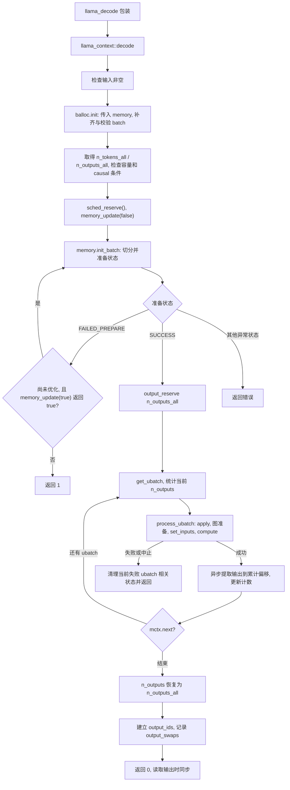

# week4 day3

本文解答[第 4 周学习路线](../../004-llama-cpp-week4-daily-learning-route.md)中 Day 3 的“当天输出与验收”: decode 主调用图、encode/decode 对照、prefill 与单 token 输入差异、causal 切分依据以及 memory 准备和应用的边界。

源码基准为当前工作区 `dd545f7e7`, 与路线标注的 `545ddb30a` 不同。主线限定为 CPU、普通 decoder-only Transformer、有 KV memory、causal attention、无 LoRA、无 backend sampling、普通 logits 输出。encode 只做源码分析; 未运行模型、GDB 或手动实验, 文中的输入和计数均为纸面例子。

## 1. API 名称与模型语义

公共包装函数分别将调用交给成员函数:

```text
llama_encode(ctx, batch) -> ctx->encode(batch)
llama_decode(ctx, batch) -> ctx->decode(batch)
```

**decoder-only 模型的 prompt prefill 和后续自回归 token 处理都走 `decode()`。** prefill 表示为已有 prompt 建立推理状态的阶段; encode 表示具体的编码计算路径。二者不是同义词。

`examples/simple/simple.cpp` 先将 prompt 包装为 batch, 再根据 `llama_model_has_encoder(model)` 分支:

| 模型 / 情况 | 首次输入路径 | 后续路径 |
| --- | --- | --- |
| 普通 decoder-only 模型 | prompt batch 直接交给 `llama_decode()` | 采样出的 token 再包装成单 token batch 交给 `llama_decode()` |
| 示例支持的 encoder-decoder 模型 | prompt 先交给 `llama_encode()` | 用模型 decoder start token, 缺省时回退到 BOS, 开始 decoder 的 `llama_decode()` 循环 |
| encoder-only / 合适的 embedding 模型 | 使用该模型支持的编码路径取得表示 | 不套用自回归生成循环 |

公共 API 注释将 decode 描述为需要 memory 的计算路径, 但当前成员函数还存在兼容分支:

```text
decode(batch_inp):
    要求至少有 token 或 embd 输入
    if memory == nullptr:
        return encode(batch_inp)
```

这是根据当前 context 是否有 memory 作出的转发, 不是根据“这是第一个 batch”来识别 prefill。普通 Qwen2 / Llama decoder-only context 有 KV memory, 首次 prompt 不会因为历史为空就进入此分支。历史为空与 memory 对象不存在是两件事。

## 2. 普通 decode 的主调用图

下面展示有 memory、无 backend sampler 的路径, 成功后才能进入 ubatch 循环:



### 2.1 输入补齐与容量检查

`balloc->init()` 接收 `memory.get()`, 因此 `pos=nullptr` 时可以从各 sequence 的已有历史继续。普通 context 的输入向量宽度取 `hparams.n_embd_inp()`, `output_all` 取 `cparams.embeddings`; 本文的普通 logits 模式为 false。

成功后得到:

```text
n_tokens_all  = balloc->get_n_tokens()
n_outputs_all = balloc->get_n_outputs()
```

关键前置条件为:

```text
n_tokens_all <= cparams.n_batch
causal_attn || cparams.n_ubatch >= n_tokens_all
```

这两项在当前实现中是 `GGML_ASSERT`, 不是自动切分任意大请求的逻辑, 也不能期待违反后一定返回普通 `-1`。如果 prompt 总长大于 `n_batch`, 应用层先安排多次合法 API 调用; core 只对本次已经合法的 batch 再做 ubatch 切分。

### 2.2 scheduler 与 memory 准备

`sched_reserve()` 先保证调度资源满足当前配置; 如 Day 1 所述, `sched_need_reserve=false` 时它会直接返回。随后 `memory_update(false)` 处理可能存在的 memory 更新, 然后才调用 `memory->init_batch()` 准备本次输入。

准备状态的处理不是无限重试:

| 结果 | 当前 decode 的处理 |
| --- | --- |
| 返回空 memory context | 返回 `-2` |
| `SUCCESS` | 进入输出预留与 ubatch 循环 |
| `FAILED_PREPARE` | 最多尝试一次 `memory_update(true)`; 仅当它返回 true 才重新调用 `init_batch()`, 否则或重试仍失败时返回 `1` |
| `NO_UPDATE` | 此处不是合法的 batch 准备成功状态, 返回 `-2` |
| `FAILED_COMPUTE` | 准备期间计算失败, 返回 `-2` |

`memory_update(true)` 是向具体 memory 实现请求优化, 不能假定它一定移动或压缩 KV。当前普通 KV 的 `init_update()` 会忽略 `optimize` 参数, 仍根据实际 pending shift/copy 等状态决定是否有更新。

### 2.3 输入与输出计数的作用域

| 变量 | 范围 | 用途 |
| --- | --- | --- |
| `n_tokens_all` | 整个本次 API batch | 容量检查、判断是否所有输入均输出 |
| `n_outputs_all` | 整个本次 API batch | 一次性准备输出容量、约束累计提取量 |
| `this->n_outputs` | 循环内为当前 ubatch; 循环结束后为整个 batch | 构图前告知当前输出数; 循环结束后供输出读取使用 |
| `n_outputs_prev` | 当前 ubatch 之前已处理的输出行数 | 计算 logits / token embeddings 在 host buffer 中的追加偏移 |
| `n_tokens_prev` | 当前 ubatch 之前已处理的输入行数 | 某些按输入行提取的可选输出使用; 不等于输出行数 |

每轮先计算 `n_outputs_new`: 若全 batch 所有位置都输出, 直接等于 `ubatch.n_tokens`; 否则遍历 `ubatch.output[i] != 0` 计数。必须在构图前赋给 `this->n_outputs`, 因为图中输出形状和选行行为依赖它。

没有输出的 ubatch 仍会进入 `process_ubatch()`。这类 ubatch 可以只为后续位置建立 K/V, 不能跳过。

### 2.4 `process_ubatch()` 与输出提取

```text
process_ubatch(ubatch, graph_type, mctx, status)
  -> 若 mctx 存在, 先 mctx->apply()
  -> 生成 graph_params
  -> 复用旧图, 或 build_graph + sched_alloc_graph
  -> res->set_inputs(&ubatch)
  -> graph_compute(graph, ubatch.n_tokens > 1)
       -> ggml_backend_sched_graph_compute_async(...)
  -> 返回本次 graph result
```

普通 context 使用 `LLM_GRAPH_TYPE_DEFAULT`; MTP 等 context 会映射到其他 graph 类型, 本日不展开。即使图可复用, 输入设置与计算仍然发生。

无 backend sampler 时, 对有输出的 ubatch, logits 从图输出 tensor 异步提取到:

```text
logits.data + n_outputs_prev * n_vocab
```

提取长度为 `n_outputs * n_vocab * sizeof(float)`。不做 pooling 的 embeddings 使用同样的输出行偏移, 行宽换为 `n_embd_out`; pooled embeddings 按 sequence 保存, 不可机械套用 token 行布局。

每轮结束后累计 `n_outputs_prev += n_outputs`、`n_tokens_prev += ubatch.n_tokens`, 再由 `mctx->next()` 决定是否继续。普通 KV 的 `next()` 只是推进当前 ubatch 索引, 不替代下一轮的 `apply()`。

### 2.5 循环结束后的映射与同步

decode 将 `this->n_outputs` 设回 `n_outputs_all`, 使用 allocator 的 `out_ids` 建立原 batch 下标到输出行的 `output_ids`。若切分导致输出顺序变化, 会排序输出位置并记录 `output_swaps`, 实际数据交换延迟到读取输出时。

例如 Day 2 的原输出位置为 `[3,5]`, 实际计算遇到顺序为 `[5,3]`: 初始提取的行分别对应 5、3, decode 记录一次两行交换, 最终映射为 `output_ids[3]=0,output_ids[5]=1`。这说明输入下标、计算遇到顺序和面向调用者的输出顺序必须区分。

decode 末尾没有无条件同步后再返回。公共 `llama_get_logits_ith()` 先 `ctx->synchronize()`, 再走输出读取路径; 本文无 backend sampler 时读取普通 logits, 必要时执行延迟重排。返回 0 表示本次调用成功, 不表示所有 backend 的异步工作必然已在函数返回前完成。

如果某个 ubatch 失败或中止, 当前实现尝试移除它相关的 memory 位置并返回相应状态; 前面已经成功的 ubatch 可能仍留在 memory。不能将一次 decode 当作始终整体回滚的事务。完整返回码和恢复处理留到 Day 7。

## 3. encode 流程与 encode/decode 对照

### 3.1 encode 的实际顺序

```text
llama_encode(ctx, batch)
  -> encode(batch)
       -> 检查输入, 取得 hparams.n_embd_inp_enc()
       -> balloc.init(batch, vocab, nullptr, ..., output_all=true)
       -> ubatch = balloc.split_simple(n_tokens)
       -> 断言 n_tokens <= cparams.n_ubatch
       -> sched_reserve()
       -> output_reserve(n_tokens)
       -> output_ids[i]=i, n_outputs=n_tokens
       -> 保存原 causal_attn, 临时设为 false
       -> process_ubatch(ubatch, LLM_GRAPH_TYPE_ENCODER, nullptr, status)
       -> 恢复原 causal_attn
       -> 提取实际存在的 logits / embeddings
       -> T5 分支保存 cross-attention 所需编码结果
       -> 返回
```

allocator 不接收 memory, 因而缺省 position 对每条 sequence 从 0 推导。这里并不意味着显式传入的 `pos` 数组会被无条件改写为 0 开始; 常规完整编码的输入应符合相应模型语义。

虽然也调用 `split_simple()`, 参数传的是整个 `n_tokens`, 所以只生成一个包含完整输入的 ubatch。随后断言 `n_tokens <= n_ubatch`; 它不是循环调用 `split_simple(n_ubatch)`。

### 3.2 对照表

| 比较项 | 普通 decoder-only `decode()` | 常规 `encode()` 路径 |
| --- | --- | --- |
| 主要用途 | prompt prefill 和后续自回归输入处理 | 编码完整输入, 供 embedding 或 encoder-decoder 使用 |
| batch allocator 的 memory 参数 | `memory.get()` | `nullptr` |
| 缺省 position | 各 sequence 的历史最大 position 加 1 后继续 | 每条 sequence 从 0 推导 |
| 普通输入宽度 | `hparams.n_embd_inp()` | `hparams.n_embd_inp_enc()` |
| 物理切分 | 由 `memory->init_batch()` 选择策略, 得到一个或多个 ubatch | `split_simple(n_tokens)`, 一次完整输入作为一个 ubatch |
| 主要容量前置条件 | 本次 token 数不超过 `n_batch`; 非 causal 分支还要求不超过 `n_ubatch` | 本次 token 数不超过 `n_ubatch`; 因有效 `n_ubatch <= n_batch`, 也落在逻辑上限内 |
| attention | 本文主线为 causal | 计算 encoder graph 时临时设为 non-causal |
| 输出选择 | 普通模式尊重显式标记, null 默认选整个 batch 最后一行; embeddings 模式要求全输出 | allocator 固定 `output_all=true`, 选取全部输入位置 |
| `this->n_outputs` | 循环内是当前 ubatch 输出数, 结束后是总输出数 | 计算前设为整个输入 token 数 |
| graph 类型 | 普通 context 为 `LLM_GRAPH_TYPE_DEFAULT` | `LLM_GRAPH_TYPE_ENCODER` |
| `process_ubatch` 的 memory context | 传入当前 `mctx`, 先 `apply()` | 传 null, 不执行该 memory 状态应用 |
| KV / 编码结果 | 使用并更新 decoder 的持久推理状态 | 常规编码不通过上述 decoder KV 增量路径; T5 可另存 encoder 输出供 cross-attention 使用 |
| 共享基础设施 | batch allocator、scheduler、graph result、`process_ubatch()`、输出 buffer、异步提取 | 同左 |

“请求所有输入位置输出”指输出选择标记和构图计数, 不保证每种 encoder graph 都产生词表 logits。encode 只有在输出 tensor 和对应 buffer 存在时才提取; pooled embeddings 还会将结果组织为按 sequence 的向量或分数。

### 3.3 T5 的 cross-attention 保存分支

当前 `encode()` 在 `model.arch == LLM_ARCH_T5 && t_embd` 时先同步, 然后保存:

- `cross.n_embd` 和 `cross.n_enc`: 编码表示宽度与编码输入长度。
- `cross.v_embd`: 编码结果的数据副本。
- `cross.seq_ids_enc`: 每个编码位置所属的 sequence id 集合, 用于后续 cross-attention。

这是源码中的具体 T5 分支, 不能把它外推为所有架构完全相同的实现。它保存的是 encoder 结果, 也不能据此说 encode 已经把同一 prompt 作为 decoder 的历史 KV 处理完毕。

API 注释与实现还需分别记录: 头文件将 encode 返回描述为成功 0、错误小于 0, 而当前 `encode()` 的 `process_ubatch()` 状态映射明确包含 `GGML_STATUS_ABORTED -> 2`。因此不能仅依据那段注释把所有非负返回都视为成功; 示例程序实际按非零返回处理异常。

## 4. 首次 prefill 与后续单 token 输入的差异

### 4.1 一个完整的纸面过程

设普通 decoder-only 模型的 context 配置 `n_seq_max=1`, 只使用 seq 0, 历史为空; 有效 `n_batch=8,n_ubatch=2`, context 容量足够, 只请求 logits。prompt 共 5 个 token `p0..p4`, 使用 `llama_batch_get_one()` 包装。

| 阶段 | 本次 API 输入 | 缺省 position | ubatch 长度 | 各 ubatch 输出数 | 计算完成后的有效 KV 历史 |
| --- | --- | --- | --- | --- | --- |
| 首次 prefill | `p0,p1,p2,p3,p4` | `0,1,2,3,4` | `2+2+1` | `0,0,1` | 5 个输入的位置 `0..4` |
| 从最后一行 logits 采样 | 无新 decode 输入, 选出 `g0` | 无 | 无 | 无新增输出 | 仍是 `0..4` |
| 随后一次 decode | 上一步采样的 `g0` | 5 | 1 | 1 | 加入 `g0`, 变为 `0..5` |
| 再采样并继续 | 从该 logits 选出 `g1`, 下一次提交 `g1` | 下一次为 6 | 1 | 1 | 下一次计算后扩展为 `0..6` |

prompt 最后一个输入位置的 logits 用于预测第一个生成 token `g0`。**采样出 `g0` 本身不会立即把它的 K/V 写入 cache**; 要到下一次把 `g0` 作为输入交给 decode 并完成计算后, 才形成它的 K/V。

prefill 的循环计数为:

| ubatch | `n_tokens_all` | `n_outputs_all` | 本轮 `this->n_outputs` | 提取前 `n_outputs_prev` | 本轮结束后 `n_tokens_prev` |
| --- | ---: | ---: | ---: | ---: | ---: |
| 0, 输入位置 `0,1` | 5 | 1 | 0 | 0 | 2 |
| 1, 输入位置 `2,3` | 5 | 1 | 0 | 0 | 4 |
| 2, 输入位置 `4` | 5 | 1 | 1 | 0 | 5 |

循环结束后 `this->n_outputs=1,n_outputs_prev=1`, 原 batch 下标 4 映射到输出行 0, 其余位置没有请求 logits。

### 4.2 两个阶段相同和不同的部分

两阶段调用相同的 decode 主干, 使用相同权重和同一个 context 的 KV。差异来自输入内容、长度和已有历史:

- prefill 首次处理较多已知 prompt token, 为这些位置建立 K/V; 普通输出选择可以只保留最后一个位置的 logits。
- 后续单 token 调用处理刚采样出的一个新 token, Q/K/V 只为当前输入计算, attention 读取已有历史 K/V, 再加入当前位置。
- 输入 `batch.n_tokens=1` 不表示 attention 只看一个 token, 也不表示 context 容量变成 1。
- prompt 如果超过 `n_batch`, prefill 可以横跨多次 API 调用; 一个合法 API batch 又可以包含多个 ubatch。

`graph_compute(..., ubatch.n_tokens>1)` 按当前 ubatch 大小选择线程配置, 不按业务名称识别 PP 或 TG。例如上面 prefill 的最后一个 ubatch 只有 1 个 token, 也会选择单 token 对应的 `n_threads`。

## 5. 为什么 causal attention 可以这样切分?

对同一 sequence 的位置 `i`, 普通 causal attention 只允许访问位置 `j <= i`。将输入按时间先后切成 A、B 两段时:

```text
A 的输出只依赖: 更早历史 + A 内不晚于自己的位置
B 的输出可以依赖: 更早历史 + 已完成的 A 的 K/V + B 内不晚于自己的位置
```

所以先计算 A 并保存各层 K/V, 再计算 B, 不会漏掉 A 需要的未来信息, 因为 causal mask 原本就禁止 A 读取 B。普通 Transformer 的 norm / FFN 等逐 token 运算也不会引入对未来位置的依赖。只要位置、mask 和 KV 状态衔接正确, 这种分段与完整 causal 前向的依赖关系相同; 不以此承诺不同执行形状下的浮点结果逐位相等。

双向 attention 中, A 内的位置也可能读取 B。若先只输入 A, 得到的 A 表示已经缺少 B 的信息; 后续再送入 B, 无法仅通过追加 KV 自动修正前面所有层的 A 表示。因而当前 encode 要求一次覆盖完整输入, 不能复用 causal prefill 的简单追加方式。

这是**模型计算依赖**的限制, 不表示后端内部不能对矩阵或 attention 算子分块。后端在保留完整依赖前提下的 kernel 分块, 与把 API 的完整双向输入切成几次独立编码是不同层次。

## 6. `init_batch()`、`apply()` 与真正的 K/V 写入

### 6.1 准备和应用分别发生在哪里?

| 阶段 | 调用位置 | 普通 KV 路径的作用 |
| --- | --- | --- |
| `memory->init_batch(...)` | decode 的 ubatch 循环之前 | 重置 splitter, 生成全部 ubatch, 用 `prepare()` 试排 memory 槽位, 返回带 ubatch 列表和 slot 信息的 memory context |
| `mctx->get_ubatch()` | 每轮循环开头 | 取得当前 ubatch, 不推进索引也不执行图 |
| `mctx->apply()` | `process_ubatch()` 最前面 | 将当前 ubatch 的预定槽位、position、sequence 等状态应用到 memory, 更新本次图需要的 KV 范围 |
| `set_inputs()` + `graph_compute()` | 应用状态、完成图准备之后 | 设置本次 tensor 输入并执行图, 计算和写入实际 K/V 数值 |
| `mctx->next()` | 本轮输出提取之后 | 前进到下一个已准备的 ubatch |

`init_batch()` 成功只表示已经准备好切分和 memory 安排, 不表示所有 ubatch 已经推理结束。`apply()` 成功也不表示数值计算完成; 它必须在构图 / 输入设置使用当前 memory 状态之前发生。

### 6.2 `prepare()` 的临时状态不能漏读

普通 `llama_kv_cache::prepare()` 不是全程不写任何内存。它对各个 ubatch 寻找 slot, 保存旧 cell / head 状态, 暂时调用 `apply_ubatch()` 模拟放入, 使后面的 ubatch 可以基于前面的安排继续规划; 结束时再逆序恢复保存的状态。

真正处理当前 ubatch 时, `llama_kv_cache_context::apply()` 再按相应 `sinfos[i_cur]` 调用 `kv->apply_ubatch()` 并更新 `n_kv`。因此准确的区别是“先试排并恢复, 后逐批应用”, 不能简化为“`init_batch()` 从不修改任何元数据”。

在本文的普通 KV 主线中, 可将三层关系记为:

```text
init_batch: 准备整个 API batch 的切分与槽位计划
apply:      应用当前 ubatch 的 memory 元数据
compute:    执行当前 ubatch 的数值计算及 K/V 写入
```

`memory_update(false/true)` 还会创建用于更新操作的 memory context, 那类 `apply()` 可能执行 shift/copy 等动作, 不要与本节用于处理 token ubatch 的 `apply()` 分支混淆。

## 7. 当天验收与手动实验状态

| 验收项 | 本文答案 |
| --- | --- |
| decode 调用图 | 已覆盖输入补齐、容量检查、memory 准备与重试、ubatch 循环、输出偏移与映射 |
| encode/decode 对照 | 已区分用途、memory、position、切分、attention、输出选择和 graph 类型, 并列出共享执行基础设施 |
| 首次 prefill 与后续输入差异 | 已用 5-token prompt 和后续 `g0` 单 token 说明输入、输出和历史的变化 |
| causal 为什么能分段 | 前段没有对后段的 attention 依赖, 后段可读取已保存的前段 K/V |
| non-causal 为什么不能同样追加 | 前段需要后段信息, 单纯后续追加不能修正前段的完整编码结果 |
| `init_batch()` 与 `apply()` 区别 | 前者切分并试排状态, 后者在本轮计算前应用当前状态; 数值 K/V 写入发生在图执行阶段 |

**按要求暂时跳过手动实验:**

| 项目 | 本次处理 | 后续验证内容 |
| --- | --- | --- |
| 运行 decoder-only 模型观察 prefill / 单 token decode | 跳过 | API 输入长度、position、实际 ubatch 数、每批输出数和 KV 位置 |
| GDB 跟踪 `init_batch/get_ubatch/apply/next` | 跳过 | 记录调用顺序、当前 ubatch 索引和状态变化 |
| 使用真正支持 encoder 的模型运行 encode | 跳过 | 完整输入约束、encoder graph 类型、输出和 cross-attention 数据 |
| 比较分段与完整 causal 输入的结果 | 跳过 | 在相同模型、位置、mask 和采样条件下比较结果, 再讨论数值差异 |

本次只完成源码证据和纸面推导。路线沿用的本地 DeepSeek-R1 蒸馏模型实际为 Qwen2, 不将其强行作为 encoder 模型运行, 也不声称已经取得 encoder 或 Llama 权重的实测日志。

## 8. 源码入口

- [公共 API](../../../../include/llama.h): `llama_model_has_encoder()`、`llama_encode()`、`llama_decode()` 及返回状态说明。
- [simple 示例](../../../../examples/simple/simple.cpp): encoder 分支、decoder start token、首次 prompt 与后续单 token batch。
- [context 实现](../../../../src/llama-context.cpp): `encode()`、`decode()`、`process_ubatch()`、`memory_update()`、`graph_compute()`、`llama_get_logits_ith()`。
- [batch 实现](../../../../src/llama-batch.cpp): `init()`、缺省 position / 输出标记和 `get_out_ids()`。
- [memory 协议](../../../../src/llama-memory.h): `init_batch()`、`get_status()`、`get_ubatch()`、`apply()`、`next()`。
- [普通 KV 实现](../../../../src/llama-kv-cache.cpp): `init_batch()`、`prepare()`、`apply_ubatch()` 和 `llama_kv_cache_context`。
- [scheduler 实现](../../../../ggml/src/ggml-backend.cpp): `ggml_backend_sched_graph_compute_async()` 与实际 split 执行。
