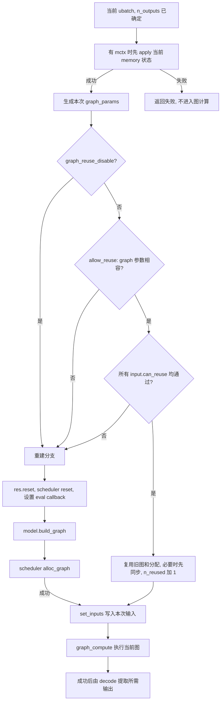

# week4 day4

本文解答[第 4 周学习路线](../../004-llama-cpp-week4-daily-learning-route.md)中 Day 4 的“当天输出与验收”: 图复用决策、两层判定条件、三个推演、断点方案, 以及图复用和 KV 复用的区别。

源码基准为当前工作区 `dd545f7e7`, 与路线标注的 `545ddb30a` 不同。主线为普通 decoder-only Transformer、causal attention、单 sequence、普通 KV cache、无 LoRA、无 backend sampling。以下为源码分析和纸面推导; GDB、日志和模型运行等手动实验暂时跳过, 观测方案未执行。

## 1. 先区分三种对象

| 对象 | 具体包含什么 | 新 token 到来时是否必然改变 |
| --- | --- | --- |
| graph 结构和布局 | 算子及依赖、tensor shape / view、输出选行尺寸、backend 分配关系等 | 不必然; 结构条件相容时可复用 |
| graph 输入值 | token id / embedding、position、KV 写入索引、attention mask、输出行选择等 | 通常需要更新; shape 相同不代表数值相同 |
| KV 内容及元数据 | 各层历史 K/V、槽位与 sequence / position 的关联 | 随输入计算更新, 并跨调用保存 |

例如两个单 token 输入可以具有相同 tensor shape, 却使用不同 token id、position 和 KV 写入位置。这解释了为什么可以复用图结构, 但必须重新设置输入并执行计算。

本日讨论的是 `llama_context` / GGML 层的图复用, 不将它等同于某个设备后端内部的图捕获机制。

## 2. reuse 决策图与 `process_ubatch()` 顺序



`process_ubatch()` 的关键顺序为:

```text
mctx->apply()
  -> graph_params(res, ubatch, mctx, gtype)
  -> !graph_reuse_disable && res->can_reuse(gparams)
       -> true: 复用分支
       -> false: reset + build_graph + alloc_graph
  -> res->set_inputs(&ubatch)
  -> graph_compute(res->get_gf(), ubatch.n_tokens > 1)
```

`apply()` 在判定之前, 因为当前 memory 状态会决定本次 `n_kv`、写入位置和 mask 等信息。不能先拿尚未应用当前 ubatch 的状态判定复用。

复用成功时, 不再执行该分支中的 `model.build_graph()` 和 `ggml_backend_sched_alloc_graph()`。如果启用了 `pipeline_parallel`, 代码先 `ggml_backend_sched_synchronize()` 再增加 `n_reused`, 避免新输入覆盖前一个异步计算仍在读取的输入 tensor。CPU 主线通常不启用此分支, 但输入存储的使用边界仍需遵守。

不能复用时, `res->reset()` 清理旧图参数、input 对象及输出 tensor 引用, 重新建立图元数据; scheduler reset 后再构图、分配。**重新构图不等于清空 KV**, 也不一定意味着底层所有 compute buffer 都重新向系统申请, allocator 可以继续使用预留容量。

构图或分配失败会提前返回; 图中为简洁只展开正常到达 `set_inputs()` 的分支。

## 3. 两层判定条件表

### 3.1 第一层: `llm_graph_params::allow_reuse()`

它比较旧 graph 参数与本次参数, 先检查 ubatch 布局, 再检查影响图结构的其他条件。当前实现的主要检查如下:

| 条件 | 当前源码实际检查 | 为什么重要 |
| --- | --- | --- |
| 布局模式 | `ubatch.equal_seqs()` 相同 | simple 布局与等长 sequence-set 布局不能仅按总长度互换 |
| token 与分组数量 | `n_tokens`、`n_seq_tokens`、`n_seqs`、`n_seqs_unq` 分别相同 | 总 token 数相同仍可能有不同的分组或 stream 结构 |
| 输入模式 | token / embedding 指针的存在模式相容 | 普通 token-only 与 embedding-only 输入不直接共用同一输入图; 当前还兼容特殊的双输入模式 |
| 等长布局的 sequence 身份 | 旧 ubatch 要拥有 `data`, 且双方 `seq_id_unq` 逐项相同 | 参与的 sequence 改变可能意味着 attention stream 改变; 保留旧数据才可以安全比较 |
| 输出数量 | `n_outputs` 相同 | 输出选行和最终输出 tensor 尺寸可以不同 |
| backend sampler 映射 | sequence id 到 sampler 指针的映射相同 | sampler 可以参与构图 |
| 存在 backend sampler 时 | 双方 ubatch 都拥有数据, 各行输出标记和第一个 sequence id 相同 | backend sampling 的输出关联也必须相容 |
| 相关运行模式 | `embeddings`、`embeddings_nextn`、`embeddings_nextn_masked`、`causal_attn` 相同 | 输出模式和 attention 语义影响图 |
| 特殊层配置 | `nextn_layer_offset` 相同 | 当前源码单独检查该字段 |
| 架构和图类型 | `arch`、`gtype` 相同 | default graph 与 encoder / MTP 等 graph 不可混用 |
| 相关对象身份 | `cvec`、`loras`、`cross` 指针相同 | 构图依赖的适配器和 cross-attention 对象需相容 |

这些是源码中明确列出的比较, 不是把整个 `cparams` 做逐字节比较, 也不是对所有权重、KV 或输入数组做内容比较。相关配置改变还可能通过 setter 触发 `sched_need_reserve`, 让旧图在进入判定前失效。

特别注意两个边界:

- 普通路径不会因为 token id 或 position 的数值不同就直接拒绝复用, 它们会在 `set_inputs()` 时更新。
- 无 backend sampler 时, 第一层检查的是输出数量, 不要求输出标记逐位置相同。例如总 token 数和输出数不变, 但选择另一行输出, 可由重新设置输出行 id 表达; 是否最终复用仍取决于其他检查。

### 3.2 第二层: `llm_graph_result::can_reuse()`

第一层通过后, `can_reuse()` 遍历当前图保存的每个 input 对象, 调用其 `can_reuse(params)`, 将结果合并。所有 input 都通过才返回 true。

| input / helper | 普通路径中的检查 | 复用后仍更新的输入 |
| --- | --- | --- |
| `llm_graph_input_embd` | 有 token 输入时已有 token tensor 且 `ne[0]==n_tokens`; 有 embedding 输入时已有 embedding tensor 且 `ne[1]==n_tokens` | 新的 token id 或输入向量 |
| `llm_graph_input_pos` | position tensor 的 `ne[0]==n_tokens*n_pos_per_embd` | 新 position 值 |
| `llm_graph_input_out_ids` | 保存的输出数量等于本次 `n_outputs` | 当前 ubatch 中被选中输出的行号 |
| `llm_graph_input_attn_kv` | K 写入索引 tensor 的长度等于 `n_tokens`, 且 KV mask shape 相容 | 当前 K/V 写入索引、mask, 以及有需要的其他 KV 输入 |
| `can_reuse_kq_mask()` | mask 的四个轴长度与本次 KV 范围、token 和 stream 布局相同 | mask 的具体允许 / 屏蔽值 |
| 其他 input | 由各自实现判断 | 不能仅凭总 token 数相同推断 |

当前普通 `llm_graph_input_attn_kv::can_reuse()` 中, V 索引长度的直接检查仍是注释掉的 TODO, 不能写成“K/V 两个索引长度都已显式检查”。上表描述的是实际执行的 K 索引检查和 mask 检查。

input 基类 `llm_graph_input_i::can_reuse()` 默认返回 false。某类 input 没有实现可复用判定时, 会保守地阻止复用, 所以第一层通过也不是充分条件。

### 3.3 KV mask 的具体 shape

普通 KV attention 输入使用:

```text
n_stream = cparams.kv_unified ? 1 : ubatch.n_seqs_unq
mask.ne  = [n_kv, ubatch.n_tokens/n_stream, 1, n_stream]
```

第二层要求已有 mask 四个 `ne[]` 分别与上述值一致。单 sequence、单 token 时为 `[n_kv,1,1,1]`; 即使 `n_tokens=1` 不变, `n_kv` 改变也会失败。

KV input 的判定还有一个动作: 将它保存的 `mctx` 更新为本次 `params.mctx`。因此复用时输入对象能使用当前 memory context 设置索引和 mask, 不会继续沿用上一轮的临时 `mctx`。

### 3.4 两层检查之外的失效来源

- `LLAMA_GRAPH_REUSE_DISABLE` 非零会使 context 跳过可复用分支, 直接重建。
- `sched_reserve()` 真正执行重新预留时会重新创建图容器和 scheduler。
- `graph_reserve()` 在 reset scheduler 时也会 reset 旧实际图, 防止复用已经失效的分配关系。
- memory 更新需要重设图 / 调度状态时, 也可能使旧图失效。

所以完整问题应是“旧图仍有效、允许复用且两层检查都通过吗”, 不能只问“输入长度是否一样”。

## 4. 三个指定推演

### 4.1 两次单 token decode, token id 和 position 不同

假设旧图有效、未禁用复用, 两次输入都属于 seq 0, 都请求一个输出, 普通配置不变, 应用当前状态后 `n_kv` 均为 256:

| 项目 | 上一次 | 本次 | 判定 |
| --- | --- | --- | --- |
| `n_tokens` / `n_outputs` | `1 / 1` | `1 / 1` | 相同 |
| token id | `t_a` | `t_b` | 数值改变, 不直接改变图结构 |
| position | 10 | 11 | 更新输入即可 |
| 单 sequence 布局 | 相同 | 相同 | 第一层可通过 |
| K 索引输入长度 | 1 | 1 | 相同 |
| mask shape | `[256,1,1,1]` | `[256,1,1,1]` | 相同 |

**结论:** 对普通支持这些 input 复用的图, 这些条件允许复用; 仍须确认其他已注册 input 的检查都通过。走复用分支后 `n_reused` 增加 1, 随后 `set_inputs()` 写入 `t_b`、position 11 和新的 KV 索引 / mask, 再执行当前完整图。

不会直接返回 `t_a` 的旧 logits, 也不会跳过 `t_b` 的 Q/K/V 和后续所需计算。`n_reused` 在计算之前增加, 因而一次增量本身只能证明选择了复用分支, 不能证明后面的 compute 一定成功。

### 4.2 两个同样长的 PP ubatch, 输出数不同

假设一个 4-token API batch 被切成两个 2-token ubatch, 只请求整个 batch 最后一个位置的输出:

```text
ubatch A: 原下标 [0,1], output=[0,0], n_tokens=2, n_outputs=0
ubatch B: 原下标 [2,3], output=[0,1], n_tokens=2, n_outputs=1
```

比较 B 与 A 的图时, 虽然 `n_tokens` 一样, `allow_reuse()` 中的 `n_outputs != other.n_outputs` 已经使第一层失败。按这个直接比较的前提, B 需要重新构图; 不必等到 input shape 检查才发现差异。

A 仍然需要计算并写入前两个 token 的 KV, B 才能读取它们。`n_outputs=0` 限制的是对外选择的输出行数, 不是“没有任务可执行”。模型可以省掉不需要的最终输出相关工作, 但不能省掉后续 token 所依赖的历史计算。

### 4.3 单 token 长度不变, `n_kv` 增长导致 mask 变化

普通 KV 的 `get_n_kv()` 按参与的各 stream 计算并取最大值, 核心公式为:

```text
p = max(n_pad, 256)
每个 stream 的范围 = min(cache_size, max(p, PAD(used_max_p1, p)))
n_kv = 参与 stream 范围的最大值
```

`used_max_p1` 是**最高已使用物理 cell 下标加 1**, 不是直接取 sequence 的最大 position, 也不是简单统计有效 token 个数。只有从头连续放置、没有空洞等情况下, 它才与有效长度一致。

假设单 stream 从物理 cell 0 开始连续写入, `n_pad=1`, cache 容量至少 512, 比较每次 `apply()` 后的状态:

| `used_max_p1` 变化 | `n_kv` 变化 | 单 token mask shape | 复用影响 |
| --- | --- | --- | --- |
| 11 -> 12 | 256 -> 256 | 均为 `[256,1,1,1]` | 历史增加, 但此项不阻止复用 |
| 255 -> 256 | 256 -> 256 | 均为 `[256,1,1,1]` | 此项仍可通过 |
| 256 -> 257 | 256 -> 512 | `[256,1,1,1]` -> `[512,1,1,1]` | 第二层 mask 的 `ne[0]` 检查失败, 旧图不能直接复用 |

这个例子不能在容量只有 256、又没有其他空间管理的 context 中硬塞第 257 个位置。它用于解释 padding 边界, 不是一份运行日志。

**结论:** 有效历史每次增加不意味着图每次重建。判断应看当前 `get_n_kv()` 对图 shape 的影响; 即使它没变, 其他条件也仍可能导致重建。

## 5. 图复用、KV 复用与零输出 ubatch

| 机制 | 保留什么 | 节省什么 | 新输入仍要做什么 |
| --- | --- | --- | --- |
| 图复用 | 相容的 graph、input 对象及已有分配关系 | 重复构图和对应图分配工作 | 更新输入、执行图、提取需要的结果 |
| KV 复用 | 已处理历史的 K/V 和相应状态 | 为新 token 重新计算整段历史的 K/V | 计算当前输入的 Q/K/V, 读取允许访问的历史, 写入新 K/V |

两者可以独立发生。例如第三个推演跨越 padding 边界时, graph 重建, 历史 KV 仍保留。图复用也不意味着输入值或输出值复用。

普通带 KV 的 attention builder 会显式把当前 K/V 写入节点加入 graph。即使该 ubatch 没有选择对外输出, 这些状态写入仍可构成必须执行的工作。以第二例为例, 如果跳过 A, B 就缺少位置 0、1 的正确历史。

## 6. 断点与日志观测方案, 尚未执行

### 6.1 需要记录的字段

对每一个实际 `process_ubatch()` 调用记录一行:

| API 调用 / ubatch | context 地址 | `n_tokens` / 布局 | token / pos / seq | `n_outputs` | 当前 `n_kv` / mask shape | `n_reused` 前后 | build 是否命中 | compute 状态 |
| --- | --- | --- | --- | --- | --- | --- | --- | --- |
| 待手动实验填写 | 待记录 | 待记录 | 待记录 | 待记录 | 待记录 | 待记录 | 待记录 | 待记录 |

这里的 `n_outputs` 必须在当前 ubatch 构图前观察, 不能只在 decode 结束后读取那个已经恢复为总输出数的成员。

### 6.2 断点位置和判断方式

| 位置 | 观测内容 |
| --- | --- |
| `llama_context::process_ubatch` 入口 | 当前 context、ubatch 布局、`this->n_outputs`、`this->n_reused` |
| 本次 `mctx->apply()` 之后 | 当前 memory 范围; 不把 apply 前的值当作本次判定值 |
| `llm_graph_params::allow_reuse` | 哪个 graph 参数不同; 内联函数不便下断点时使用其调用处或源码行 |
| `llm_graph_result::can_reuse` / `llm_graph_input_attn_kv::can_reuse` | 第一层结果, K 索引长度和 mask 的四轴检查 |
| `llama_model::build_graph` | 是否从当前 `process_ubatch()` 的重建分支进入; 用调用栈排除初始化预留 |
| `llama_context::graph_compute` 入口 | 与同一次 `process_ubatch()` 入口的 `n_reused` 比较, 确认计算仍发生 |
| compute 返回处 | 检查状态, 区分“选择了复用”和“计算成功” |

可在已有 Debug 可执行程序中手动设置以下断点, **本次没有执行这些命令**:

```gdb
break llama_context::process_ubatch
break llama_context::graph_compute
break llama_model::build_graph
```

停在某次 `process_ubatch()` 入口时记录:

```gdb
set $w4_ctx = this
set $w4_reused_before = this->n_reused
print ubatch.n_tokens
print ubatch.n_seq_tokens
print ubatch.n_seqs
print ubatch.n_seqs_unq
print this->n_outputs
```

继续到**同一调用链、同一 context**的 `graph_compute()` 入口, 再检查:

```gdb
bt 4
print this == $w4_ctx
print this->n_reused - $w4_reused_before
```

- 增量为 1, 且调用链匹配: 本轮走复用分支; 随后仍进入计算。
- 增量为 0, 且在同轮命中 `process_ubatch -> build_graph`: 本轮走重建分支。
- 没有到达 compute: 可能在 apply、构图或分配阶段失败, 不能当作“没有执行所以成功复用”。

### 6.3 日志如何辅助, 如何避免误计数

在进程启动前设置 `LLAMA_GRAPH_RESULT_DEBUG=2`, 可以让 `can_reuse()` 打印参数不相容、各 input 检查和最终结果等调试日志。还需要确保程序的日志配置实际接收 DEBUG 级别; 环境变量开启内部打印不保证日志接收端一定显示。

一次判定可以打印多条 input 日志, 第一层失败则可能提前返回, 所以日志行数不等于图执行次数。`LLAMA_GRAPH_REUSE_DISABLE` 会直接绕过 `can_reuse()`; 初始化 `sched_reserve()`、算子探测和应用 warmup 也可能命中 builder。必须将日志与实际用户 API 调用、ubatch 和调用栈关联。

`llama_perf_context()` 返回的 `n_reused` 可以辅助观察累计复用次数, 但它不是成功生成 token 数; 调用 perf reset 还会把它清零。

## 7. 当天验收与跳过说明

| 验收项 | 答案 / 状态 |
| --- | --- |
| reuse 决策图 | 已画出 apply、两层检查、复用 / 重建分支及共同计算路径 |
| 判定条件表 | 已区分 graph 参数、input shape 和额外失效机制 |
| 三个推演 | 已说明输入值变化可复用、输出数变化拒绝复用、`n_kv` 跨 padding 边界改变 mask |
| 断点方案 | 已提供断点位置、字段和同一次调用内比较 `n_reused` 的方法, 尚未执行 |
| 图复用与 KV 复用 | 前者保留图 / 分配, 后者保留历史 K/V; 都不等于跳过新输入的计算 |
| `n_outputs=0` | 仍可能需要计算并写入 KV, 为后续 ubatch 提供历史 |

**手动实验暂时跳过:** 未运行 PP/TG 模型实验, 未实际采集 `n_reused` 增量、builder 断点或 `LLAMA_GRAPH_RESULT_DEBUG` 日志, 未实测跨越 KV padding 边界。上述推演不作为运行通过的证据。

## 8. 源码入口

- [context 实现](../../../../src/llama-context.cpp): `process_ubatch()`、`graph_params()`、`sched_reserve()`、`graph_reserve()`、`perf_get_data()`。
- [graph 定义](../../../../src/llama-graph.h): `llm_graph_params::allow_reuse()`、`llm_graph_input_i`、`llm_graph_result`。
- [graph 实现](../../../../src/llama-graph.cpp): `can_reuse()`、各 input 的判定和设置、`can_reuse_kq_mask()`、带 KV 的 `build_attn()`。
- [普通 KV 实现](../../../../src/llama-kv-cache.cpp)与[cell 定义](../../../../src/llama-kv-cells.h): `get_n_kv()`、`used_max_p1()`、memory context 的 `apply()`。
- [日志接收实现](../../../../common/log.cpp): DEBUG 日志的显示条件。
- [公共性能 API](../../../../include/llama.h): `llama_perf_context_data::n_reused`。
