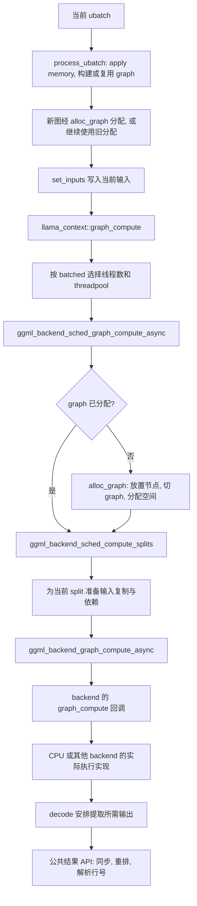

# week4 day5

本文解答[第 4 周学习路线](../../004-llama-cpp-week4-daily-learning-route.md)中 Day 5 的“当天输出与验收”: graph 到 backend 的边界、scheduler 的职责、异步输出与同步、两个输出索引例子, 以及累计输出偏移的含义。

源码基准为当前工作区 `dd545f7e7`, 与路线标注的 `545ddb30a` 不同。以下以普通 decoder-only 模型、无 backend sampling、正常 logits 输出为主。CPU 与异步 backend 的区别依据源码说明, 未进行模型运行、GPU 测量或 GDB 实验; 所有索引例子均为纸面推导。

## 1. 三层切分不能混为一谈

| 层次 | 谁决定 | 切分对象 | 主要约束 |
| --- | --- | --- | --- |
| 应用提交 API batch | 调用者 / 上层工具 | prompt 或待处理输入 | 每次提交的 token 数不超过有效 `n_batch` |
| memory 切 ubatch | `memory->init_batch()` 与 batch allocator | 本次 API batch 的输入行 | `n_ubatch`、sequence-set 布局、memory 类型和状态 |
| scheduler 切 graph | `ggml_backend_sched_split_graph()` | 一张 graph 中的计算节点及数据依赖 | backend 放置、op 支持、buffer 兼容性和复制需求等 |

例如单 sequence 的 10-token prompt, 有效 `n_batch=4,n_ubatch=2`, 可以由应用提交 `4+4+2` 三次 API batch; 若使用普通单 stream KV 的 simple 切分且准备成功, 对应 `2+2`、`2+2`、`2` 共五个 ubatch。每个 ubatch 的 graph 又可能有自己的 scheduler splits, 这里不能仅凭 token 数推算 split 数。

scheduler split 是执行段, 不等于 Transformer 层数、ubatch 数或 backend 个数。一个 backend 可以在同一图的多个执行段中出现。

## 2. graph 到 backend 的边界图



其中有三个明确边界:

1. `model.build_graph()` 描述计算依赖, 本身不执行模型数值计算。
2. scheduler 负责 graph 的执行资源、放置、切分与数据移动, 通过 backend 接口提交各段计算。
3. backend 的具体实现执行计算。CPU 的 `ggml_backend_cpu_graph_compute()` 建立 `ggml_cplan` 后调用 `ggml_graph_compute()`; 其他 backend 可以采用自己的执行和异步机制。

调用链中的 async 名称不能证明 CPU 实现也必然在后台返回。当前 CPU callback 直接计算后返回, CPU 的异步 tensor get 回调也为空, 会走同步读取的兼容分支。

## 3. `graph_compute()` 怎样选择线程配置?

`process_ubatch()` 传入的 `batched` 精确等于 `ubatch.n_tokens > 1`:

| 条件 | 使用线程数 | 使用线程池 |
| --- | --- | --- |
| `ubatch.n_tokens > 1` | `cparams.n_threads_batch` | `threadpool_batch` |
| `ubatch.n_tokens == 1` | `cparams.n_threads` | `threadpool` |

context 如果能取得 CPU backend 的线程池设置函数, 就设置相应 threadpool; 随后调用已收集到的各 backend 线程数设置函数, 再进入 scheduler 的异步计算接口。

这里判断的是**当前物理批次的 token 数**, 不直接识别业务上的 PP/TG:

- prompt prefill 最后剩下一个 token 的 ubatch 会走 `batched=false`。
- 多条 sequence 各生成一个 token, 若合在一个多 token ubatch 中, 会走 `batched=true`。
- 线程数配置是传给支持相应接口的 backend, 不能将它理解为设置 GPU kernel 的线程块数量。

## 4. scheduler 接口的职责与放置依据

### 4.1 各接口的边界

| 接口 | 做什么 | 是否完成用户输入的数值计算 |
| --- | --- | --- |
| `ggml_backend_sched_reserve()` | 用测量图切分并预留 compute buffer 容量, 随后 reset 调度状态 | 不执行该测量图的数值计算 |
| `ggml_backend_sched_reset()` | 清除 tensor/backend 分配记录和当前图已分配状态 | 不执行计算, 也不等于清空 model 权重或 KV |
| `ggml_backend_sched_split_graph()` | 为节点选择 backend, 建立 splits 及需要复制的 tensor | 只做调度规划 |
| `ggml_backend_sched_alloc_graph()` | 切分当前 graph, 分配其实际计算存储并标记已分配 | 分配不等于计算; 可使用此前预留的空间 |
| `ggml_backend_sched_graph_compute_async()` | 必要时补做分配, 然后调用 `compute_splits()` | 提交 / 执行各 split; 不承诺所有 backend 工作在返回前完成 |
| `ggml_backend_sched_synchronize()` | 对 scheduler 管理的各 backend 同步 | 等待已经提交的工作, 不额外发起一次模型前向 |
| `ggml_backend_sched_get_tensor_backend()` | 查询 tensor 被分配到哪个 backend | 不复制数据, 也不承担同步职责 |

reset 后不能继续把旧 tensor 当作仍有效的已分配图使用。`process_ubatch()` 的重建分支配套 reset graph result 并创建新图; Day 4 的复用分支则保留有效的图和分配关系。

### 4.2 backend 不是只按层号分配

在 `ggml_backend_sched_backend_id_from_cur()` 和 `ggml_backend_sched_split_graph()` 中, 可定位以下依据:

| 依据 | 对放置的影响 |
| --- | --- |
| 已有或显式的 backend 绑定 | 第一轮不会随意覆盖调用者已设置的节点分配 |
| 已分配 tensor / view 的 buffer | 需要能使用该 buffer type 且支持相应 op; 已分配结果不能任意搬换执行位置 |
| 权重所在 buffer | 涉及权重的 op 通常优先靠近能直接使用该权重 buffer 的 backend, 但有例外和 offload 策略 |
| backend 优先级 | 传给 scheduler 的 backend 列表中, 较小索引具有较高优先级; CPU 是最后的 fallback |
| op 支持能力 | backend 必须支持该 op, 邻近节点的放置也只能在支持条件下扩展 |
| 输入 buffer 的兼容性 | 未定节点可按可直接支持的输入数量选择 backend, 兼容的 buffer type 也可能允许提高 backend 优先级 |
| 数据复制与资源约束 | backend 切换、不兼容输入、权重复制空间复用及 split 输入约束等都会影响执行段划分 |

具体源码先进行若干轮放置, 再在 split 阶段处理 backend 变化和复制输入。它会为无法被目标 backend 直接使用的输入创建副本, 并在计算时安排复制和事件 / 同步依赖。

`compute_splits()` 在无 eval callback 的普通路径中, 对每个 split 调用 `ggml_backend_graph_compute_async(split_backend,&split->graph)`, 后者再调用 `backend->iface.graph_compute`。若使用 eval callback, split 内还可能按观察节点再分段提交并同步; 本日主线不启用它。

如果一张图的计算节点都落到同一个 CPU backend, 且没有其他切分条件, 可以组成一个 split。但“CPU 运行”还可能包含 ACCEL / BLAS backend, 所以实际数量应读该图的 `ggml_backend_sched_get_n_splits()`。本次未运行, 不填写固定的 CPU split 实测值。

## 5. 输出从图到 host 的路径

### 5.1 decode 中的追加偏移

decode 在进入 ubatch 循环前为 `n_outputs_all` 准备输出空间, 并令:

```text
n_outputs_prev = 0
n_tokens_prev  = 0
```

每轮 `process_ubatch()` 成功返回后, 从 graph result 取得 `t_logits`。在本文无 backend sampler 的普通路径中, 若本轮有 logits 输出, 处理为:

```text
t_logits = res->get_logits()
backend_res = ggml_backend_sched_get_tensor_backend(sched, t_logits)
logits_out = logits.data + n_outputs_prev * n_vocab

ggml_backend_tensor_get_async(
    backend_res,
    t_logits,
    logits_out,
    0,
    n_outputs * n_vocab * sizeof(float))

n_outputs_prev += n_outputs
n_tokens_prev  += ubatch.n_tokens
```

上式是调用关系说明, 不涉及本次实际运行。源 tensor 的读取偏移为 0, 目标 host 指针的偏移是此前 ubatch 已累计的输出行数乘以词表宽度。

`n_outputs_prev*n_vocab` 的单位是 float 元素数, 传入 get 接口的长度则以字节计。一个输出行包含 `n_vocab` 个 float, 表示一个输入位置对应的整行词表 logits。

**`n_outputs_prev` 是本次 API 调用内的累计输出行数**, 与以下数量都不同:

- cache 中已经保存的历史 token 数。
- 本次已经处理的输入行数 `n_tokens_prev`。
- token 的 sequence position。
- 所有过去 API 调用累计产生的输出行数。

某个 ubatch 的 `n_outputs=0` 时不提取 logits, `n_outputs_prev` 也不增加, 但本轮仍可执行 K/V 计算。下一次 API 调用又从 `n_outputs_prev=0` 开始组织新输出。

### 5.2 为什么 decode 返回后还要同步?

对于支持异步计算和传输的 backend, graph compute 和 tensor get 可以只把工作提交到执行队列。decode 末尾的无条件 `synchronize()` 被注释掉, 因此不能假设返回 0 的时刻就是所有 host 输出已经可读的时刻。

`ggml_backend_tensor_get_async()` 自身有两条路径:

| backend 能力 | 当前实现 |
| --- | --- |
| 有 `get_tensor_async` 回调 | 调用异步读取回调, 完成时刻由 backend 队列决定 |
| 没有该回调 | 先同步该 backend, 再同步读取 tensor 数据 |

所以 CPU 路径可能在调用返回时已经有结果, GPU 等路径可能仍有未完成工作。调用者使用公共结果 API 可以跨 backend 保持正确的同步语义。

## 6. 公共 logits 访问的同步、重排和解析

### 6.1 `llama_get_logits_ith()` 的顺序

```text
llama_get_logits_ith(ctx, i)
  -> ctx->synchronize()
       -> ggml_backend_sched_synchronize()
  -> 尝试 get_sampled_logits_ith(i)
       -> output_reorder()
       -> 本文无 backend sampling, 返回 nullptr
  -> ctx->get_logits_ith(i)
       -> output_reorder(), 已完成的重排不会重复交换
       -> j = output_resolve_row(i)
       -> 返回 logits.data + j*n_vocab
```

当前包装层即使在无 backend sampler 时也先探测 sampled logits。该函数开头会调用 `output_reorder()`, 所以实际交换可能在这次探测中已经发生; 随后普通 getter 再调用时, swap 列表已清空。

关键先后关系始终是**先同步, 再访问或重排 host 数据**。同步只保证已提交数据可用, 不会自动修正行顺序; 重排修正行顺序, 也不能替代计算完成同步。

`llama_get_logits()`、`llama_get_embeddings()`、`llama_get_embeddings_ith()` 和 `llama_get_embeddings_seq()` 的公共包装层同样先同步。调用者正常通过这些 API 读取时通常无需再单独调用 `llama_synchronize()`。

### 6.2 `out_ids`、`output_ids`、`output_swaps` 各是什么?

| 对象 | 方向 / 内容 | 何时使用 |
| --- | --- | --- |
| allocator 的 `out_ids` | 按切分遇到输出的顺序记录其原 batch 下标 | ubatch 切分时积累, decode 结尾用于建立映射并可能排序 |
| context 的 `output_ids` | 原 batch 下标 -> 最终输出行号, 未输出位置为 -1 | 非负索引访问时解析 |
| context 的 `output_swaps` | 需要交换的输出行号对 | decode 结尾记录, 读取输出时由 `output_reorder()` 应用 |

decode 结束时, 映射可以已经指向“重排后的行号”, 但浮点数据仍保持提取顺序。因此不能绕过公共 getter 直接拿内部 buffer 并假定映射与数据已经一致。

### 6.3 索引规则

```text
若 i >= 0:
    j = output_ids[i]
    i 是本次 API batch 的 token 下标, 不是输出行号

若 i < 0:
    j = n_outputs + i
    从最终已输出的行末尾倒数

要求 0 <= j < n_outputs
返回 logits.data + j*n_vocab
```

非负索引包括 0。即使想取第一行输出, 也不能无条件传 0; 必须确认原 batch 下标 0 请求了输出。返回值是一行 logits 的指针, 不是 token id, 也不是单个词表分数。

## 7. 索引例子一: Day 2 的 `[5,3]` 输出顺序

沿用两个独立 sequence: seq 0 有 4 行, seq 1 有 2 行, 原 batch 输出位置为 3 和 5。按 `split_equal(8,false,0)` 得到:

| ubatch | 原 batch 下标列表 | 输出所在局部下标 | 对应原输出位置 | 提取前 `n_outputs_prev` | 写入的输出行 |
| --- | --- | ---: | ---: | ---: | ---: |
| 0 | `[0,1,4,5]` | 3 | 5 | 0 | 0 |
| 1 | `[2,3]` | 1 | 3 | 1 | 1 |

令 `L_i` 表示原 batch 下标 i 的一行 logits。提取及重排过程为:

```text
按计算遇到顺序提取:
    out_ids = [5,3]
    host rows = [L_5,L_3]

decode 先建立的映射, 仅列前 6 项:
    output_ids = [-1,-1,-1,1,-1,0]

decode 排序原输出下标并记录交换:
    out_ids = [3,5]
    output_swaps = [(0,1)]
    output_ids = [-1,-1,-1,0,-1,1]

公共 getter 同步并应用交换后:
    host rows = [L_3,L_5]
    output_swaps = []
```

最终读取关系:

| 调用 | 输出行 | 原 batch 下标 | sequence / position |
| --- | ---: | ---: | --- |
| `llama_get_logits_ith(ctx,3)` | 0 | 3 | seq 0, pos 3 |
| `llama_get_logits_ith(ctx,5)` | 1 | 5 | seq 1, pos 1 |
| `llama_get_logits_ith(ctx,-2)` | 0 | 3 | seq 0, pos 3 |
| `llama_get_logits_ith(ctx,-1)` | 1 | 5 | seq 1, pos 1 |

最终按**原 batch 下标**排序, 不是按 sequence position 大小排序。这个例子中的 pos 3 仍排在 pos 1 对应输出之前。

## 8. 索引例子二: 四个 token, 只有两行输出

假设 seq 0 已有位置 `0..7`, 本次合法提交 4 个输入, 请求输出的标记如下:

```text
batch token index:  0  1  2  3
sequence position:  8  9 10 11
logits flag:        0  1  0  1
```

若普通单 stream 路径使用 `n_ubatch=2`, 则:

| ubatch | 原 batch 下标 | position | 本轮输出数 | 提取前 `n_outputs_prev` | 提取后累计输出数 |
| --- | --- | --- | ---: | ---: | ---: |
| 0 | `[0,1]` | `[8,9]` | 1 | 0 | 1 |
| 1 | `[2,3]` | `[10,11]` | 1 | 1 | 2 |

两行已经按原 batch 顺序提取, 不需要交换:

```text
out_ids = [1,3]
output_ids 的前 4 项 = [-1,0,-1,1]
n_outputs = 2

row 0: batch index 1, sequence position 9
row 1: batch index 3, sequence position 11
```

| 访问 | 结果 | 理由 |
| --- | --- | --- |
| `llama_get_logits_ith(ctx,1)` | row 0 | `output_ids[1]=0` |
| `llama_get_logits_ith(ctx,3)` | row 1 | `output_ids[3]=1` |
| `llama_get_logits_ith(ctx,-1)` | row 1 | `2-1=1` |
| `llama_get_logits_ith(ctx,-2)` | row 0 | `2-2=0` |
| index 0 或 2 | 非法, 不执行 | 对应输入没有请求输出, 映射为 -1 |
| index -3 | 非法, 不执行 | `2-3=-1`, 超出输出行范围 |

若使用 `llama_get_logits(ctx)` 取得完整输出 buffer, 第一行在基址, 第二行在基址加 `n_vocab` 个 float。它与 `llama_get_logits_ith(ctx,0)` 的语义不同: 后者仍在询问原 batch 下标 0 的输出。

历史 token 数在第一次 ubatch 之前为 8, 但第一次提取的目标偏移为 0, 第二次为 `1*n_vocab`。这直接证明 `n_outputs_prev` 不是历史长度, 也不是 position 8、9、10、11 中的任何一个值。

两个例子中, `output_ids` 的实际分配长度为有效 `n_batch`, 表内只列当前 API batch 涉及的前几项。

## 9. 非法访问与输出指针的生命周期

当前普通 `get_logits_ith()` 对未请求输出、越界或无 logits 等情况记录错误。Debug 构建在捕获错误后可能 `GGML_ABORT`, 非 Debug 分支返回 null。虽然公共头文件写有非法 id 返回 null 的说明, 也不能据此期待 Debug 下一定平稳返回。

本题只根据映射判断非法下标, 不通过故意崩溃来验证。

返回的 logits 指针由 context 管理, 指向其 output buffer。后续 decode 可覆盖内容, 输出重排可交换行内容, 扩容或 context 释放可使旧指针失效。需要长期保存某行结果时, 应在公共 getter 完成同步后由应用复制该行 `n_vocab` 个 float, 而不是自行释放返回指针。

## 10. 当天验收与手动实验状态

| 验收项 | 答案 / 状态 |
| --- | --- |
| graph 到 backend 边界图 | 已覆盖 graph 准备、线程配置、scheduler splits、backend callback 和输出访问 |
| scheduler 的职责 | 已区分 reserve/reset/alloc/compute/synchronize/query, 并列出放置依据 |
| 输出拷回路径 | 已给出 tensor backend 查询、累计输出偏移和复制字节数 |
| 两个索引例子 | 已手算 `[5,3]` 的重排和 `[0,1,0,1]` 输出标记下的非负 / 负索引 |
| 异步结果为什么要同步 | 返回可能只意味着提交; 公共结果访问包装层先同步再访问 host 数据 |
| `n_outputs_prev` 的范围 | 本次 API 调用内、当前 ubatch 之前的输出行数, 不是 KV 历史长度 |

**手动实验暂时跳过:** 未运行 CPU/GPU 对照, 未实测 graph split 数、异步完成时刻或输出复制耗时, 未用 GDB 观察真实输出内存, 未执行非法索引调用。后续可以在 `graph_compute()`、`ggml_backend_sched_compute_splits()`、decode 的输出提取处和公共 `llama_get_logits_ith()` 下断点, 将同一 API / ubatch 的执行段、复制偏移和最终行映射关联起来。

## 11. 源码入口

- [context 实现](../../../../src/llama-context.cpp): `graph_compute()`、decode 输出提取与映射、`output_reorder()`、`output_resolve_row()`、公共结果 getter。
- [scheduler API](../../../../ggml/include/ggml-backend.h): scheduler 各接口及其分配 / 同步约定。
- [backend 与 scheduler 实现](../../../../ggml/src/ggml-backend.cpp): 放置、split、`compute_splits()`、backend callback、`tensor_get_async()`。
- [CPU backend 实现](../../../../ggml/src/ggml-cpu/ggml-cpu.cpp): `ggml_backend_cpu_graph_compute()` 和 backend interface 表。
- [公共输出 API](../../../../include/llama.h): logits 布局、索引规则及自动同步说明。
- [batch 切分实现](../../../../src/llama-batch.cpp): `ubatch_add()` 如何积累 `out_ids`。
- [Day 2 答案](week4-day2.md): `[0,1,4,5]`、`[2,3]` 的切分来源。
