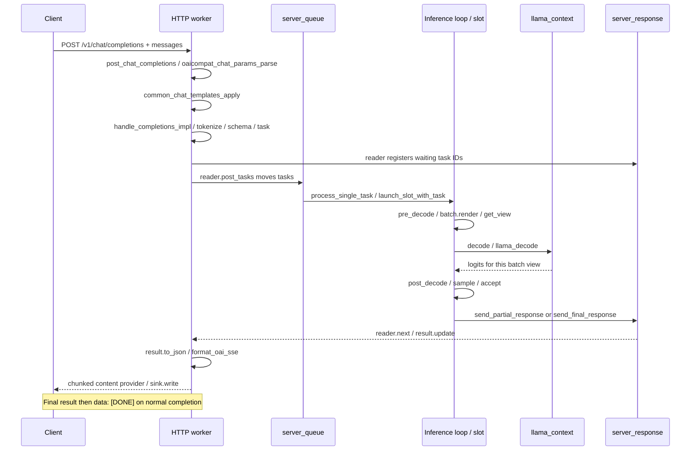

# week8 day2: HTTP、task、线程边界与 SSE

本文回答[第 8 周学习路线](../../008-llama-cpp-week8-daily-learning-route.md)中 Day 2 的当天输出与验收。源码基准为 `697b4bbf4633a38abfd66f7cc54a167095aedef3`。

已完成源码时序、所有权和协议说明。按要求跳过启动 Server、发送 HTTP 请求、采集 SSE 与计时。下方请求是待执行输入, 不是已经发送的请求; `single-a.*` 的真实响应和时间均待补。本文承担路线中 `notes/week8-day2.md` 的笔记内容。

## 1. 单请求时序图

范围为单模型 inference mode、普通 `/v1/chat/completions` 流式请求, 不发送 `X-Conversation-Id`, 不含工具、图像或 speculative decoding。



图中 generation 部分会重复多次。Server 的 route 在建立正常 SSE 响应前先读取第一个 result: 若第一个 result 就是 error, 返回非流式错误; 开始 SSE 后遇到 error, 则通过流内 error 结束。不能把所有错误都描述成 HTTP 200, 也不能只检查 HTTP 200 就判定成功。

## 2. 每个箭头对应什么函数

| 阶段 | 源码入口 | 实际职责 |
| --- | --- | --- |
| 注册聊天 route | [server.cpp](../../../../tools/server/server.cpp) 的 `/v1/chat/completions` 注册 | 把 POST 交给 `routes.post_chat_completions` |
| messages 转 prompt | [server-context.cpp](../../../../tools/server/server-context.cpp) 的 `server_routes::init_routes()`; [server-common.cpp](../../../../tools/server/server-common.cpp) 的 `oaicompat_chat_params_parse()` | 解析 OAI 参数, 建立模板输入, 调用 `common_chat_templates_apply()` |
| prompt 转 task | `server_routes::handle_completions_impl()` | `tokenize_input_prompts()`、`server_schema::eval_llama_cmpl_schema()`、分配 task ID、填写 tokens/参数 |
| 进入推理队列 | [server-queue.cpp](../../../../tools/server/server-queue.cpp) 的 `server_response_reader::post_tasks()` | 保存响应状态, 注册等待的 ID, move tasks 到 queue |
| task 进入 slot | `server_queue::start_loop()`、`process_single_task()`、`launch_slot_with_task()` | 从队列取任务, 找到可用 slot, 接管 task |
| 模型执行 | `update_slots/pre_decode/decode/post_decode()` | 准备 batch view, 调用 `llama_decode()`, 按 slot 下标采样 |
| 返回结果 | `send_partial_response/send_final_response()`、`server_response::send()` | 推理侧构造 result, 交给响应队列 |
| 响应增量状态 | `server_response_reader::next()` | 取 result, 调用 `result->update(states[idx])`, 统计结束结果 |
| JSON 和 SSE | result 的 `to_json()`、`format_oai_sse()`、route 的 next 回调 | 在 HTTP 侧转换为 OAI delta、结束结果和 SSE 文本 |
| 网络写出 | [server-http.cpp](../../../../tools/server/server-http.cpp) 的 `process_handler_response()` | content provider 调用 `response->next()` 和 `sink.write()` |

路线提到 `server-chat.cpp`, 但当前 checkout 的 OAI 聊天参数转换和模板调用关键入口位于 `server-common.cpp`。学习时应跟函数实际定义, 不依赖旧文件划分。参数约束另见 [server-schema.cpp](../../../../tools/server/server-schema.cpp), 结果类型与格式化见 [server-task.h](../../../../tools/server/server-task.h) 和 [server-task.cpp](../../../../tools/server/server-task.cpp)。

## 3. 线程边界

| 执行位置 | 处理的工作 | 通过什么跨边界 |
| --- | --- | --- |
| HTTP listener 与 worker 线程 | 接收请求、JSON 解析、模板、tokenize、请求参数校验、响应 JSON/SSE、网络写出 | `server_queue` 提交 task, `server_response` 接收 result |
| 调用 `ctx_server.start_loop()` 的线程 | task 分配、slot 状态转换、batch 调度、decode 调用、按 slot 采样 | 队列中的拥有所有权的任务/结果 |
| backend 内部工作线程或设备 | tensor 运算与图执行 | 由 decode/后端执行接口驱动 |

独立 `llama-server` 的 inference mode 在调用 `llama_server()` 的主线程中执行 `ctx_server.start_loop()`; HTTP listener 另外启动线程, HTTP 请求由其 worker pool 处理。CLI 内嵌模式则由 `cli_server` 新建的线程调用 `llama_server()`。所谓单个推理控制循环, 不等于只使用一个 CPU 核, 也不意味着每个请求都拥有一个专属推理线程。

HTTP worker 等待 `reader.next()` 时, 推理循环仍可推进其他活动 slot。反过来, 把复杂 JSON 后处理放进推理循环会延长所有 slot 的调度间隔, 因而格式化留在 HTTP 层。

## 4. 消息、task、reader 与结果由谁拥有

```text
客户端应用
  owns messages/history
  -> HTTP body 中提交本次所需的消息

HTTP 层 response generator
  owns server_response_reader
    owns waiting task IDs + task_result_state
    borrows server_queue + server_response

task 生命周期
  handler 局部 vector<server_task>
    -> move 到 server_queue
    -> move 到推理循环局部 task
    -> 无可用 slot: move 到 deferred queue
    -> 有可用 slot: move 到 slot 持有的 task

result 生命周期
  推理循环构造 server_task_result_ptr
    -> response queue
    -> reader.next()
    -> HTTP 层更新状态、格式化、写出
```

reader 持有的是等待 ID 和响应解析状态, 不是把已经 move 给 slot 的生成 task 再复制一份。`task.id` 用于队列关联; HTTP `chatcmpl-...` completion ID 用于协议输出, 两者不是同一个 ID。存在 `n` 等参数时, 一个 HTTP 请求还可能包含 parent/child 多个 task, 所以 HTTP 请求数也不能普遍等同于 task 数。

`post_tasks()` 先注册 waiting ID 再入任务队列, 使结果可以正确匹配等待者。`next()` 获取部分或最终结果, 遇到错误会停止剩余任务; 非流式路径使用 `wait_for_all()` 聚合结果。reader 析构时调用 `stop()`, 未结束任务会收到取消 task。HTTP stream 的 shared pointer 保持 request/response 在回调期间有效, 完成回调再释放。

### KV 复用为什么不是持久聊天历史

聊天 history 由客户端提交。CLI 的 `impl->messages` 就是一个具体 owner; 自己写 HTTP client 时, 必须自己保存并提交所需历史。Server 将请求消息模板化后得到 prompt tokens, 可能利用已有 slot prompt/KV 的共同前缀减少 prefill。

KV 是某个 context 中对 token 前缀的计算状态, 可以被清除、覆盖或随 slot 重用。它不等价于永久保存用户的 system/user/assistant 消息列表。没有消息持久化契约时, 下一次只发送一条新 user 消息, 不能期待 Server 从旧 KV 自动补回全部历史。

## 5. 待执行请求与 SSE 验收办法

请求 A 的内容可保存为路线要求的 `request-a.json`:

```json
{
  "model": "week8-local",
  "messages": [{"role": "user", "content": "Request A: Explain why KV cache helps decoding. Keep it short."}],
  "stream": true,
  "stream_options": {"include_usage": true},
  "temperature": 0,
  "seed": 42,
  "max_tokens": 64,
  "cache_prompt": false
}
```

本次没有发送该请求。后续先按路线启动 Server, 以 `/health` 返回 200 且 body 为 `{"status":"ok"}` 为就绪证据, 再保存 `/props` 和空闲 `/slots`。`-c 4096 -np 2 --no-kv-unified` 的每 slot 容量预期约 2048, 仍要核对实际配置; 不应写成每 slot 4096。

| 应保存的文件 | 检查内容 | 本次状态 |
| --- | --- | --- |
| `request-a.json` | 原始请求, 不把 A 标签当 task ID | 内容已列出, 未发送 |
| `props.json`、`slots-idle.json` | 模型、模板、slot 数、容量基线 | 暂时跳过 |
| `single-a.headers.txt` | HTTP 状态、`Content-Type: text/event-stream` | 暂时跳过 |
| `single-a.sse` | 原始事件、同一 completion ID、delta、finish reason、usage、正常 `[DONE]` | 暂时跳过 |
| `single-a.trace.txt` | 分块接收时间, 首个非空 reasoning/content 的到达时间 | 暂时跳过 |
| `single-a.http-time.json` | `http_code`、`ttfb_s`、`total_s`, 并保留 curl 退出状态 | 暂时跳过, 未测值不能填 0 |

当前 `format_oai_sse()` 将每个 JSON 结果写为 `data: <JSON>\n\n`, 正常 OAI 流最后另发 `data: [DONE]\n\n`。首个事件可能只有 role 或空内容; 最终 finish reason 与单独 usage 事件不能丢弃。`length` 表示预算或相关限制导致结束, 不是完整语义回答的证明; `stop` 也不证明内容一定正确。

网络分块、SSE event 和模型 token 不一一对应。一个读取回调可能只收到半行, 也可能同时收到多个事件。当前 `cli_client::post_sse()` 通过 `pending` 缓存完整行, 消费 `data: ` 行并忽略 `[DONE]`, 适配本 Server 的单行 JSON 输出; 不能把这个具体实现当作通用多行 SSE 解析器。

`curl --no-buffer` 关闭的是 curl 输出缓冲, 不会消除服务端、网络或代理的所有缓冲。`time_starttransfer` 是首字节相关时间, 不是首个模型 token 时间。reasoning 模型应分别记录首个非空 `reasoning_content` 和首个非空 `content`; 没有最终 content 时标为未产生, 不拿 reasoning 时间代替。

## 6. 当天验收答案

- 谁提交消息/history: CLI 或 HTTP client 所在的应用, Server 消费本次请求的 messages。
- 谁持有 task: 从 handler 转移到 queue, 再转移到 deferred queue 或 slot; reader 主要保存响应状态和 ID。
- 部分结果在哪里格式化: 推理侧产生 result, HTTP 侧经 reader 更新状态, 再 `to_json()`、`format_oai_sse()` 和网络写出。
- 为什么 KV 不是持久 history: 它是可复用、可淘汰的计算缓存, 不替代应用消息记录。
- 本次完成范围: 单请求时序图、线程/所有权边界与验收办法已完成; 完整 SSE、headers 和时间记录按要求暂时跳过, Day 2 的运行验收尚未完成。
