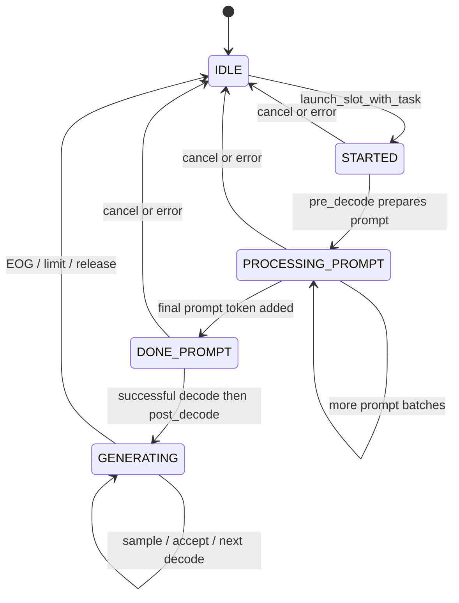

# week8 day3: Slot 状态、合批、排队与取消

本文回答[第 8 周学习路线](../../008-llama-cpp-week8-daily-learning-route.md)中 Day 3 的当天输出与验收。源码基准为 `697b4bbf4633a38abfd66f7cc54a167095aedef3`。

按要求跳过 A/B 并发请求、顺序对照、GDB、排队/取消实验和 `llama-parallel` 运行。下文的 batch 数字是静态推导示例, 不冒充真实 batch。路线中的 `server-concurrency.csv` 在本文给出待补记录格式, 没有生成实测 CSV。

## 1. Slot 的基础状态图



这里只覆盖普通单 completion 路径。`DONE_PROMPT` 表示最后的 prompt token 已排入本轮处理, 真正读取 logits 仍须等待对应 `llama_decode()` 成功。parent/child 的 `WAIT_OTHER`、embedding、rerank 等分支不在此图中。

slot 是一次活动生成的执行单元, 可被后续请求复用。`release()` 将其改为 IDLE, reset 请求相关状态, 并调用释放回调; 它不承诺清空所有 prompt/KV。当前 child slot 的 release 有显式 prompt 清理, 普通 slot 则可能留下可复用前缀。因此 IDLE 只能证明没有活动任务, 不能证明 KV 为空。

源码: [server-context.cpp](../../../../tools/server/server-context.cpp) 的 `server_slot::release()`、`launch_slot_with_task()`、`pre_decode()` 和 `post_decode()`。

## 2. 一轮 continuous batching 做什么

```text
server_queue::start_loop()
  -> 处理当前 queue_tasks: process_single_task()
  -> update_slots()
       -> 有活动 slot 时投递 NEXT_RESPONSE, 推动下一轮
       -> pre_decode()
            -> 收集 GENERATING slot 的上一个 sampled token
            -> 在配置与资源允许时加入新请求的 prompt tokens
            -> 设置各 slot 的 i_batch
       -> batch.render()
       -> 按 off / n_tokens 取 batch.get_view()
       -> decode() -> llama_decode(ctx_tgt, batch_view)
       -> 成功后 post_decode(n_tokens, off, batch_view)
            -> 只处理 i_batch 落在当前 view 的 slot
            -> common_sampler_sample(..., i_batch - off)
            -> common_sampler_accept(..., true)
            -> 更新输出、停止原因, 必要时 release
```

continuous batching 的关键是持续接纳和释放兼容任务, 不要求请求同时开始或同时结束。正在生成的 slot 可以与新请求的 prefill 在调度中共存, 但是否在某次 decode 中合批取决于实际条件, 必须看 batch 证据。

`server_slot::can_batch_with()` 当前检查 task type 相同、`inp_embd.size()` 相同、LoRA 配置兼容。它不是完整资源检查: 还受 `cont_batching`、逻辑 batch 上限、context/KV 容量以及其他路径约束。不同 sampler 参数由各 slot 分别处理, 不要求只因 temperature 不同就各跑一个模型。

Server 的 batch view 与 libllama 的 ubatch 是不同层次: Server 按 `llama_n_batch()` 等条件切分提交视图, libllama 还会按内部计算约束切成 ubatch。一个 HTTP 请求可以贡献多个 prompt tokens, 一个 batch 也可以包含多个 sequence; 所以请求数、slot 数、`batch.n_tokens` 和 ubatch 数不能互换。

## 3. Request、task、slot、sequence、logits 对照

| 标识 | 所属范围 | 用途 |
| --- | --- | --- |
| 客户端 A/B | 实验标签 | 关联不同输入, 不是服务端 task ID |
| HTTP completion ID | 一次协议 completion | 对应 SSE 中的 `id` |
| task ID | Server 队列 | 关联任务、结果和取消 |
| slot ID | Server 执行单元 | 指出哪个 slot 正在处理该 task |
| seq ID | 某个 llama_context 内 | 标识 token 的 memory 归属; 当前普通 Server 路径使用 slot ID |
| position | 某 sequence 的 token 位置 | 例如 A 的 pos=40 与 B 的 pos=70 可以同时出现 |
| `slot.i_batch` | 本轮 Server batch | 该 slot 要采样的 token 输入下标 |
| `i_batch - off` | 当前 decode view | 传给 common sampler 的对应输出位置 |

### 静态示例, 不是本机日志

假设 A/B 已完成 prefill, 当前两个 slot 各提交一个 token, 本次 `off=0`, `batch_view.n_tokens=2`:

| 请求 | 假设 task ID | slot | seq | token position | batch 输入下标 | logits 标志 | `i_batch` | 采样 idx |
| --- | ---: | ---: | ---: | ---: | ---: | --- | ---: | ---: |
| A | 101 | 0 | 0 | 40 | 0 | true | 0 | 0 |
| B | 102 | 1 | 1 | 70 | 1 | true | 1 | 1 |

这两个 token 在同一次 view 中计算, 每个 slot 用自己的 sampler 选择下一 token。把两个 slot 都传 `idx=-1` 会把它们指向同一份最后输出, 不是正确的多 sequence 映射。

再做一个下标手算: 假设某个更大 batch 中 A 的 `i_batch=4`, B 的 `i_batch=5`, 当前 view 覆盖 `[4,6)`, 则 `off=4`、采样 idx 分别为 0 和 1。这只是解释偏移, 不是声称默认 `-b 512` 会把一个六 token batch 按此方式拆分。若某 slot 的 `i_batch` 不在当前 view 内, 本次应跳过它, 不能访问旧 logits。

真实记录至少还须包含 `run_id/phase/batch_token_count/batch_view_offset/prompt_tokens/generated_tokens/finish_reason/evidence`。`evidence` 应指向对应日志片段或断点快照; 本文没有这些运行证据。

## 4. 无空闲 slot 时怎样排队

`process_single_task()` 调用 `get_available_slot(task)`。没有空闲 slot、指定 slot 忙碌、或 parent task 没有足够 child slots 时, 任务会 move 到 `queue_tasks.defer()`。

slot 释放回调调用 `pop_deferred_task(id_slot)`: 优先找指定这个 slot 的等待任务, 否则取 deferred 队列头, 放回主队列前面。任务随后重新进入 `process_single_task()`。这不是为每个等待请求新建 model/context, 也不能在有指定 slot 的情况下宣称严格全局 FIFO。

见 [server-queue.h](../../../../tools/server/server-queue.h) 与 [server-queue.cpp](../../../../tools/server/server-queue.cpp)。队列等待和 model compute 是不同延迟来源; 要计算排队时间, 必须记录 task 接纳与 slot 分配两个对应时间戳。

## 5. 普通 SSE 取消路径与慢客户端

```text
已接纳的普通 SSE 请求断开
  -> HTTP should_stop 或 sink.write 失败 / 响应结束
  -> reader.stop(), 取消未完成 task
  -> 注销 waiting IDs, 将 CANCEL task 优先加入主队列
  -> queue.post 清除目标仍在主队列/deferred 队列中的任务
  -> process_single_task(CANCEL)
  -> 查找 task.id == id_target 的活动 slot
  -> slot.release() -> 后续等待任务可获得 slot
```

取消 task 有自己的 ID, `id_target` 才是目标生成 task ID。reader 不再等待的结果不会继续作为该客户端的有效输出。取消通过轮询、队列和调度边界生效, 不保证立即中断已经运行的 backend kernel。

本实验必须省略 `X-Conversation-Id`。当前[可恢复流实现](../../../../tools/server/server-stream.cpp)在启用后会改变断连语义, 可继续生成并缓存结果供重连, 不能拿它验证普通 SSE 的断连取消。

慢消费者可能阻塞 HTTP 写出, 推理侧与 HTTP 侧之间还有结果队列。当前 `server_response` 使用结果容器, `send()` 对仍在等待的 task 追加结果; 这段路径没有给出按每客户端字节数设置的完整有界背压契约。不能推断慢读会立即停止 decode 或内存一定保持固定。需分别观察网络缓冲、worker、结果队列与 slot 进度。

一次有效取消证据要同时证明: 目标曾获得 slot、收到取消或断连信号、目标 slot 随后释放、后续短请求能继续。仅有 curl timeout, 尤其在模型就绪或连接建立前超时, 不能验收活动生成取消。

## 6. 两请求实验与待填 CSV

后续使用同一个 `-np 2` Server, A 询问 KV cache, B 询问 prefill/decode, 其他参数保持一致。顺序发送和并发发送都保留请求、原始 SSE、客户端退出码和服务端关联证据。仅拿到两个正常响应, 无法证明它们同时占用 slot, 更不能证明进入同一个 batch。

以下是 `server-concurrency.csv` 的待补内容, `pending` 不是实际观测值, `skipped` 表示本次暂时跳过:

```csv
run_id,scenario,request_label,task_id,slot_id,seq_id,phase,batch_token_count,batch_view_offset,logits_index,prompt_tokens,generated_tokens,finish_reason,queue_ms,total_ms,status,evidence
pending,sequential,A,pending,pending,pending,pending,pending,pending,pending,pending,pending,pending,pending,pending,skipped,manual_experiment_skipped
pending,sequential,B,pending,pending,pending,pending,pending,pending,pending,pending,pending,pending,pending,pending,skipped,manual_experiment_skipped
pending,concurrent,A,pending,pending,pending,pending,pending,pending,pending,pending,pending,pending,pending,pending,skipped,manual_experiment_skipped
pending,concurrent,B,pending,pending,pending,pending,pending,pending,pending,pending,pending,pending,pending,pending,skipped,manual_experiment_skipped
pending,queue,C,pending,pending,pending,pending,pending,pending,pending,pending,pending,pending,pending,pending,skipped,manual_experiment_skipped
pending,cancel,cancel_probe,pending,pending,pending,pending,pending,pending,pending,pending,pending,pending,pending,pending,skipped,manual_experiment_skipped
```

一条请求可对应多条调度记录, 不能要求这个表每请求只有一行。A/B 活动期间保存 `/slots` 快照; 同 batch 证据须进一步看到 view 内两个 seq。等待 C 要看到 defer 与后续分配, 取消要看到完整生命周期。观察窗口不足时填 `not_observed`, 不填通过; 本次则是未执行, 不混写为观察失败。

GDB 只用于定位 `process_single_task/pre_decode/post_decode` 的参数和调用栈, 停止所有线程会改变时序, 其耗时不能用于性能比较。慢消费者实验为选做, 本次同样未执行。

## 7. 对照 llama-parallel 与性能验收

[parallel.cpp](../../../../examples/parallel/parallel.cpp)用 `common_batch_add()` 拼接多个 client 的 token, 每个 client 保存 `i_batch`, 在 batch 切片内使用 `client.i_batch - i` 采样并独立 accept。它保留 seq 0 作为共享 system prompt, client 使用 `id+1`; `llama_memory_seq_cp/rm()` 管理共享前缀和请求结束后的清理。这与 Server 普通路径中 slot ID 作为 seq ID 的约定不同。

路线中的 `-np 3 -ns 6` 分别是模拟三个并发 client 与总共六个请求, 不是六个同时执行的线程。该示例的自定义 prompt 格式不保证适配所有 instruction 模型, 见 [parallel README](../../../../examples/parallel/README.md); 最终项目仍使用模型 chat template。

合批可能提高总体吞吐, 因为多个 sequence 的 token 共同执行可摊薄调度开销并增加权重利用。但每个请求还会受到排队、其他 prompt 的 prefill、更大 batch 的单步时间、KV 访问和设备竞争影响, 所以首 token 或总延迟可能上升。

待验证假设是: 固定模型、backend、线程、模板、容量和采样, A/B 并发相对顺序可能提高 `总生成 token 数 / 整组墙钟时间`, 但不保证 A/B 各自延迟下降。Day 7 再各预热并重复至少三组, 保存波动。不能把各请求 tokens/s 相加作为总体吞吐, 也不能把两个并发 `time_total` 相加作为整组墙钟时间。

当天结论: 状态图、调度/取消分析、下标手算和实验记录契约已完成。真实 batch 对照、顺序/并发 CSV、排队与取消记录均暂时跳过, 尚不能声称本机并发或性能验收通过。
