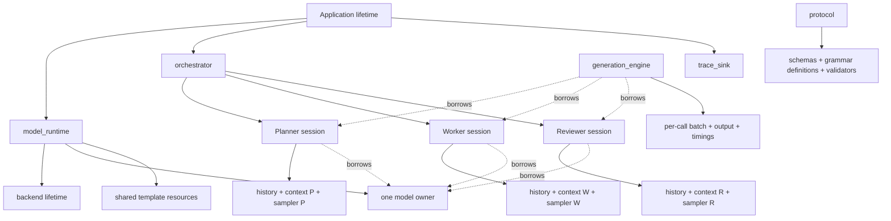
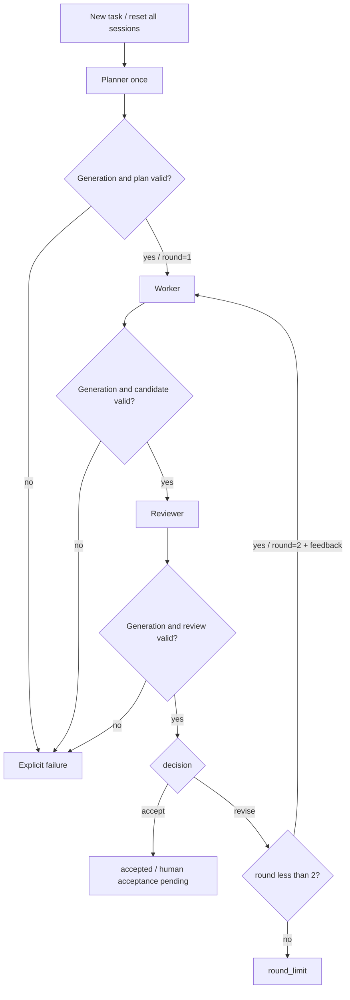

# week8 day4: 多角色项目的所有权、协议与测试契约

本文回答[第 8 周学习路线](../../008-llama-cpp-week8-daily-learning-route.md)中 Day 4 的当天输出与验收。参考源码版本为 `697b4bbf4633a38abfd66f7cc54a167095aedef3`。

以下是文档层面的设计答案, 包含原定 `design.md`、两个 Schema 和 `tests/cases/` 的内容契约。按本次要求统一写在本文件, 未另建仓外工程、Schema 文件或测试程序。手动资源测量、模型运行和闭卷口述验收暂时跳过; 不能据此声称学习者已经独立掌握或项目已经实现。

## 1. 设计范围与不变量

第一版采用本地顺序执行: 一个共享 model, Planner/Worker/Reviewer 各自拥有 context、history 和该次调用的 sampler。每个 context 只使用 seq 0。角色是应用职责, 不代表三个线程, 也不是把聊天消息的 role 自行扩展为任意字符串。

必须保持的规则:

1. 一个进程中的 runtime 只加载一次 model, 三个 session 借用它。
2. 每次角色调用重新格式化完整的角色消息, 清空该角色 memory, 重建 sampler, 完整 prefill。
3. history 是应用文本消息, KV 只是其推理状态; context state 不能代替 sampler/history 的生命周期管理。
4. 角色间只传明确允许的任务、计划、候选和反馈, 不复制对方的可变 sampler 或 KV。
5. orchestrator 只接受经过完整解析和校验的业务结果; 模型给出的步骤不能改写调度和预算。
6. Planner 最多一次, Worker/Reviewer 最多两轮, 总生成调用最多五次, 不设隐含自动重试。
7. 失败输出可保留为 trace, 但不能进入“成功完成”的 plan/candidate/review 状态。

这是应用层编排, 不修改 Server route、核心库或引入通用 Agent 框架, 符合 [Server 开发范围](../../../../tools/server/README-dev.md)。

## 2. 对象所有权图与销毁顺序



实线表示拥有, 虚线表示借用。图表示职责, 不要求每个框都实现成一个新类。

| 对象 | 拥有的状态 | 生命周期与职责 |
| --- | --- | --- |
| `model_runtime` | backend 生命周期、唯一 model owner、模板资源 | 启动时建立, 所有 session 销毁后才释放 |
| `agent_session` | role、system prompt、文本 history、独立 context、独立 sampler | context 可以跨任务保留, 每个新任务清空状态 |
| `generation_engine` | 一次调用的 batch、输出缓冲、计时、停止检查 | 借用 session, 返回结果, 不自行调用下一角色 |
| `orchestrator` | 原任务、已校验 plan、候选、review、round、总预算 | 决定下一步, 遇到失败停止后续角色 |
| `protocol` | 两个 Schema、grammar 配置、解析和验证规则 | 不采样, 不替模型输出补全括号 |
| `trace_sink` | 输入输出和状态转换记录 | 只观测, 不改变 token 候选、预算或决策 |

销毁顺序: 完成或停止活动生成 -> 释放调用 batch -> 释放角色 sampler/context/history -> 释放依赖 model 的模板等资源 -> 释放唯一 model owner -> 结束 backend 生命周期。若使用 `common_init_result_ptr`, model 只由该 owner 释放, 借用指针不能再独立 free。

context 内的 seq ID 只在该 context 范围内有意义。`context=P,seq=0` 与 `context=W,seq=0` 没有共享 KV 的含义, trace 必须同时保存 role/context/seq。

## 3. 内存估算与预算选择

沿用[第 5 周 KV 计算](../week5/week5-day2.md)和[第 7 周模型记录](../week7/week7-day1.md), 对本地 Qwen2、28 层、2 个 KV heads、K/V head dimension 均为 128、F16 KV、每 context 2048 cells 做理想存储估算:

```text
KV bytes per context
  = 28 * 2048 * (2 * 128 + 2 * 128) * 2
  = 58,720,256 bytes = 56 MiB

three contexts: 3 * 56 MiB = 168 MiB

process memory
  = one model's resident resources
  + three contexts' KV/compute/output resources
  + templates, samplers, histories, batches and allocator overhead
```

56 MiB 只表示上述假设下的 K/V 元素容量, 不是单个 context 的完整 RSS。backend padding、计算工作区、logits、mmap 页驻留等还需测量。本地 GGUF 文件大小为 `3560416128` bytes, 也不能直接当作模型常驻内存。第 7 周答案没有完成实测性能/内存验收, 因此本节只能给静态估算。

资源不足时可以在每次角色调用时创建并销毁 context, 仍保留一个 model; 代价是额外初始化和完整 prefill。第一版不使用共享 context 多 sequence 优化。

| 预算项 | 本文设计起点 | 检查规则 |
| --- | ---: | --- |
| 每 context 容量 | 2048 tokens | 以创建后的实际容量为准, 不做自动 context shift |
| Planner 生成上限 | 128 | 最多一次 |
| Worker 生成上限 | 每轮 192 | 最多两次 |
| Reviewer 生成上限 | 每轮 96 | 最多两次 |
| 总生成上限 | 704 | `128 + 2*192 + 2*96`, 已失败调用消耗也计入 |
| 每次调用 deadline | 60 秒 | 使用单调时钟, 包含格式化、prefill 和生成 |
| 总任务 deadline | 180 秒 | 从接纳任务到最终状态, 包含角色之间的处理 |
| 最大 round | 2 | 一轮为一次 Worker + 一次 Reviewer |

这些是待实测的应用默认值, 不是仓库固定参数或性能承诺。计数口径选择“本次采样出的 token 数, 包含 EOG”, 另记实际送入 decode 的 token 数。每次调用前检查 `prompt_tokens + generation_reserve <= actual_context_capacity`, 其中 prompt 必须包含模板特殊 token、system、任务、候选和反馈。

有效调用 deadline 取“单次开始时间 + 60 秒”和总 deadline 的较早者。检查发生在角色、batch 和 token 边界, 不承诺立即抢占正在执行的 kernel。模型输出不能修改这些上限。

## 4. 固定状态机与返回语义



Planner 不是任意工作流生成器。它的 worker 步骤合并为一次 Worker 输入, reviewer 步骤作为审查要求; 即使只出现 worker 步骤, 固定状态机仍必须调用 Reviewer。

| 条件 | generation / protocol 处理 | orchestrator 行为 |
| --- | --- | --- |
| 正常 EOG | `eog`, 得到本次完整候选输出, 仍要解析与校验 | 通过后才进入下一状态 |
| token 上限 | `token_limit`, 保留部分输出 | 第一版保守地停止, 即使恰好能解析 JSON 也不自动提升为成功 |
| prompt 加生成预留超过容量 | `context_limit`, prefill 前拒绝 | 不调用后续角色 |
| deadline 到期 | `timeout`, 停止继续提交 decode | 记录超时点并终止 |
| decode 非成功 | `decode_error`, 保留返回码和阶段 | 清理部分状态, 不使用旧 logits |
| model/context/sampler 分配或初始化失败 | `init_error` 或 `allocation_error` | 初始化失败则不开始角色链 |
| JSON 不完整、Schema 或业务规则失败 | `invalid_protocol`, 保留原文和失败层次 | 不猜测补全, 不进入下一角色 |
| Worker 没有有效候选 | `invalid_candidate` | 不调用 Reviewer |
| 第二轮仍 revise | `round_limit` | 返回未通过, 可附最后候选供查看 |
| 用户取消 | `cancelled` | 停止后续角色与 token 调用 |

底层 `llama_decode()` 的 1 是 KV slot 不足警告, 2 是 abort, -1 是无效 batch, 小于 -1 是 fatal error。第一版不做自动重试: ret=1 作为带原因的本次生成失败, ret=2 依据实际取消/超时来源分类, 其他错误保留具体返回码。fatal/abort 可能已写入部分 ubatch, 不能假设失败后 memory 完全没有变化。

## 5. Planner 与 Reviewer Schema

Planner 复用[第 6 周 Day5](../week6/week6-day5.md)的完整 Schema, 对应未来的 `schemas/planner.schema.json`:

```json
{
  "type": "object",
  "properties": {
    "goal": {"type": "string", "minLength": 1, "maxLength": 48},
    "steps": {
      "type": "array",
      "minItems": 1,
      "maxItems": 3,
      "items": {
        "type": "object",
        "properties": {
          "role": {"type": "string", "enum": ["worker", "reviewer"]},
          "task": {"type": "string", "minLength": 1, "maxLength": 64}
        },
        "required": ["role", "task"],
        "additionalProperties": false
      }
    }
  },
  "required": ["goal", "steps"],
  "additionalProperties": false
}
```

Reviewer 对应未来的 `schemas/reviewer.schema.json`:

```json
{
  "type": "object",
  "properties": {
    "decision": {"type": "string", "enum": ["accept", "revise"]},
    "feedback": {"type": "string", "maxLength": 128}
  },
  "required": ["decision", "feedback"],
  "additionalProperties": false
}
```

验证必须分层:

1. 检查停止原因, 对预期协议正文做完整 JSON 解析; 允许前后空白, 不允许代码围栏、尾随说明或截断。重复 key 也作为歧义输入拒绝, 不依赖 parser 静默覆盖。
2. 校验 type、required、enum、数组数量、字符串长度与额外字段。字符长度按解析后 Unicode 字符计数, 不按 UTF-8 bytes 或 JSON 转义串的字面长度计数。
3. 应用规则要求 goal/task 去空白后非空, 至少一个 worker 步骤; revise 时 feedback 去空白后非空。Worker 文本也必须非空。
4. 计划与用户需求是否相关、候选是否正确、accept 是否覆盖任务标准, 需要语义审查和最终人工验收, 不能由 Schema 单独证明。

grammar 约束生成路径, 不保证预算内能到达完整结束状态, 也不保证语义正确。如果模板含 reasoning, 必须用已确认的边界取出完整协议正文并保存原始输出; 不能随意搜索第一个 `{` 就忽略周围未知文本。第 6 周目前是文档与待实测配置, 不能直接宣称实际模型的结构化输出路径已验证。

## 6. 正反例与 fixture 设计

合法 Planner 示例 `P_ok`:

```json
{"goal":"Learn KV cache","steps":[{"role":"worker","task":"Write three exercises with checkable outputs"},{"role":"reviewer","task":"Check accuracy and whether outputs are testable"}]}
```

合法 Reviewer 示例 `R_accept` 与 `R_revise`:

```json
{"decision":"accept","feedback":"Three exercises have clear checks."}
```

```json
{"decision":"revise","feedback":"Give a concrete output for exercise 2."}
```

| 反例输入 | 预期失败位置 | 后续调用 |
| --- | --- | --- |
| `{"goal":"Learn","steps":` | JSON 截断 | Planner 后停止 |
| 完整对象后追加 `done` | JSON 尾随文本 | 停止 |
| `{"goal":"Learn","steps":[]}` | Schema: minItems | Planner 后停止 |
| `{"goal":"Learn","steps":[{"role":"admin","task":"run"}]}` | Schema: role enum | Planner 后停止 |
| `{"goal":"Learn","steps":[{"role":"reviewer","task":"check"}]}` | 应用: 没有 worker | Planner 后停止 |
| `{"decision":"approved","feedback":"ok"}` | Schema: decision enum | Reviewer 后停止 |
| `{"decision":"accept"}` | Schema: 缺 feedback | Reviewer 后停止 |
| `{"decision":"accept","feedback":"ok","rounds":99}` | Schema: 额外字段 | 不接受模型修改轮数 |
| `{"decision":"revise","feedback":"   "}` | Schema 可通过, 应用规则失败 | 不启动下一轮 Worker |
| feedback 为 129 个字符 | Schema: maxLength | Reviewer 后停止 |

`W1`、`W2` 表示不同的非空 mock 候选文本, 所有正常 mock generation 返回 `stop_reason=eog`。以下是未来 `tests/cases/` 的测试契约, 本次没有运行 orchestrator 测试:

| fixture 名 | mock 返回序列 | 必须断言 |
| --- | --- | --- |
| `first_accept` | `P_ok, W1, R_accept` | 顺序 P/W/R, round=1, 调用 3 次, 返回 accepted |
| `revise_accept` | `P_ok, W1, R_revise, W2, R_accept` | 顺序 P/W/R/W/R, 调用 5 次, W2 输入含 W1 和准确 feedback |
| `revise_twice` | `P_ok, W1, R_revise, W2, R_revise` | 返回 round_limit, 调用严格为 5, 不启动 W3 |
| `invalid_plan` | 截断或无 worker 的 Planner 输出 | 返回 invalid_protocol, 调用 1 次 |
| `invalid_review` | `P_ok, W1, 非法 Reviewer` | 返回 invalid_protocol, 调用 3 次, 不重试 |
| `worker_failure` | `P_ok, decode_error` | 调用 2 次, Reviewer 未调用, 保留返回码 |
| `budget_or_cancel` | 可控时钟/取消标志在指定边界触发 | 边界后的角色不再执行, 总计数与 trace 一致 |
| `isolation_A_B_A` | 连续任务 A、B、A, 捕获实际 messages/tokens | 每个新任务清理三角色状态, B 私有数据不进入第二次 A |

mock engine 捕获每次调用输入, 按预先排好的结果返回; fake monotonic clock 控制超时。这样无需加载模型也能强制验证终止分支, 不依赖模型“恰好给出 revise”。mock 通过只证明编排契约, 不能证明真实模型能输出合法 JSON 或正确内容。

## 7. history 与数据传递约定

| 调用 | 允许进入的消息内容 | history 处理 |
| --- | --- | --- |
| Planner | 规划 system prompt、原任务、Schema 要求 | 新任务只保留本角色 system 和当前任务 |
| Worker 第 1 轮 | 工作 system prompt、原任务、已校验计划 | 保存本轮输入和成功候选 W1 |
| Reviewer 第 1 轮 | 审查 system prompt、原任务、计划、W1、固定检查项 | 只审查当前候选 |
| Worker 第 2 轮 | 原任务、计划、W1、第一轮经过校验的 feedback | 在 Worker 自己 history 中追加反馈, 完整重新格式化 |
| Reviewer 第 2 轮 | 原任务、计划、W2、固定检查项 | 重建为当前审查输入, 不把 W1 当作当前候选 |

实际 chat messages 继续使用模型支持的 system/user/assistant roles。Planner/Worker/Reviewer 是 session 的应用身份。共享候选文本是显式数据传递, 不等于共享角色状态。

每个新任务清空三角色 history、memory、sampler 和 orchestrator 的上一任务结果, 然后重建固定 system 消息。某次调用失败时先保留 trace, 清理受影响 session 的部分状态, 返回失败; 下一个任务仍从三角色全部重置开始。模板可能改变消息边界和 generation prompt, 因此不假设重新格式化后的 tokens 是旧 tokens 加一个严格后缀。

## 8. generation 接口契约与验收答案

接口在设计上接收 session、完整 messages、采样/grammar 配置、token/context/deadline 预算和取消信号; 返回 `raw_output`、协议正文或解析所需信息、token 计数、`stop_reason`、底层错误码、计时及 role/context/seq 标识。它不直接返回业务上的 accept, accept 属于后续 protocol 与 orchestrator 的判断。

五个口述问题的答案:

- model 唯一 owner 是 runtime, 三个 session 只创建 context, 不再次加载权重。
- Worker 得到任务和合法计划, 第二轮另得 W1 与 feedback; Reviewer 得到原任务、计划和本轮候选。
- 新任务显式清理 history、sampler、KV; 失败的部分输出只保留为证据, 不提交为成功业务结果。
- EOG 后仍要验证; token/context/deadline/decode/JSON 错误均按第 4 节有限退出。
- 两次 revise 后一定终止, 因为 round 由 orchestrator 控制且上限为 2; `revise_twice` fixture 不需要模型即可验证调用上限 5。

Day 4 的设计文档、完整 Schema、正反例和测试契约已提供。独立文件落地、测试执行、资源实测和学习者闭卷讲解均未在本次完成; 后续实现前仍应由学习者确认能解释这些选择。
